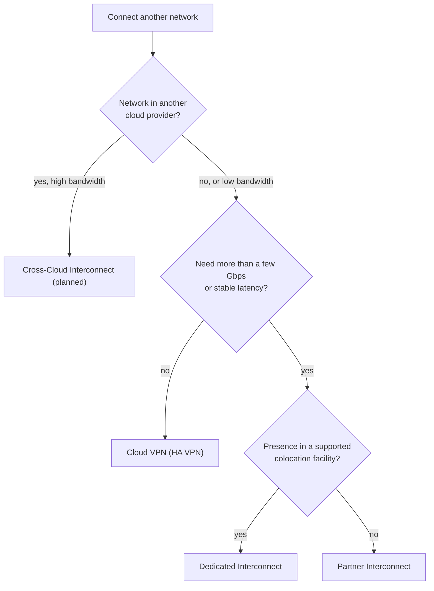

# Hybrid connectivity

Ways to connect on-premises networks and other clouds to Google Cloud VPC networks: encrypted tunnels over the internet and private dedicated or partner links.

## Choosing an option

Start at the top: bandwidth and latency needs decide between the internet (VPN) and private links (Interconnect); physical presence decides between Dedicated and Partner.

## Notes in reading order

1. [Cloud VPN](cloud-vpn.md): IPsec tunnels, HA VPN, static and dynamic routing with Cloud Router.
2. [Cloud Interconnect](cloud-interconnect.md): Dedicated and Partner Interconnect, bandwidth, SLA and encryption.

## Planned topics

- Cloud Router and BGP in depth
- Cross-Cloud Interconnect
- Network Connectivity Center
- Direct Peering and Carrier Peering
- Hybrid DNS with Cloud DNS forwarding
