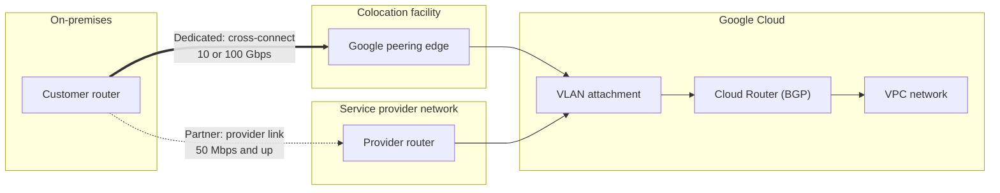
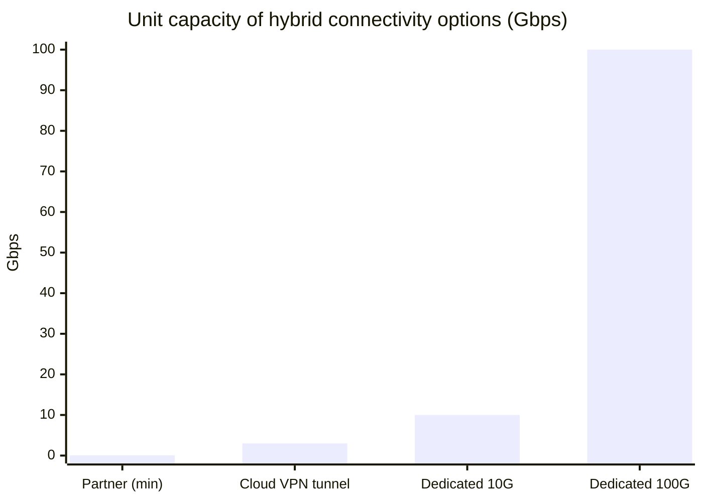

# Cloud Interconnect

## Summary

Cloud Interconnect links an on-premises network to Google Cloud VPC networks over private connections that do not cross the public internet. *Dedicated Interconnect* is a physical cross-connect between your router and Google's network in a colocation facility, in 10 Gbps or 100 Gbps circuits. *Partner Interconnect* reaches Google through a supported service provider, starting at 50 Mbps, for organizations that cannot reach a colocation facility. Both give internal IP (RFC 1918) communication, high bandwidth and low, stable latency, and both need Cloud Router for BGP.

## Prerequisites

- [Cloud VPN](cloud-vpn.md) for Cloud Router and BGP.
- [VPC networks](../vpc/vpc-networks.md).

## Core concepts

### Use cases

- **High performance workloads.** Data-intensive work such as machine learning training data transfer, data warehousing and real-time analytics.
- **Flexible connectivity.** Small and medium organizations without colocation presence use Partner Interconnect.
- **Hybrid architectures.** Extend on-premises environments to Google Cloud with private addressing.

### Types

- **Dedicated Interconnect.** A direct physical connection. Circuits of 10 Gbps or 100 Gbps, bundled for more capacity. Requires your routing equipment in a Google-supported colocation facility. Google offers an end-to-end SLA for the Google side when the recommended topology is used.
- **Partner Interconnect.** Connectivity through a service provider's network. VLAN attachments from 50 Mbps up to tens of Gbps. Google's SLA covers the connection between Google and the provider; the rest depends on the provider.
- **Cross-Cloud Interconnect.** Dedicated links between Google Cloud and another cloud provider (AWS, Azure, Oracle, Alibaba).

TODO: Write a note on Cross-Cloud Interconnect.

The solid path is Dedicated Interconnect: your router meets Google in the same building. The dotted path is Partner Interconnect: the provider carries traffic to a point where it already meets Google.

### Comparison

| Feature | Dedicated Interconnect | Partner Interconnect |
| --- | --- | --- |
| Connection type | Direct physical connection | Through a service provider |
| Minimum bandwidth | 10 Gbps per circuit | 50 Mbps per VLAN attachment |
| Maximum bandwidth | Scales with multiple circuits | Depends on provider offerings |
| Traffic path | Private, no public internet | Provider's private network |
| SLA | End-to-end for Google's part with recommended topology | Google to provider; provider covers the rest |
| Colocation facility | Required | Not required |

### Bandwidth of hybrid options

The chart compares the unit capacity of each option. Values are the per-unit figures from the notes and documentation (one VPN tunnel, the smallest Partner attachment, one Dedicated circuit of each size); they are approximate and must be checked against current documentation.

### Benefits

- Low latency and high availability for consistent, high performance connectivity.
- Private IP communication between on-premises and VPC networks.
- Scalability: multiple 10 or 100 Gbps circuits, or many partner capacities.
- Traffic stays on private networks, which lowers exposure and usually egress cost compared with internet egress.

Note that Interconnect traffic is not encrypted by IPsec by default. Use MACsec (Dedicated) or HA VPN over Cloud Interconnect when encryption is required.

TODO: Verify MACsec availability per circuit type.

## Worked example

A bank needs 20 Gbps between its data center in Frankfurt and `europe-west3`, with 99.99 percent availability. Design: four 10 Gbps Dedicated Interconnect circuits in two different edge availability domains of the same metro, VLAN attachments in two regions or two Cloud Routers as Google's 99.99 percent topology requires, and HA VPN over Interconnect for encryption of sensitive flows.

TODO: Check this design against the current 99.99 percent topology guide and add the attachment and router commands.

## Trade offs and when to use it

- Interconnect has a fixed monthly cost per circuit or attachment and lead time for provisioning; VPN is cheap and immediate.
- Dedicated gives the most bandwidth and control but requires colocation presence; Partner trades some control and SLA scope for reach.
- Use VPN as a backup path or until Interconnect is ready.

## Common mistakes

- **One circuit, one location.** No high availability. Follow the 99.9 or 99.99 percent topologies.
- **Assuming encryption.** Plan MACsec or HA VPN over Interconnect if data must be encrypted in transit.
- **Ignoring BGP route limits and priorities.** Configure MED or route priorities so traffic prefers the right path.

## Practice

1. What is the minimum bandwidth of Dedicated Interconnect and of Partner Interconnect?
2. A company has no presence in any colocation facility. Which option fits?
3. Is traffic over Cloud Interconnect encrypted by default?

Answers: 1. 10 Gbps per circuit; 50 Mbps per attachment. 2. Partner Interconnect. 3. No; use MACsec or HA VPN over Interconnect.

## Further reading

- [Cloud Interconnect overview](https://docs.cloud.google.com/network-connectivity/docs/interconnect/concepts/overview), Google Cloud documentation. Types and choosing between them.
- [Dedicated Interconnect overview](https://docs.cloud.google.com/network-connectivity/docs/interconnect/concepts/dedicated-overview), Google Cloud documentation. Circuits, locations and topologies.
- [Partner Interconnect overview](https://docs.cloud.google.com/network-connectivity/docs/interconnect/concepts/partner-overview), Google Cloud documentation. Provider model and capacities.
