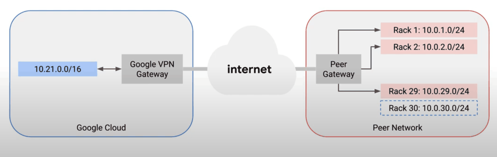
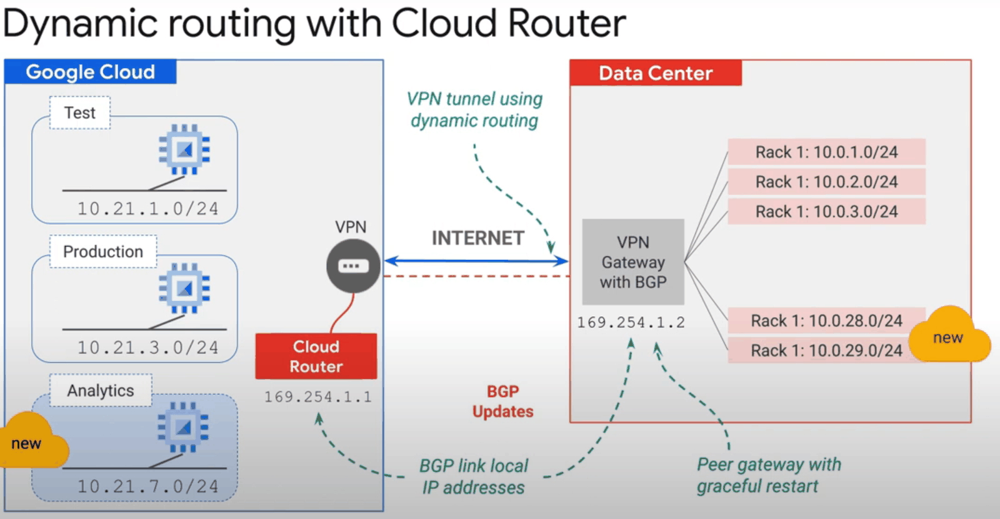
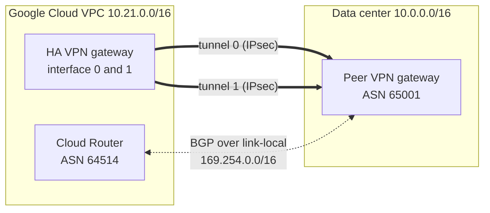

# Cloud VPN

## Summary

Cloud VPN connects an on-premises network, another cloud or another VPC to a Google Cloud VPC network through IPsec tunnels over the internet. Traffic is encrypted end to end between the two VPN gateways. Routes can be static or, preferably, dynamic through Cloud Router and BGP, which learns and advertises subnets automatically. *HA VPN* uses two interfaces and two tunnels for a 99.99 percent availability SLA. Cloud VPN is the quick, low cost way to hybrid connectivity; Cloud Interconnect is the high bandwidth one.

## Prerequisites

- [VPC networks](../vpc/vpc-networks.md), especially routes.
- IPsec and BGP basics.

## Core concepts

### Use cases

- **Hybrid cloud.** Extend on-premises networks to a VPC for hybrid workloads.
- **Multicloud.** Link a VPC with AWS or Azure networks.
- **Data center extension.** Encrypted connections for workloads that cannot wait for a dedicated link.

### Features

- **IPsec encryption** with IKEv1 or IKEv2 and a pre-shared key.
- **Traffic path.** Over the public internet, or over Direct Peering for better performance.
- **Bandwidth.** Each tunnel carries up to about 3 Gbps (the sum of ingress and egress), limited by packets per second. The original notes state 1.5 Gbps over the internet and 3 Gbps over Direct Peering; Google now documents a packets-per-second based limit. More bandwidth needs more tunnels.
- **Managed.** Google runs the gateway; no VPN appliance to patch.
- **Routing.** Static routes or dynamic routes through Cloud Router.
- **Gateways.** *HA VPN* (two interfaces, 99.99 percent SLA with correct configuration, BGP only) and *Classic VPN* (one interface, 99.9 percent, partly deprecated).

TODO: Record the current per-tunnel limit and check date.

### Static and dynamic routing



- **Static routing.** You configure routes for each remote prefix. Every network change (for example a new rack subnet) needs a manual update. Fine for small, stable setups. Classic VPN only.
- **Dynamic routing with Cloud Router.** Cloud Router speaks BGP with the peer gateway. New subnets on either side are learned and advertised automatically, without disruption. Dynamic routing is required for HA VPN, Dedicated Interconnect and Partner Interconnect.



A route is made of a destination prefix in CIDR form and a *next hop*. With Cloud Router, routes to on-premises prefixes appear in the VPC with the tunnel as next hop.



Two tunnels from the two HA VPN interfaces give redundancy; BGP sessions over link-local addresses inside the tunnels exchange routes.

## Worked example

HA VPN to an on-premises gateway with one public IP (untested; secrets are placeholders):

```bash
gcloud compute vpn-gateways create ha-gw --network=prod-vpc --region=europe-west1
gcloud compute external-vpn-gateways create onprem-gw --interfaces=0=203.0.113.10
gcloud compute routers create vpn-router --network=prod-vpc \
  --region=europe-west1 --asn=64514

for i in 0 1; do
  gcloud compute vpn-tunnels create tunnel-$i --region=europe-west1 \
    --vpn-gateway=ha-gw --interface=$i \
    --peer-external-gateway=onprem-gw --peer-external-gateway-interface=0 \
    --router=vpn-router --ike-version=2 --shared-secret='<PRE_SHARED_KEY>'
done

gcloud compute routers add-interface vpn-router --region=europe-west1 \
  --interface-name=if-0 --vpn-tunnel=tunnel-0 --ip-address=169.254.0.1 --mask-length=30
gcloud compute routers add-bgp-peer vpn-router --region=europe-west1 \
  --peer-name=onprem-0 --interface=if-0 --peer-ip-address=169.254.0.2 --peer-asn=65001
# repeat for tunnel-1 with 169.254.1.1 and 169.254.1.2
```

When the on-premises team adds `10.0.29.0/24`, it is advertised over BGP and appears in the VPC routing table without any change on the Google side.

## Trade offs and when to use it

- **Advantages.** Encrypted, quick to set up, high availability with HA VPN, low cost compared with dedicated links, and less admin work with dynamic routing.
- **Limits.** Internet path means variable latency; bandwidth per tunnel is limited; traffic is billed as internet egress.
- **Choose VPN** for fast hybrid onboarding, low volume traffic, backup for Interconnect, or encryption over Interconnect (HA VPN over Interconnect).
- **Choose Interconnect** for high, predictable bandwidth. See [Cloud Interconnect](cloud-interconnect.md).

## Common mistakes

- **One tunnel only.** No SLA; use HA VPN with two tunnels.
- **Static routes in changing networks.** Use Cloud Router.
- **Weak pre-shared keys.** Use long random keys and restrict the peer IPs.
- **Overlapping ranges.** Plan IP ranges with the on-premises team.

## Practice

1. Which routing type does HA VPN require?
2. A new subnet is added on-premises. What must you change on Google Cloud with dynamic routing?
3. How do you get more than one tunnel's bandwidth?

Answers: 1. Dynamic routing with Cloud Router (BGP). 2. Nothing; it is learned over BGP. 3. Add more tunnels (and gateways), or use Cloud Interconnect.

## Further reading

- [Cloud VPN overview](https://docs.cloud.google.com/network-connectivity/docs/vpn/concepts/overview), Google Cloud documentation. HA VPN, Classic VPN, bandwidth and SLA.
- [Cloud Router overview](https://docs.cloud.google.com/network-connectivity/docs/router/concepts/overview), Google Cloud documentation. BGP sessions and route advertisement.
- [Create an HA VPN gateway to a peer VPN gateway](https://docs.cloud.google.com/network-connectivity/docs/vpn/how-to/creating-ha-vpn), Google Cloud documentation. Step by step setup.
