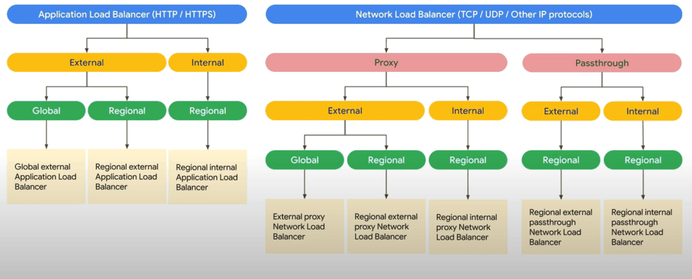
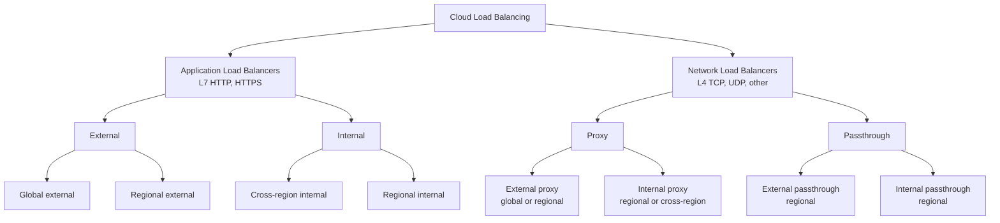
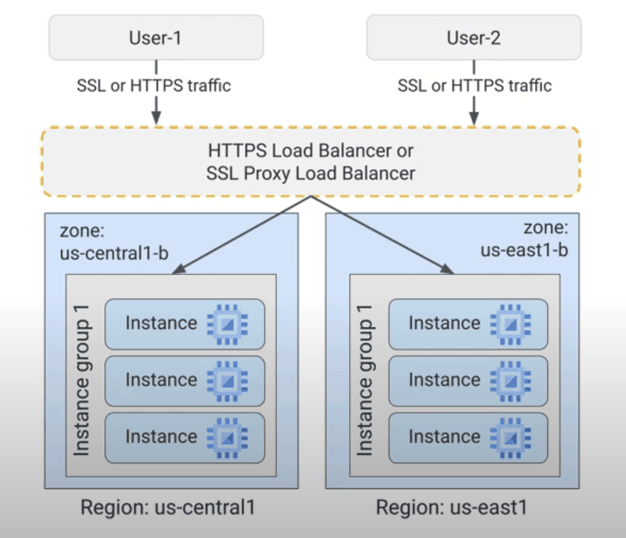

# Load balancing

Cloud Load Balancing distributes traffic across backends for scalability and availability. It is a software-defined, managed service: there are no load balancer VMs to size, and global load balancers get a single anycast IP address and built-in protection against volumetric DDoS attacks.

## Map of the subarea

The family of load balancers splits first by layer (Application Load Balancers at layer 7, Network Load Balancers at layer 4), then by proxy or passthrough, then by external or internal, then by global or regional scope.

Read the tree from the top. The first question is whether the traffic is HTTP(S); the second, for layer 4, is whether the client connection should be terminated (proxy) or forwarded unchanged (passthrough).

## How proxy load balancing works

- **HTTPS load balancing** terminates the user's HTTPS connection at the load balancer and sends requests to backends over HTTP, HTTPS or HTTP/2. The target HTTPS proxy needs at least one SSL certificate.
- **SSL proxy load balancing** (now part of the external proxy Network Load Balancer) terminates TLS for non-HTTP traffic and forwards it to backends over TCP or SSL.
- Benefits of termination at the load balancer: TLS work is offloaded from backends, certificates and TLS policies are managed in one place, and backends are not directly exposed to the internet.

## Notes in reading order

1. [Application Load Balancers](application-load-balancers.md): layer 7 proxy, URL maps, backend services, NEGs, Cloud Armor, IAP and the request flow.
2. [Network Load Balancers](network-load-balancers.md): layer 4 proxy and passthrough, 5-tuple hashing, source IP preservation and firewall dependency.
3. [SSL policies and certificates](ssl-policies-and-certificates.md): Google-managed and self-managed certificates, TLS versions and profiles.

## Planned topics

- Global external Application Load Balancer
- Regional external Application Load Balancer
- Internal Application Load Balancer (regional and cross-region)
- External proxy Network Load Balancer
- External passthrough Network Load Balancer
- Internal proxy Network Load Balancer
- Internal passthrough Network Load Balancer
- Classic load balancers and migration
- Health checks in depth
- Cloud CDN
- Cloud Armor security policies
