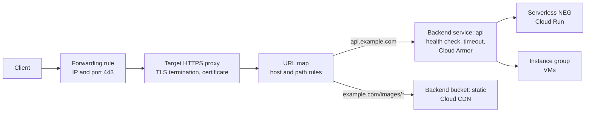
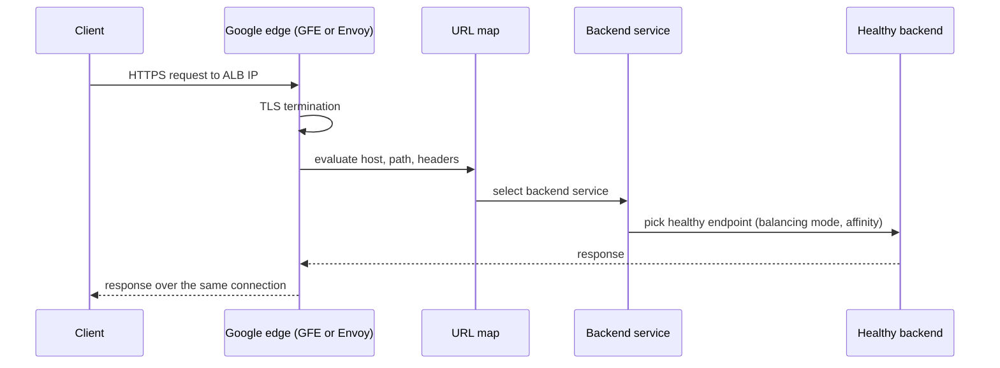

# Application Load Balancers

## Summary

An Application Load Balancer (ALB) is Google Cloud's layer 7 (HTTP and HTTPS) proxy-based load balancer. It terminates client connections, reads the request (host, path, headers, query) and routes it to the right backend service, which may be VM instance groups, GKE Pods, Cloud Run services or on-premises endpoints. Because it sees the application layer, it is also the place to enforce TLS, a web application firewall (Cloud Armor), authentication (Identity-Aware Proxy) and caching (Cloud CDN). Think of it as an application-aware edge gateway with built-in load balancing.

## Prerequisites

- [Load balancing overview](README.md).
- [VPC networks](../vpc/vpc-networks.md) and [VPC firewall](../vpc/vpc-firewall.md).
- HTTP basics: methods, headers, status codes, TLS.

## Core concepts

### Architectural position

An ALB typically acts as:

- the **public entry point** for north-south traffic: internet to API, web or microservices;
- an **internal service router** for east-west traffic: internal services to microservices through an internal ALB;
- a **migration and multi-environment router**: hybrid traffic to on-premises or other clouds through hybrid NEGs.

### Types

| Type | Scope | IP | Notes |
| --- | --- | --- | --- |
| Global external ALB | Global | Anycast external IP | Traffic enters the nearest Google edge and rides the backbone; Envoy-based |
| Classic ALB | Global (Premium) or regional (Standard) | External | Older Google Front End based implementation |
| Regional external ALB | One region | Regional external IP | For data residency or Standard Tier |
| Regional internal ALB | One region | Internal IP | Microservices inside a VPC |
| Cross-region internal ALB | Multi-region | Internal IP per region | Internal failover across regions |

### Components



- **Forwarding rule.** The frontend: IP address (external or internal), protocol and port (80 or 443). The entry point for traffic.
- **Target proxy.** Terminates the connection. An HTTP proxy or an HTTPS proxy; the HTTPS proxy holds certificates and an SSL policy.
- **URL map.** The routing brain: host rules, path matchers and advanced matches on headers and query parameters. Example: `api.example.com` to `backend-api`, `example.com/images/*` to `backend-static`.
- **Backend service.** Defines how traffic is handled after routing: health check, timeout, session affinity, balancing mode, connection draining, and the attachment points for Cloud CDN and Cloud Armor.
- **Backends.** Managed or unmanaged instance groups, zonal NEGs (GKE Pods), serverless NEGs (Cloud Run, App Engine, Cloud Run functions), hybrid connectivity NEGs (on-premises or other clouds), internet NEGs and Private Service Connect NEGs. A **backend bucket** serves a Cloud Storage bucket.

### Request flow



### Capabilities

- **Advanced routing.** Path, host, header and query parameter based rules, redirects and URL rewrites.
- **Traffic engineering.** Weighted traffic splitting for canary and blue-green releases, and request mirroring (shadow traffic) for testing or validating ML inference.
- **Serverless integration.** Cloud Run and App Engine behind the same load balancer as VMs, without managing VMs or Kubernetes.
- **Hybrid and multicloud.** Hybrid NEGs route to on-premises services or other clouds, which supports gradual migrations.
- **Performance.** Global anycast with a single IP worldwide, autoscaling to millions of requests per second without pre-warming, HTTP/2 and HTTP/3 to clients, keep-alive and connection reuse.
- **Observability.** Request logs in Cloud Logging, metrics in Cloud Monitoring (request count, latency, backend errors, health), tracing through headers and OpenTelemetry.

### Security capabilities

- **TLS termination** with Google-managed or self-managed certificates and SSL policies. See [SSL policies and certificates](ssl-policies-and-certificates.md).
- **Cloud Armor** (WAF and DDoS): preconfigured OWASP Top 10 rules, rate limiting, IP reputation, geo-blocking, Adaptive Protection.
- **Identity-Aware Proxy (IAP)**: authentication and authorization before a request reaches the backend, for zero trust access without VPN.
- **Header manipulation**: add or remove headers, enforce security headers such as `Strict-Transport-Security`, `Content-Security-Policy` and `X-Frame-Options`.

### Advanced topics

- **Network endpoint groups (NEGs)** decouple the load balancer from instance groups: zonal NEGs for Pods (container-native load balancing), serverless, hybrid and PSC NEGs. They enable multi-environment routing and gradual migrations.
- **Cloud Service Mesh integration** (formerly Traffic Director) for Envoy-based, fine-grained service-to-service traffic control.
- **Cloud CDN** caches at the edge and offloads backends.
- **Failover.** Health checks drive automatic failover; the global ALB fails over across regions.

## Worked example

A public API with static content (untested sketch of the main objects):

```bash
gcloud compute network-endpoint-groups create api-neg --region=europe-west1 \
  --network-endpoint-type=serverless --cloud-run-service=orders-api

gcloud compute backend-services create api-bs --global \
  --load-balancing-scheme=EXTERNAL_MANAGED
gcloud compute backend-services add-backend api-bs --global \
  --network-endpoint-group=api-neg --network-endpoint-group-region=europe-west1
gcloud compute backend-services update api-bs --global --security-policy=api-armor

gcloud compute backend-buckets create static-bb --gcs-bucket-name=example-static --enable-cdn

gcloud compute url-maps create web-map --default-backend-bucket=static-bb
gcloud compute url-maps add-path-matcher web-map --path-matcher-name=api \
  --default-backend-bucket=static-bb --backend-service-path-rules="/api/*=api-bs" \
  --new-hosts=example.com

gcloud compute ssl-certificates create web-cert --domains=example.com --global
gcloud compute target-https-proxies create web-proxy --url-map=web-map \
  --ssl-certificates=web-cert
gcloud compute forwarding-rules create web-fr --global \
  --load-balancing-scheme=EXTERNAL_MANAGED --target-https-proxy=web-proxy --ports=443
```

Result: `https://example.com/api/orders` goes through Cloud Armor to Cloud Run; `https://example.com/logo.png` is served from the bucket and cached at the edge.

Practical patterns from the original notes:

| Pattern | Design |
| --- | --- |
| Public API gateway | Global external ALB + Cloud Armor + IAP, backends on GKE or Cloud Run |
| Microservices | Internal ALB for service-to-service routing |
| Hybrid migration | ALB routes some paths to on-premises (hybrid NEG) and others to the cloud |
| SaaS platform | Host-based routing per customer domain, multi-tenant backends |

## Trade offs and when to use it

- Use an ALB for anything HTTP(S): it gives routing, security and observability that a layer 4 balancer cannot.
- Use the **global external** ALB for internet-facing apps with users in many regions, the **regional** ALB for data residency or Standard Tier, and the **internal** ALB for microservices.
- For raw TCP or UDP, client IP preservation or the lowest latency, use a [Network Load Balancer](network-load-balancers.md).

## Common mistakes

- **Choosing L4 for HTTP.** You lose content-based routing, WAF and IAP.
- **Misconfigured health checks.** Wrong path or port causes false negatives and traffic black holes; firewall rules must allow the health check ranges.
- **No security layer.** An internet-facing ALB without Cloud Armor and HTTPS-only is exposed to attacks.
- **Backend timeouts that do not match the app.** Too short gives 502 and 504 errors; long-running requests need a longer backend service timeout.

## Practice

1. Which component decides that `/images/*` goes to a bucket?
2. What kinds of backends can a serverless NEG point to?
3. Name two security controls that attach to an ALB and not to a passthrough NLB.

Answers: 1. The URL map. 2. Cloud Run, App Engine and Cloud Run functions. 3. Cloud Armor and IAP (also TLS termination).

## Further reading

- [Application Load Balancer overview](https://docs.cloud.google.com/load-balancing/docs/application-load-balancer), Google Cloud documentation. Types, components and features.
- [URL maps overview](https://docs.cloud.google.com/load-balancing/docs/url-map-concepts), Google Cloud documentation. Routing rules and advanced matching.
- [Network endpoint groups overview](https://docs.cloud.google.com/load-balancing/docs/negs), Google Cloud documentation. NEG types.
- [Choose a load balancer](https://docs.cloud.google.com/load-balancing/docs/choosing-load-balancer), Google Cloud documentation. Selection guide.
