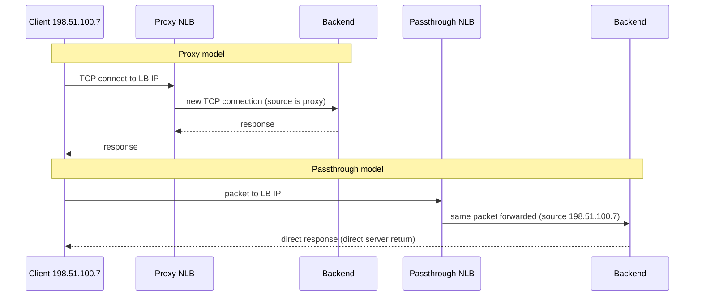

# Network Load Balancers

## Summary

A Network Load Balancer (NLB) works at layer 4: it distributes TCP, UDP and other IP traffic based on addresses, ports and protocol, without understanding HTTP. It comes in two models. A *proxy* NLB terminates the client connection and opens a new one to the backend. A *passthrough* NLB forwards packets unchanged, so backends see the real client IP and reply directly. NLBs are the choice for non-HTTP protocols, the highest throughput and the lowest latency; security then shifts to firewall rules and the backends.

## Prerequisites

- [Load balancing overview](README.md) and [Application Load Balancers](application-load-balancers.md) for comparison.
- [VPC firewall](../vpc/vpc-firewall.md).

## Core concepts

### When to choose an NLB

- The protocol is not HTTP(S): databases (PostgreSQL, MySQL), game servers (often UDP), VoIP and real-time media, custom TCP protocols, financial and trading systems.
- You need raw TCP or UDP handling, very high throughput or minimal latency.
- You must preserve the client IP (passthrough) or avoid proxy overhead.

An NLB does not do path routing, header inspection or content-aware decisions.

### Types

| Type | Model | Scope | Protocols | Notes |
| --- | --- | --- | --- | --- |
| External proxy NLB | Proxy | Global or regional | TCP, optional TLS offload | Formerly TCP proxy and SSL proxy load balancers |
| Internal proxy NLB | Proxy | Regional or cross-region | TCP | Internal-only, Envoy-based |
| External passthrough NLB | Passthrough | Regional | TCP, UDP, ESP, GRE, ICMP | Backends see client IP |
| Internal passthrough NLB | Passthrough | Regional | TCP, UDP and others | Internal-only, lowest latency, next hop for routes |

The original notes call the external proxy NLB global; Google now also offers a regional variant.

TODO: Verify protocol lists and scopes for each type.

### Proxy versus passthrough flow



- **Proxy result.** The client sees the load balancer IP; the backend sees the proxy as client, unless the PROXY protocol header passes the original address.
- **Passthrough result.** The source IP is preserved, overhead is minimal, and responses go straight back to the client.

### Components

- **Forwarding rule.** IP address, port or port range, protocol.
- **Backend service.** Instance groups or zonal NEGs, zonal distribution. Classic target-pool based passthrough NLBs use target pools instead.
- **Health checks.** TCP, SSL, HTTP or HTTPS probes remove unhealthy backends automatically.

### Distribution

- **Passthrough.** Consistent hashing on a tuple of packet fields. The default is the 5-tuple (source IP, destination IP, source port, destination port, protocol); session affinity can reduce it to 3-tuple or 2-tuple so a client sticks to one backend.
- **Proxy.** Balancing per connection, with more flexible policies.

TODO: Verify the default affinity options per protocol.

### Properties compared

| Aspect | Proxy NLB | Passthrough NLB |
| --- | --- | --- |
| Throughput and latency | Slight proxy overhead | Near line rate, minimal latency |
| TLS termination | Possible (external proxy) | No, backends terminate TLS |
| Client IP at backend | Lost unless PROXY protocol | Preserved |
| Connection tracking | Proxy tracks connections | Stateless forwarding, consistent hashing |
| Logging | Better connection-level logs | Limited; rely on backend logs and flow logs |
| Cloud Armor | Supported for some proxy types | Only network edge security policies for external passthrough |

TODO: Verify current Cloud Armor support for each NLB type; the original notes state that NLBs have no Cloud Armor support, which is outdated for some types.

### Security and firewall dependency

With an NLB, much of the security work moves to:

- VPC firewall rules (passthrough traffic arrives with the client source IP, so rules must allow client ranges),
- host-based security on the backends,
- TLS on the backends for passthrough,
- Google's infrastructure DDoS protections at the edge.

### GKE integration

A Kubernetes `Service` of type `LoadBalancer` creates a passthrough NLB (external or internal with an annotation). It is common for stateful workloads and game servers that need TCP or UDP. See [GKE networking](../../containers-and-kubernetes/gke-networking.md).

## Worked example

An internal passthrough NLB in front of a PostgreSQL read replica pool (untested):

```bash
gcloud compute health-checks create tcp pg-hc --region=europe-west1 --port=5432
gcloud compute backend-services create pg-bs --region=europe-west1 \
  --load-balancing-scheme=INTERNAL --protocol=TCP \
  --health-checks=pg-hc --health-checks-region=europe-west1
gcloud compute backend-services add-backend pg-bs --region=europe-west1 \
  --instance-group=pg-replicas --instance-group-zone=europe-west1-b
gcloud compute forwarding-rules create pg-ilb --region=europe-west1 \
  --load-balancing-scheme=INTERNAL --network=prod-vpc --subnet=data-euw1 \
  --ip-protocol=TCP --ports=5432 --backend-service=pg-bs
```

Applications connect to the forwarding rule's internal IP on port 5432. Firewall rules must allow the app subnet and the health check ranges (`35.191.0.0/16`, `130.211.0.0/22`) on 5432.

Use cases from the original notes: a database layer (internal passthrough), gaming infrastructure on UDP (external passthrough), internal non-HTTP microservices (internal proxy or passthrough), high performance TCP APIs.

## Trade offs and when to use it

- Use **passthrough** for performance-critical workloads and when the client IP matters.
- Use **proxy** when you want TLS offload, connection control and better observability.
- Use an **ALB** instead whenever the traffic is HTTP(S).

| Feature | Application LB | Network LB |
| --- | --- | --- |
| Layer | L7 | L4 |
| Routing | Content-based | IP and port |
| TLS termination | Yes | Proxy only |
| WAF | Yes | Limited |
| Performance | High | Very high |
| Use case | Web and API | TCP and UDP |

## Common mistakes

- **Using an NLB for HTTP.** You lose routing and security features.
- **No TLS strategy with passthrough.** Backends must terminate TLS.
- **Firewall rules that only allow the LB.** For passthrough, allow the client ranges, because packets keep the client IP.
- **Ignoring health checks.** Traffic reaches dead instances.

## Practice

1. A game server must see each player's IP address. Which NLB model fits?
2. What does a passthrough NLB use to pick a backend?
3. Why must firewall rules for an external passthrough NLB allow client IP ranges?

Answers: 1. Passthrough. 2. A hash of packet fields, by default the 5-tuple. 3. Packets arrive at the backend with the original client source IP.

## Further reading

- [Network Load Balancer overview](https://docs.cloud.google.com/load-balancing/docs/network/networklb-backend-service), Google Cloud documentation. Proxy and passthrough types.
- [External passthrough Network Load Balancer overview](https://docs.cloud.google.com/load-balancing/docs/network/networklb-backend-service), Google Cloud documentation. Distribution and session affinity.
- [Internal passthrough Network Load Balancer overview](https://docs.cloud.google.com/load-balancing/docs/internal), Google Cloud documentation. Internal use and next-hop routes.
