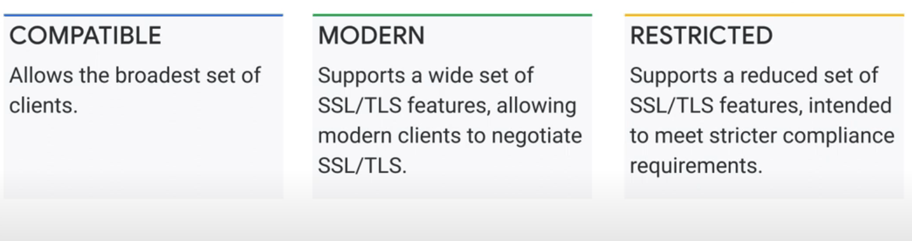
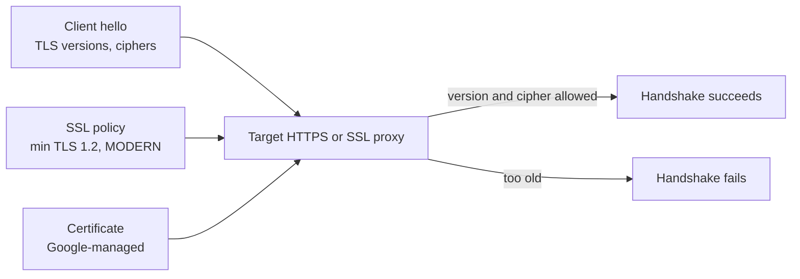

# SSL policies and certificates

## Summary

SSL (Secure Sockets Layer) and its successor TLS (Transport Layer Security) encrypt data in transit between clients and servers. Google Cloud load balancers that terminate TLS hold the certificates, either *Google-managed* (issued and renewed automatically) or *self-managed* (uploaded by you). An *SSL policy* controls which TLS versions and cipher suites the load balancer negotiates with clients, through a minimum TLS version and a profile: COMPATIBLE, MODERN, RESTRICTED or CUSTOM. Without a policy, the default (COMPATIBLE, minimum TLS 1.0) is used, which favors old clients over security.

## Prerequisites

- [Load balancing overview](README.md).
- TLS handshake basics: certificates, cipher suites, protocol versions.

## Core concepts

### Certificates

| Option | Who issues and renews | Notes |
| --- | --- | --- |
| Google-managed certificates | Google, automatically | Domain validation through DNS pointing to the load balancer, or DNS authorization with Certificate Manager |
| Self-managed certificates | You upload certificate and private key | Needed for EV certificates or your own CA; you handle renewal |

Certificate Manager is the newer service for managing certificates at scale (many domains, wildcard certificates with DNS authorization, certificate maps).

TODO: Write a note on Certificate Manager.

### SSL policies

An SSL policy sets:

- **Minimum TLS version**: 1.0, 1.1, 1.2 or 1.3.
- **Profile**: which features (cipher suites) are allowed.



| Profile | Meaning |
| --- | --- |
| COMPATIBLE | The broadest set of clients, including old ones with outdated features |
| MODERN | A wide set of features for modern clients |
| RESTRICTED | A reduced set intended for stricter compliance requirements |
| CUSTOM | You choose the features manually |



The proxy compares what the client offers with what the policy allows; clients that only speak older versions fail the handshake.

Use cases: HTTPS on Application Load Balancers, and TLS for non-HTTP applications on external proxy Network Load Balancers.

## Worked example

Require TLS 1.2 or newer with the MODERN profile on an existing proxy (untested):

```bash
gcloud compute ssl-policies create modern-tls12 \
  --profile=MODERN --min-tls-version=1.2
gcloud compute target-https-proxies update web-proxy --ssl-policy=modern-tls12
```

Check from a client: `openssl s_client -connect example.com:443 -tls1_1` should fail, `-tls1_2` should succeed.

## Trade offs and when to use it

- **COMPATIBLE** maximizes reach (very old devices) but allows weak versions and ciphers.
- **MODERN with TLS 1.2** fits most public sites today.
- **RESTRICTED** or TLS 1.3 only fits regulated or internal clients you control.
- Google-managed certificates remove renewal outages but need DNS to point at the load balancer before issuance.

## Common mistakes

- **Leaving the default policy.** Set a policy explicitly on every HTTPS proxy.
- **Expired self-managed certificates.** Monitor expiry or use Google-managed certificates.
- **Provisioning stuck in `PROVISIONING`.** DNS for the domain does not point at the load balancer IP yet.

## Practice

1. Which profile and minimum version apply if no SSL policy is attached?
2. Which profile would you choose for a payment API used only by modern partner systems?
3. What must be true before a Google-managed certificate can be issued with load balancer authorization?

Answers: 1. COMPATIBLE with TLS 1.0. 2. RESTRICTED (or CUSTOM) with TLS 1.2 or 1.3. 3. The domain's DNS records must point to the load balancer's IP.

## Further reading

- [SSL policies overview](https://docs.cloud.google.com/load-balancing/docs/ssl-policies-concepts), Google Cloud documentation. Profiles and the features each one allows.
- [SSL certificates overview](https://docs.cloud.google.com/load-balancing/docs/ssl-certificates), Google Cloud documentation. Google-managed and self-managed certificates.
- [Certificate Manager overview](https://docs.cloud.google.com/certificate-manager/docs/overview), Google Cloud documentation. Certificates at scale.
