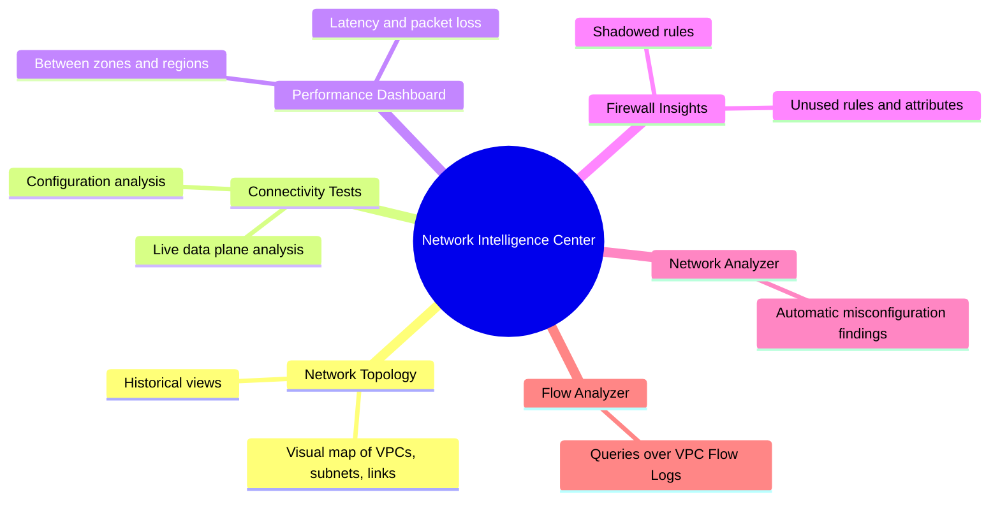

# Network Intelligence Center

## Summary

Network Intelligence Center (NIC) is a set of Google Cloud tools for network visibility, verification and troubleshooting. Network Topology draws the network and its traffic, Connectivity Tests simulate the path of a packet between two endpoints and say where it would be dropped, Performance Dashboard shows latency and packet loss, Firewall Insights finds unused and shadowed rules, and Network Analyzer detects misconfigurations automatically. Used together, they let teams find network problems before users do and prove that the deployed network matches the intended design.

## Prerequisites

- [VPC networks](vpc/vpc-networks.md), [VPC firewall](vpc/vpc-firewall.md) and [VPC Flow Logs](vpc/vpc-flow-logs.md).

## Core concepts

### Goals

- Prevent outages by detecting misconfigurations early.
- Improve security and compliance by analyzing firewall rules, routes and traffic continuously.
- Give operational visibility across VPCs, hybrid connections and managed services.

### Modules



| Module | Purpose | Practical uses | Limits |
| --- | --- | --- | --- |
| Network Topology | Visual map of VPCs, subnets, interconnects and services with traffic | Dependencies during migrations and audits | Limited visibility into Google-managed services; needs IAM permissions |
| Connectivity Tests | Simulates packet flow between endpoints (VMs, load balancers, on-premises IPs) | Diagnose routing and firewall issues, validate hybrid paths before deployment | Billable beyond a free allowance; needs network viewer permissions |
| Performance Dashboard | Latency, packet loss and throughput between zones and regions | Detect degradation, check SLA adherence | Network-level only; application delays are separate |
| Firewall Insights | Usage of firewall rules: unused, shadowed, overly permissive | Reduce attack surface, clean up rules | Covers Google Cloud firewalls only |
| Network Analyzer | Automatic detection of misconfigurations such as overlapping routes or blocked health checks | Root causes in large environments | Needs data access; does not see external links |

The original notes record a free tier of 20 Connectivity Tests per month.

TODO: Verify current Connectivity Tests pricing and free allowance.

### Path tracing

Connectivity Tests analyze routes, firewall rules, peering, VPN and load balancer configuration to compute the expected path, and can run a live data plane check. The result says whether the packet is delivered, dropped or forwarded, and at which step. In security terms, this verifies segmentation: that dev cannot reach prod, or that a database is reachable only from the app tier.

### Network intent verification

Running Connectivity Tests after every change checks that the deployed configuration matches the intended design. Put in a CI/CD pipeline, they become a shift-left network check: a deployment fails if a critical path becomes `UNREACHABLE`.

### Compliance alignment

The original notes map NIC to frameworks; this is an interpretation, not an official mapping:

| Standard | NIC contribution |
| --- | --- |
| NIST SP 800-53 (SI-4, CA-7, CM-6) | Continuous monitoring and configuration validation |
| CIS Benchmarks | Firewall and routing audits |
| ISO/IEC 27001 (network security and monitoring controls) | Network monitoring evidence |
| MITRE ATT&CK | Visibility of lateral movement paths |

## Worked example

Check that the app tier reaches the database and that the internet does not (untested):

```bash
gcloud services enable networkmanagement.googleapis.com

gcloud network-management connectivity-tests create app-to-db \
  --source-instance=projects/PROJECT_ID/zones/europe-west1-b/instances/app-1 \
  --destination-ip-address=10.10.16.5 --destination-port=5432 --protocol=TCP

gcloud network-management connectivity-tests describe app-to-db \
  --format="value(reachabilityDetails.result)"
```

Expected output: `REACHABLE`. A second test from an external IP to `10.10.16.5` should return `UNREACHABLE` with the step "dropped by firewall rule". In a pipeline, a script fails the deployment if the first test is not `REACHABLE`.

Integration workflow from the original notes: inventory (VPCs, subnets, links), visualize with Network Topology, create Connectivity Tests for critical paths (app to database, client to API, VPN to Google Cloud), monitor latency with Performance Dashboard, audit firewall rules monthly with Firewall Insights and Network Analyzer, and automate the tests in CI/CD.

## Trade offs and when to use it

- **Use cases.** Pre-deployment validation after `terraform apply`, change verification, weekly firewall audits, latency dashboards and post-incident path analysis.
- **Costs.** Connectivity Tests beyond the free allowance and Flow Logs volume are billed.
- **Visibility gaps.** Managed services such as Cloud SQL may not appear fully in the topology; cross-project analysis is easier with Shared VPC or hub and spoke designs.

## Common mistakes

- **Reading latency as a network problem.** It may be the application; check both layers.
- **Missing IAM permissions.** Results are partial without `roles/networkmanagement.viewer` and network viewer roles.
- **Too many automated tests without review.** They create noise.
- **No baseline.** Take a snapshot of topology and test results before major changes.

## Practice

1. Which module tells you that a firewall rule never matches because a higher priority rule always matches first?
2. How can Connectivity Tests be used in CI/CD?
3. Name one limitation of Network Topology.

Answers: 1. Firewall Insights (shadowed rules). 2. Run tests after deployment and fail the pipeline if a critical path is not reachable. 3. Limited visibility of Google-managed services, or partial data without IAM permissions.

## Further reading

- [Network Intelligence Center overview](https://docs.cloud.google.com/network-intelligence-center/docs/overview), Google Cloud documentation. All modules.
- [Connectivity Tests overview](https://docs.cloud.google.com/network-intelligence-center/docs/connectivity-tests/concepts/overview), Google Cloud documentation. Analysis types and results.
- [Firewall Insights overview](https://docs.cloud.google.com/network-intelligence-center/docs/firewall-insights/concepts/overview), Google Cloud documentation. Insight types.
