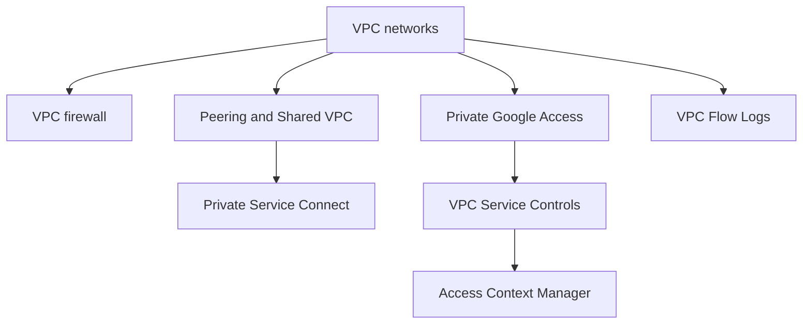

# Virtual Private Cloud

The VPC network and everything defined on it: subnets and IP addressing, firewall rules, connections between networks, private access to Google APIs and services, data exfiltration perimeters and traffic logs.

## Map of the subarea

Start with VPC networks. The left branch is about connecting networks, the right branch about private access to Google services and protecting it.

## Notes in reading order

1. [VPC networks](vpc-networks.md): global networks, regional subnets, auto and custom mode, routes, IP addresses and Cloud NAT.
2. [VPC firewall](vpc-firewall.md): stateful distributed rules, implied and default rules, firewall policies and best practices.
3. [VPC Network Peering and Shared VPC](vpc-network-peering-and-shared-vpc.md): connecting separate networks versus sharing one network.
4. [Private Google Access](private-google-access.md): Google APIs from VMs without external IPs.
5. [Private Service Connect](private-service-connect.md): service-level private endpoints across networks and organizations.
6. [VPC Flow Logs](vpc-flow-logs.md): sampled flow records for monitoring, forensics and cost analysis.
7. [VPC Service Controls](vpc-service-controls.md): service perimeters against data exfiltration.
8. [Access Context Manager](access-context-manager.md): access levels based on IP, device and identity.

## Planned topics

- Routes, Cloud Router and dynamic routing modes
- Cloud NAT in depth
- Cloud NGFW tiers and secure tags
- Packet Mirroring
- Network Connectivity Center
- IPv6 in VPC networks
