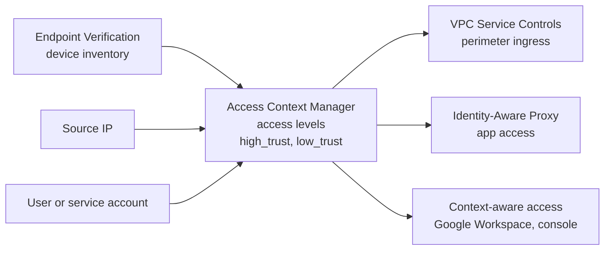

# Access Context Manager

## Summary

Access Context Manager lets organization administrators define *access levels*: named sets of conditions about the context of a request, such as source IP range, device state and identity. It does not enforce anything by itself. Other services use the access levels to decide: VPC Service Controls use them to let requests cross a perimeter, and Identity-Aware Proxy and context-aware access use them to protect apps. Access levels live in an organization-wide *access policy*.

## Prerequisites

- [VPC Service Controls](vpc-service-controls.md).
- [IAM](../../security-and-identity/identity-and-access/iam.md).

## Core concepts

### Building blocks

- **Access policy.** An organization-wide container for access levels and service perimeters. Scoped policies can be delegated to folders or projects.
- **Access level.** A named set of conditions, for example `high_trust`, `medium_trust`, `low_trust`. A request either meets the level or not.
- **Conditions.**
  - *IP address*: one or more CIDR ranges.
  - *Device attributes*: collected by Endpoint Verification, for example OS type and version, screen lock, encryption, company-owned device.
  - *Identity*: specific users or service accounts. Identity-only levels can be managed only with `gcloud` or the API, not in the console.
  - *Region* of the request origin.
- **Basic and custom levels.** Basic levels combine conditions with AND or OR. Custom levels use Common Expression Language (CEL) for richer logic.

TODO: Verify which device attributes need the BeyondCorp Enterprise (Chrome Enterprise Premium) license.

### How it fits together



Access Context Manager describes; VPC Service Controls, IAP and context-aware access enforce. This separation lets one definition (for example "corporate device, latest OS") be reused by many enforcement points.

Example levels:

- `high_trust`: company-owned device, disk encryption on, OS up to date, any network.
- `low_trust`: any device, but only from the corporate IP range, for limited apps.

## Worked example

A device-based level combined with IP (untested):

```yaml
# high_trust.yaml: basic level spec, conditions are ANDed inside one entry
- devicePolicy:
    requireScreenlock: true
    requireCorpOwned: true
    allowedEncryptionStatuses:
      - ENCRYPTED
  ipSubnetworks:
    - 203.0.113.0/24
```

```bash
gcloud access-context-manager levels create high_trust \
  --title="High trust" --basic-level-spec=high_trust.yaml \
  --combine-function=AND --policy=ACCESS_POLICY
```

The level can then be referenced in a VPC Service Controls ingress rule or an IAP-protected app.

## Trade offs and when to use it

- **Benefits.** A second, attribute-based layer next to IAM roles; fine-grained control by device, identity and location; one definition reused across perimeters and apps.
- **Costs.** Device-based levels need Endpoint Verification deployed on devices. IP-based levels are easy but weak for remote work.
- **Best practices.** Combine several attributes, audit levels regularly, use Endpoint Verification for device rules, combine with IAM and VPC Service Controls, and keep identity-only levels for the cases that really need them.

## Common mistakes

- **Expecting an access level to block traffic on its own.** It must be attached to a perimeter, an IAP resource or a context-aware access rule.
- **IP-only levels for remote staff.** Home and mobile IPs change; use device attributes.
- **Overly broad identity-only levels.** They bypass the context checks the levels exist for.

## Practice

1. Does creating an access level change who can access a bucket?
2. Which component collects device attributes for access levels?
3. Name two services that enforce access levels.

Answers: 1. No, not until a service such as VPC Service Controls uses it. 2. Endpoint Verification. 3. VPC Service Controls and Identity-Aware Proxy.

## Further reading

- [Access Context Manager overview](https://docs.cloud.google.com/access-context-manager/docs/overview), Google Cloud documentation. Policies, levels and enforcement points.
- [Create a basic access level](https://docs.cloud.google.com/access-context-manager/docs/create-basic-access-level), Google Cloud documentation. Conditions and YAML format.
- [Endpoint Verification overview](https://support.google.com/a/answer/9007320), Google Workspace Admin Help. Device inventory used by device conditions.
