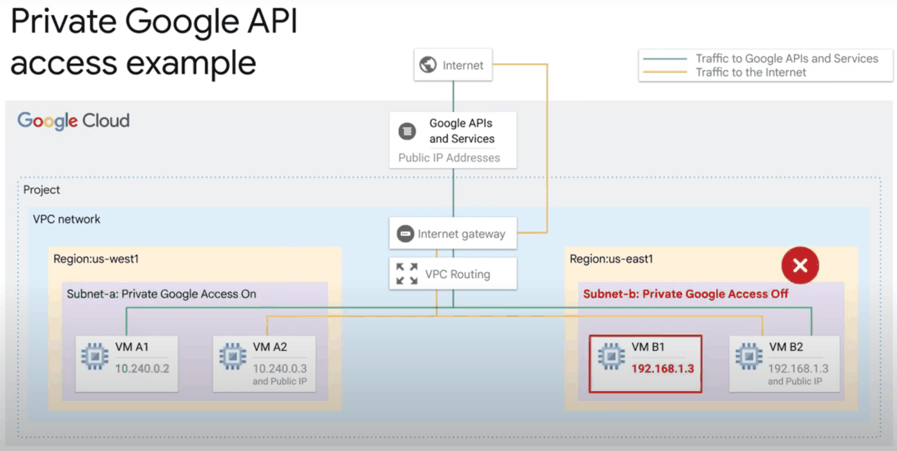
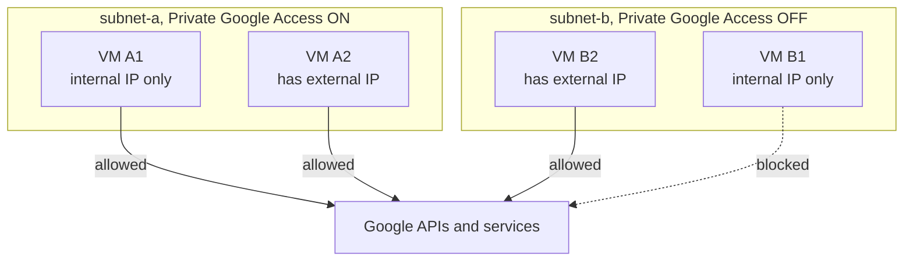

# Private Google Access

## Summary

Private Google Access lets VMs that have only internal IP addresses reach Google APIs and services, such as Cloud Storage and BigQuery, without external IPs or Cloud NAT. It is a per-subnet setting. API traffic still goes to the public API endpoints, but it stays on Google's network. It removes the most common reason for giving a VM an external IP and is part of most private network designs.

## Prerequisites

- [VPC networks](vpc-networks.md) for subnets, routes and the default internet gateway.
- DNS basics.

## Core concepts

### How it works

- **Subnet level.** The setting is enabled per subnet; VMs inherit it from their subnet.
- **Which VMs benefit.** Only VMs without an external IP are affected. A VM with an external IP can always reach Google APIs, with or without the setting.
- **Routing and DNS.** The VPC needs a route to the Google API ranges (the default route to the default internet gateway is enough) and firewall egress that allows it. Optionally, DNS can point `*.googleapis.com` to the special domains `private.googleapis.com` (`199.36.153.8/30`) or `restricted.googleapis.com` (`199.36.153.4/30`); the restricted range only serves APIs supported by VPC Service Controls.
- **Supported services.** Most Google APIs, for example BigQuery, Bigtable, Dataproc, Datastore and Firestore, Pub/Sub, Spanner, Cloud Storage and Artifact Registry.

The original notes describe the traffic as "NATed internally and invisible to the user". More precisely, packets keep the VM's internal source IP and are routed to Google's front ends inside Google's network; no customer-managed NAT gateway is involved.

### Behavior matrix





| VM | Subnet setting | External IP | Reaches Google APIs |
| --- | --- | --- | --- |
| A1 | On | No | Yes |
| A2 | On | Yes | Yes |
| B1 | Off | No | No |
| B2 | Off | Yes | Yes |

### Related options

| Option | What it gives |
| --- | --- |
| Private Google Access | Internal-only VMs reach Google APIs |
| Private Google Access for on-premises hosts | On-premises hosts reach Google APIs over VPN or Interconnect, using `private` or `restricted` VIPs |
| Private services access | Private IPs for Google-managed services such as Cloud SQL (peering) |
| [Private Service Connect](private-service-connect.md) for Google APIs | An internal endpoint IP of your choice for Google APIs |

## Worked example

Enable the setting on an existing subnet and test from a VM without an external IP (untested):

```bash
gcloud compute networks subnets update web-euw1 --region=europe-west1 \
  --enable-private-ip-google-access

gcloud compute ssh web-1 --zone=europe-west1-b --tunnel-through-iap \
  --command='gcloud storage ls gs://my-bucket'
```

Expected result: the bucket listing succeeds. With the setting off, the same command times out, because the VM has no path to the public API endpoints.

## Trade offs and when to use it

- **Benefits.** Smaller attack surface (no external IPs), simpler architecture (no NAT just for APIs), lower cost and minimal configuration.
- **Limits.** It covers Google APIs only, not the general internet (use Cloud NAT). It is not an exfiltration control on its own; combine it with [VPC Service Controls](vpc-service-controls.md) and the `restricted.googleapis.com` VIP.

## Common mistakes

- **Enabling it and keeping external IPs.** The point is to remove external IPs.
- **Deleting the default route.** Without a route to the API ranges, Private Google Access stops working; add a custom route to the `private` or `restricted` range instead.
- **Forgetting DNS for the restricted VIP.** When using VPC Service Controls, resolve `*.googleapis.com` to `restricted.googleapis.com`.

## Practice

1. A VM with an external IP sits in a subnet without Private Google Access. Can it reach Cloud Storage?
2. What is the difference between `private.googleapis.com` and `restricted.googleapis.com`?
3. Does Private Google Access give a VM access to `github.com`?

Answers: 1. Yes. 2. `restricted` serves only APIs supported by VPC Service Controls and is used with perimeters; `private` serves most Google APIs. 3. No; use Cloud NAT.

## Further reading

- [Private Google Access](https://docs.cloud.google.com/vpc/docs/private-google-access), Google Cloud documentation. Requirements and supported services.
- [Configure Private Google Access](https://docs.cloud.google.com/vpc/docs/configure-private-google-access), Google Cloud documentation. DNS and routing for the special domains.
- [Private access options for services](https://docs.cloud.google.com/vpc/docs/private-access-options), Google Cloud documentation. Comparison of all private access options.
