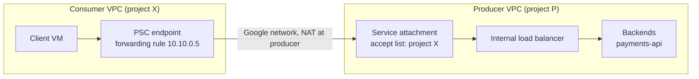

# Private Service Connect

## Summary

Private Service Connect (PSC) lets a consumer reach a specific service in another VPC network, project or organization through an internal IP address in the consumer's own network. The producer publishes the service behind an internal load balancer with a *service attachment*; the consumer creates an *endpoint* (a forwarding rule with a private IP) that connects to it. Only that one service is exposed, the networks are never joined, and IP ranges may overlap. PSC also gives private endpoints for Google APIs.

## Prerequisites

- [VPC networks](vpc-networks.md), [VPC Network Peering and Shared VPC](vpc-network-peering-and-shared-vpc.md).
- Internal load balancers, see [load balancing](../load-balancing/README.md).

## Core concepts

### The problem

How do you expose a service to other projects, organizations or customers without the public internet and without connecting whole networks? Peering exposes every subnet in both directions and fails with overlapping ranges. PSC exposes one service, one direction.

### Producer and consumer model



- **Service producer.** Owns the backend service and exposes it through an internal load balancer and a service attachment.
- **Service attachment.** Defines how the service is exposed: which consumers may connect (projects or networks), automatic or manual acceptance, connection limits and the NAT subnet used on the producer side.
- **PSC endpoint.** Created in the consumer VPC with an internal IP. Clients call this IP; traffic is carried over Google's network to the producer.

Traffic path: client to the endpoint IP, through the forwarding rule and Google's internal network, to the service attachment, the producer's load balancer and the backend.

### Types

| Type | Use |
| --- | --- |
| PSC for Google APIs | An internal IP (for example `10.255.255.254`) and private DNS names for Google APIs, replacing public endpoints |
| PSC for published services | Internal services exposed across projects and organizations |
| PSC for third-party services | SaaS providers publish services that customers reach privately |
| PSC backends | A load balancer in the consumer network uses a PSC network endpoint group to reach a service, adding consumer-side policy |

### Security model

- **No public exposure.** No external IPs are needed; traffic stays on Google's network.
- **Producer controls access.** Accept lists of projects or networks, with automatic or manual approval of each connection.
- **Isolation.** The consumer sees only the endpoint IP, not the producer network; the producer sees connections from its NAT subnet, not the consumer's network.
- **Layer it with identity.** PSC is network-level access. Combine it with firewall rules, IAM, mTLS (service mesh) or OAuth and JWT. PSC does not authenticate users.

This supports zero trust designs: no public endpoints, explicit access policies, restricted lateral movement and per-service isolation.

### Comparison

| Feature | PSC | VPC Network Peering | Private Google Access |
| --- | --- | --- | --- |
| Granularity | One service | Whole networks | Google APIs only |
| Overlapping IP ranges | Allowed | Not allowed | Not applicable |
| Cross-organization | Yes | Yes | No |
| Direction | Consumer to producer only | Both directions | VM to Google APIs |
| Typical use | SaaS, platform services, managed services | Full connectivity between trusted networks | Private VMs calling APIs |

Other building blocks for related problems: API management (for example [Apigee](../../integration-and-apis/apigee.md)) for an API product layer, and a service mesh for in-cluster and cross-cluster service traffic.

## Worked example

A platform team exposes `payments-api` to project `shop-prod` (untested, simplified):

```bash
# Producer: NAT subnet for PSC and the service attachment on an existing internal LB
gcloud compute networks subnets create psc-nat-euw1 --network=producer-vpc \
  --region=europe-west1 --range=10.100.0.0/28 --purpose=PRIVATE_SERVICE_CONNECT

gcloud compute service-attachments create payments-attachment \
  --region=europe-west1 --producer-forwarding-rule=payments-ilb-fr \
  --connection-preference=ACCEPT_MANUAL \
  --consumer-accept-list=shop-prod=10 --nat-subnets=psc-nat-euw1

# Consumer: reserve an internal IP and create the endpoint
gcloud compute addresses create payments-ep-ip --region=europe-west1 \
  --subnet=apps-euw1 --addresses=10.10.0.5
gcloud compute forwarding-rules create payments-ep --region=europe-west1 \
  --network=consumer-vpc --address=payments-ep-ip \
  --target-service-attachment=projects/PRODUCER_PROJECT/regions/europe-west1/serviceAttachments/payments-attachment
```

Clients in `shop-prod` now call `https://10.10.0.5` (or a private DNS name pointing to it). Up to 10 endpoints from that project are accepted.

## Trade offs and when to use it

- **Use PSC** for service-level exposure, SaaS multi-tenancy (each customer gets its own endpoint), central platform services (authentication, logging, billing APIs), isolation between environments, overlapping ranges and on-premises access to services through VPN or Interconnect.
- **Use peering** when two trusted networks need broad connectivity and ranges do not overlap. Using PSC there adds unneeded components.
- PSC is regional per endpoint; global access options exist for some cases.

TODO: Verify global access support for published services.

## Common mistakes

- **Assuming PSC replaces authentication.** It controls the network path only.
- **Overexposing services.** Keep accept lists narrow and prefer manual approval for external consumers.
- **Ignoring connection limits and NAT subnet size.** A small NAT subnet limits concurrent connections.
- **Not monitoring.** Enable VPC Flow Logs and alert on new connection requests.

## Practice

1. Two VPCs both use `10.0.0.0/16`. Can a client in one reach a service in the other with peering? With PSC?
2. Which resource does the producer create, and which one does the consumer create?
3. Does a PSC endpoint let the consumer reach other VMs in the producer network?

Answers: 1. Not with peering (overlap); yes with PSC. 2. Producer: service attachment (behind an internal LB); consumer: endpoint (forwarding rule with an internal IP). 3. No, only the published service.

## Further reading

- [Private Service Connect overview](https://docs.cloud.google.com/vpc/docs/private-service-connect), Google Cloud documentation. Types, components and limits.
- [Publish services by using Private Service Connect](https://docs.cloud.google.com/vpc/docs/configure-private-service-connect-producer), Google Cloud documentation. Producer configuration.
- [Access Google APIs through endpoints](https://docs.cloud.google.com/vpc/docs/configure-private-service-connect-apis), Google Cloud documentation. PSC for Google APIs.
