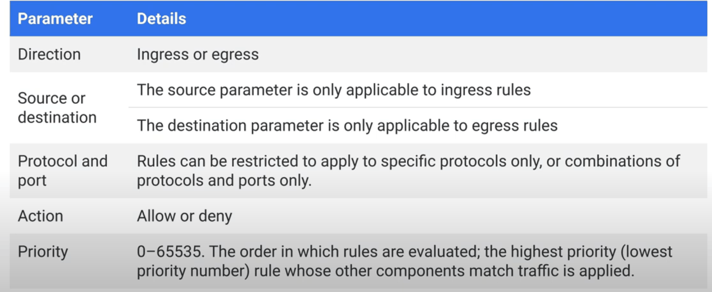
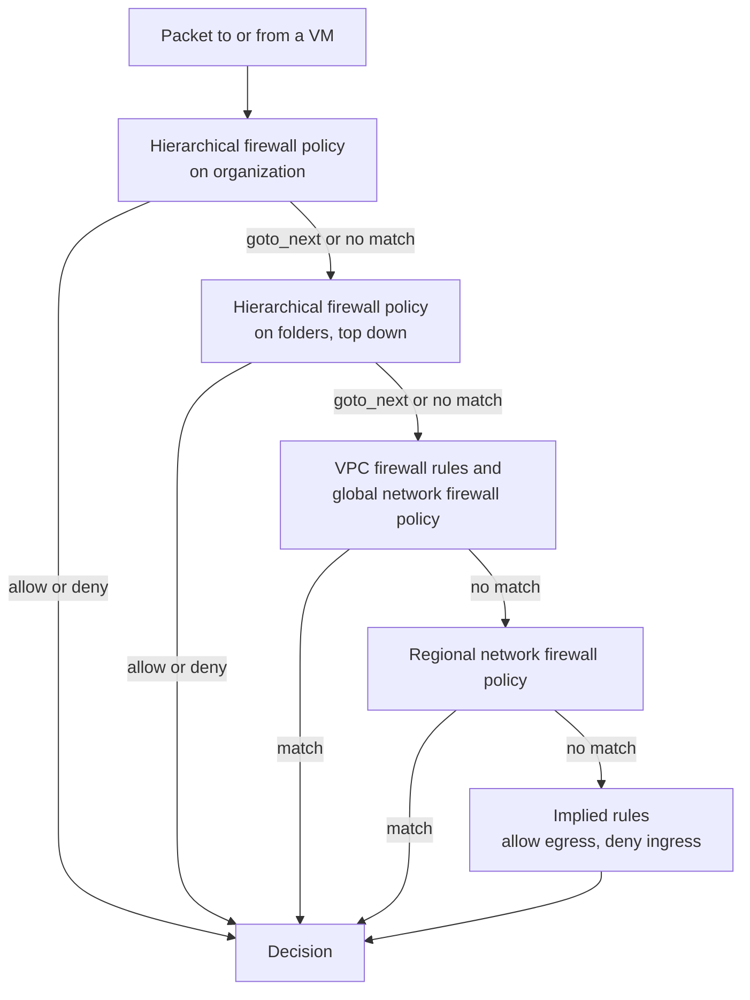
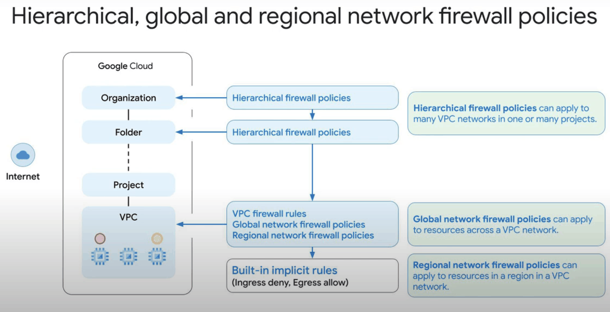
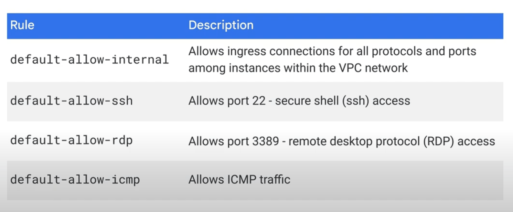
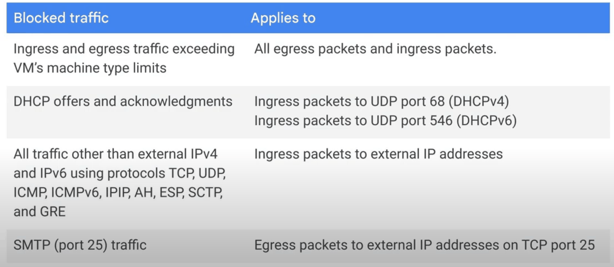
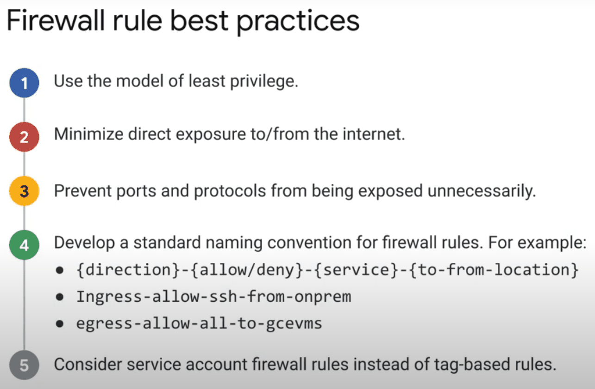

# VPC firewall

## Summary

Google Cloud firewalls are distributed and stateful: rules are defined once for a VPC network (or higher in the resource hierarchy) and enforced at every VM's network interface, not in a central appliance. Each rule has a direction, a source or destination, protocols and ports, an action and a priority. Every network has two implied rules (allow all egress, deny all ingress), and the `default` network adds four permissive rules that should be removed in production. Rules can be organized in hierarchical, global and regional firewall policies so that an organization can enforce baselines that projects cannot override.

## Prerequisites

- [VPC networks](vpc-networks.md).
- TCP and UDP ports, stateful versus stateless filtering.

## Core concepts

### Characteristics

- **Distributed.** Every VPC acts as a distributed firewall. Decisions are enforced per instance, regardless of the guest OS.
- **Stateful.** If a connection is allowed in one direction, return traffic is allowed automatically. A tracked connection stays alive while at least one packet is sent every 10 minutes.
- **Global.** VPC firewall rules belong to the network, which is global. Regional network firewall policies limit rules to one region.
- **Flexible targeting.** Rules apply to all instances, to instances with *network tags*, or to instances that run as a given *service account*.

Typical uses: restrict traffic between instances to what applications need, deny ingress from the internet except trusted ranges, allow on-premises ranges over VPN or Interconnect, and allow only specific protocols such as TCP 443.

### Rule parameters



| Parameter | Meaning |
| --- | --- |
| Direction | Ingress (incoming) or egress (outgoing) |
| Source or destination | Ingress rules match a source (IP ranges, tags, service accounts); egress rules match a destination range |
| Targets | All instances, instances with target tags, or instances with a target service account |
| Protocol and ports | For example `tcp:22`, `udp:53`, `icmp`; empty means all protocols |
| Action | Allow or deny |
| Priority | 0 (highest) to 65535 (lowest); default 1000 |

Rules are evaluated by priority. The highest priority rule that matches decides. If an allow and a deny rule have the same priority and both match, the deny rule wins.

### Evaluation order



Read the diagram from the top: organization policies get the first word, and a policy can delegate the decision to lower levels with the `goto_next` action. The order of VPC rules and network firewall policies can be configured per network.

TODO: Verify the default enforcement order between VPC firewall rules and global network firewall policies.



### Implied rules

Every VPC network, auto or custom mode, has implied rules with priority 65535 that cannot be removed:

| Rule | IPv4 | IPv6 (if enabled) |
| --- | --- | --- |
| Egress | Allow to `0.0.0.0/0` | Allow to `::/0` |
| Ingress | Deny from `0.0.0.0/0` | Deny from `::/0` |

They are a safety net: unconfigured inbound traffic is denied, outbound traffic is allowed. Higher priority rules override them.

### Default network rules



The `default` network created with each project has four extra rules with priority 65534:

| Rule | Allows |
| --- | --- |
| `default-allow-internal` | All protocols and ports between instances in the network |
| `default-allow-ssh` | TCP 22 from any source |
| `default-allow-rdp` | TCP 3389 from any source |
| `default-allow-icmp` | ICMP from any source |

They are convenient for tests and a risk in production. Delete or narrow them.

### Always allowed and always blocked traffic

Always allowed, regardless of rules: traffic to and from the metadata server (`169.254.169.254`), traffic to an instance's own IP addresses, traffic tied to load balancer forwarding rules and protocol forwarding (health checks still need rules), and addresses configured inside the instance's network overlay.



Always blocked:

- Traffic above the VM's machine type limits.
- DHCP offers and acknowledgments that do not come from the metadata server.
- Protocols other than TCP, UDP, ICMP, ICMPv6, IPIP, AH, ESP, SCTP and GRE to external IP addresses.
- Egress to TCP port 25 (SMTP) on external IP addresses, except for some customers.

### Firewall policies

- **Hierarchical firewall policies** are attached to the organization or folders and apply to every VPC in the projects below. They enforce baselines, for example "deny SSH from the internet everywhere".
- **Global network firewall policies** apply to one VPC network in all regions and allow batch updates of many rules at once.
- **Regional network firewall policies** apply to one VPC network in one region.
- **VPC firewall rules** are the classic, per-network rules.
- Network firewall policies support **IAM-governed secure tags**, which are safer targets than network tags because attaching them requires an IAM permission.

These are now part of Cloud Next Generation Firewall (Cloud NGFW), which adds tiers with features such as FQDN and geolocation objects and intrusion prevention.

TODO: Write a note on Cloud NGFW tiers.

## Worked example

Goal: a web tier on network `prod-vpc` that accepts HTTPS from the load balancer and SSH only through Identity-Aware Proxy. Untested commands.

```bash
# Health checks and proxies of Google Cloud load balancers
gcloud compute firewall-rules create ingress-allow-https-from-lb \
  --network=prod-vpc --direction=INGRESS --action=ALLOW --priority=1000 \
  --rules=tcp:443 --source-ranges=130.211.0.0/22,35.191.0.0/16 \
  --target-service-accounts=web@PROJECT_ID.iam.gserviceaccount.com

# SSH through IAP TCP forwarding only
gcloud compute firewall-rules create ingress-allow-ssh-from-iap \
  --network=prod-vpc --direction=INGRESS --action=ALLOW --priority=1000 \
  --rules=tcp:22 --source-ranges=35.235.240.0/20 \
  --target-service-accounts=web@PROJECT_ID.iam.gserviceaccount.com

# Optional strict egress: deny everything at the lowest custom priority
gcloud compute firewall-rules create egress-deny-all \
  --network=prod-vpc --direction=EGRESS --action=DENY --priority=65000 \
  --rules=all --destination-ranges=0.0.0.0/0
```

Expected behavior: HTTPS from the internet to a web VM's external IP is dropped (no matching allow, implied deny), HTTPS through the load balancer works, SSH works only with `gcloud compute ssh --tunnel-through-iap`, and outbound traffic is blocked until a higher priority egress allow rule is added (for example to Google APIs).

## Trade offs and when to use it

- **Tags versus service accounts.** Any user who can edit an instance can add a network tag, so tags are weak security boundaries. Service accounts require `iam.serviceAccounts.actAs`, so service account targets are stronger. Changing an instance's service account requires stopping it.
- **VPC rules versus policies.** VPC rules are simple for one project. Hierarchical and network firewall policies scale to many projects and support batch updates.
- **Deny-all egress** greatly reduces exfiltration paths but requires explicit rules for every dependency (package mirrors, APIs).

## Common mistakes

- **`0.0.0.0/0` sources on allow rules.** Restrict to known ranges, the load balancer ranges or the IAP range.
- **Forgetting health check ranges.** Load balancer backends show as unhealthy if `130.211.0.0/22` and `35.191.0.0/16` are not allowed.
- **Unclear rule names.** Use a convention such as `{direction}-{allow|deny}-{service}-{from|to}-{location}`, for example `ingress-allow-ssh-from-onprem` or `egress-allow-all-to-gcevms`.
- **Never cleaning up.** Use Firewall Insights to find shadowed and unused rules (see [Network Intelligence Center](../network-intelligence-center.md)).



Best practices, in short: least privilege, minimal internet exposure, block unused ports and protocols, a naming convention, service account targets instead of tags, hierarchical policies for organization-wide controls, regular audits with Firewall Insights and Recommender, and testing changes before production.

## Practice

1. Two rules match a packet, both with priority 1000: one allows, one denies. What happens?
2. Which rule lets return traffic of an outbound HTTPS request back into a VM?
3. Why are service account targets preferred over network tags?
4. Which traffic is not subject to firewall rules at all?

Answers: 1. The deny rule wins. 2. None is needed; the firewall is stateful. 3. Attaching a service account needs an IAM permission, while tags can be set by anyone who can edit the instance. 4. Traffic to the metadata server, to the instance's own IPs and some load balancer related traffic.

## Further reading

- [VPC firewall rules](https://docs.cloud.google.com/firewall/docs/firewalls), Google Cloud documentation. Parameters, implied rules, always allowed and blocked traffic.
- [Firewall policies overview](https://docs.cloud.google.com/firewall/docs/firewall-policies-overview), Google Cloud documentation. Hierarchical, global and regional policies and evaluation order.
- [Cloud NGFW overview](https://docs.cloud.google.com/firewall/docs/about-firewalls), Google Cloud documentation. Tiers and advanced features.
- [Health checks overview: firewall rules](https://docs.cloud.google.com/load-balancing/docs/health-check-concepts), Google Cloud documentation. Probe source ranges.
