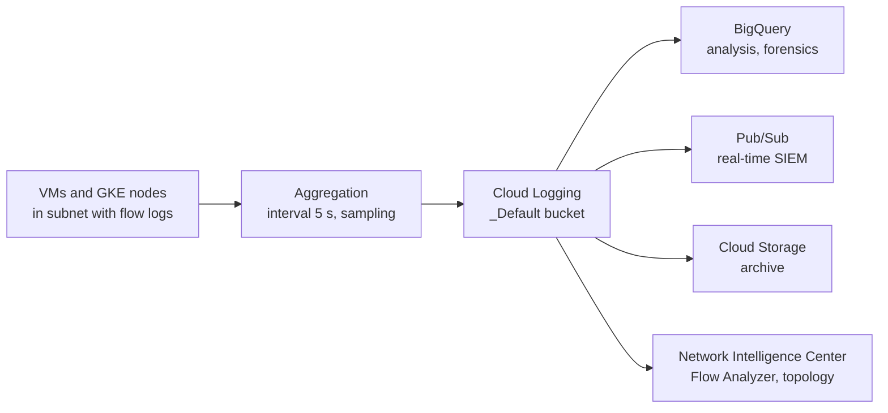

# VPC Flow Logs

## Summary

VPC Flow Logs record a sample of the network flows sent from and received by VM instances (and GKE nodes) in a subnet. Each record holds the 5-tuple, byte and packet counts, timing and metadata such as the VM name and geographic location of external peers. Flow logs are enabled per subnet, delivered to Cloud Logging and can be exported to BigQuery or Pub/Sub. They are used for network monitoring, security forensics, cost analysis and compliance, and they can generate a lot of log volume.

## Prerequisites

- [VPC networks](vpc-networks.md) and [VPC firewall](vpc-firewall.md).
- [Cloud Logging](../../operations/cloud-logging.md) for sinks and log buckets.

## Core concepts

### What is recorded

- Flows sent from or received by VMs, with source and destination IPs and ports, protocol, bytes, packets, start and end times.
- Metadata: VM, VPC and subnet names, and geographic details of external endpoints.
- Only traffic seen by the VM is logged. Outbound traffic blocked by an egress rule is logged; inbound traffic blocked by an ingress rule never reaches the VM and is not logged. Use Firewall Rules Logging for blocked ingress.
- Records are aggregated per connection over an interval (5 seconds by default) and exported in near real time. A sampling rate controls how many packets are considered.

### Pipeline



Flow logs are generated by the VPC infrastructure itself, so there is no agent and no added latency on the packet path.

### Configuration

- Enabled or disabled **per subnet**; all VMs in the subnet are covered. There is no per-VM setting in the classic subnet configuration.
- Tunable parameters: aggregation interval, sampling rate, metadata inclusion and a filter expression to keep only relevant flows.

TODO: Verify the newer options for configuring flow logs on VPC networks, VLAN attachments and VPN tunnels.

## Worked example

Enable flow logs with half the flows sampled and full metadata, then find the top talkers to the internet in BigQuery (untested):

```bash
gcloud compute networks subnets update web-euw1 --region=europe-west1 \
  --enable-flow-logs --logging-flow-sampling=0.5 \
  --logging-aggregation-interval=interval-5-sec \
  --logging-metadata=include-all
```

After routing the logs to a BigQuery dataset with a log sink:

```sql
SELECT
  jsonPayload.connection.src_ip AS src_ip,
  jsonPayload.connection.dest_ip AS dest_ip,
  SUM(CAST(jsonPayload.bytes_sent AS INT64)) AS bytes
FROM `PROJECT_ID.network_logs.compute_googleapis_com_vpc_flows_*`
WHERE _TABLE_SUFFIX >= FORMAT_DATE('%Y%m%d', DATE_SUB(CURRENT_DATE(), INTERVAL 1 DAY))
GROUP BY src_ip, dest_ip
ORDER BY bytes DESC
LIMIT 10;
```

The result lists the ten flows that sent the most bytes in the last day, which is a quick way to spot unexpected egress cost or data exfiltration.

## Trade offs and when to use it

- **Uses.** Network monitoring and capacity planning, security analysis (unauthorized access attempts, unusual transfers), egress cost optimization, and compliance evidence.
- **Cost.** High traffic subnets can generate large volumes. Lower the sampling rate, increase the aggregation interval, filter, and route only what you need.
- **Scope.** Flow logs are not packet captures. For payload inspection use Packet Mirroring or Cloud IDS.

## Common mistakes

- **Expecting blocked ingress in flow logs.** Use Firewall Rules Logging.
- **Enabling full sampling everywhere.** Enable selectively on subnets that need it.
- **Keeping logs only in the `_Default` bucket.** Its default retention is 30 days. Export to BigQuery or Cloud Storage for longer analysis.

## Practice

1. Is inbound traffic blocked by an ingress firewall rule visible in VPC Flow Logs?
2. At which level are flow logs enabled?
3. Name two ways to reduce flow log cost.

Answers: 1. No, it never reaches the VM. 2. Per subnet. 3. Lower sampling, longer aggregation interval, filters or exclusion of metadata.

## Further reading

- [VPC Flow Logs](https://docs.cloud.google.com/vpc/docs/flow-logs), Google Cloud documentation. Record format, sampling and configuration.
- [Use VPC Flow Logs](https://docs.cloud.google.com/vpc/docs/using-flow-logs), Google Cloud documentation. Commands and examples.
- [Firewall Rules Logging](https://docs.cloud.google.com/firewall/docs/firewall-rules-logging), Google Cloud documentation. Logs for allowed and denied connections per rule.
