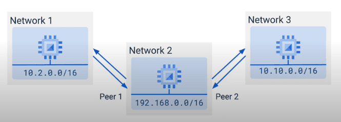
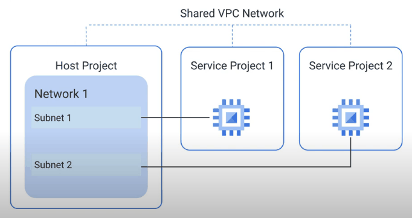
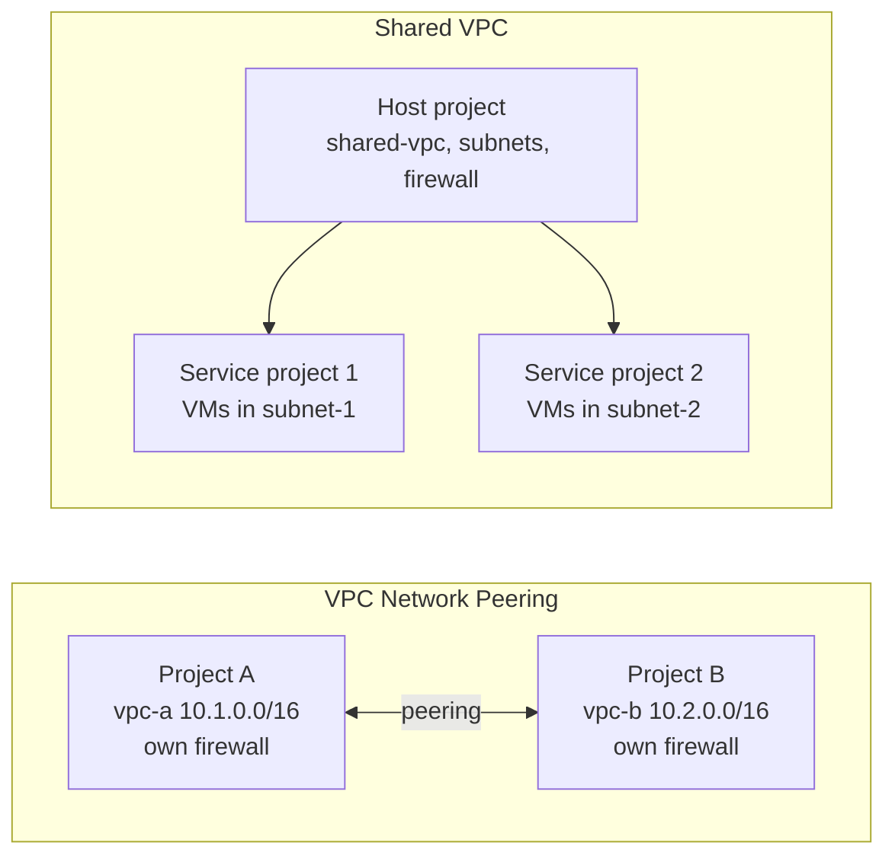

# VPC Network Peering and Shared VPC

## Summary

There are two native ways to let resources in different projects talk over internal IPs. *VPC Network Peering* connects two separate VPC networks, which can be in different projects or even different organizations; each side keeps its own administration and firewall rules. *Shared VPC* goes the other way: one *host project* owns a single network and *service projects* in the same organization put their resources into its subnets, so network administration is centralized. Peering connects networks; Shared VPC shares one network.

## Prerequisites

- [VPC networks](vpc-networks.md) and [VPC firewall](vpc-firewall.md).
- [Resource hierarchy](../../foundations/resource-hierarchy.md) for projects and organizations.

## Core concepts

### VPC Network Peering

VPC Network Peering connects two VPC networks with non-overlapping subnet ranges so that their resources communicate over internal (RFC 1918 or other private) addresses.

- **Private communication.** Traffic uses internal IPs and stays on Google's network, so it is not exposed to the internet and has lower latency than external IP paths.
- **Independence.** Each network keeps its own firewall rules and routes. Firewall rules are not shared; each side must allow the traffic it accepts.
- **Across projects and organizations.** Both networks can belong to different projects or organizations. Both sides must create the peering for it to become active.
- **No transitive peering.** If A peers with B and B peers with C, A cannot reach C through B. Every pair that must talk needs its own peering (or a different design such as Network Connectivity Center).
- **Limits.** A network can have a limited number of direct peerings; the original notes record 25.
- **Cost.** Traffic over internal IPs avoids external IP egress charges, but normal network pricing (for example cross-zone and cross-region) still applies.
- **Route control.** Subnet routes are exchanged as a whole; you cannot exclude individual subnet ranges from import or export, so filtering must be done with firewall rules. Custom routes can be optionally imported and exported.

TODO: Verify the current peering quota.

### Shared VPC

- **Structure.** A host project contains the shared network. Service projects are attached to it and their resources use specific subnets.
- **Administration.** Network and security administrators in the host project manage subnets, routes and firewall rules. Service project administrators can create VMs in subnets they were granted (`roles/compute.networkUser`) but cannot change the network. This enforces least privilege.
- **Scope.** Host and service projects must be in the same organization.

### Comparison

| Feature | VPC Network Peering | Shared VPC |
| --- | --- | --- |
| Scope | Across projects and organizations | Within one organization |
| Management | Independent per network | Central in the host project |
| Subnet sharing | None; connects two separate networks | Subnets shared with service projects |
| Firewall rules | Managed separately in each network | Managed centrally in the host project |
| Transitivity | Not transitive | Not applicable (one network) |

*Analogy.* Peering is a corridor built between two separate office buildings, each with its own security desk. Shared VPC is one building with one security desk, where different companies rent floors. The analogy breaks on transitivity: corridors between buildings in real life can be walked through, peering cannot.

## Worked example

A platform team runs a Shared VPC host project `net-host-prod` with subnets `apps-euw1` (`10.10.0.0/20`) and `data-euw1` (`10.10.16.0/20`). Team A's service project `shop-prod` gets `roles/compute.networkUser` on `apps-euw1` only. A partner company with its own organization needs access to one internal API: the platform team peers `shared-vpc` with the partner's `partner-vpc` (`172.16.0.0/16`) and adds an ingress rule that allows only `172.16.0.0/16` on `tcp:443` to the API's service account. Because peering is not transitive, the partner cannot reach any third network peered with `shared-vpc`. For exposing a single service to many consumers, [Private Service Connect](private-service-connect.md) would be a cleaner choice.

## Trade offs and when to use it

- Use **Shared VPC** for central network control in one organization with many projects. It is the usual base of an enterprise landing zone.
- Use **peering** to connect independently managed networks, including across organizations, when full network-level reachability is acceptable.
- Use **Private Service Connect** when only one service should be exposed, ranges overlap, or consumers are many.
- Peering topologies can be hub and spoke or chains, as long as ranges do not overlap, but the lack of transitivity makes large meshes hard to manage.

## Common mistakes

- **Overlapping subnets.** Peering fails or routes are not exchanged. Plan ranges centrally.
- **Expecting firewall rules to carry over.** Configure rules in both networks.
- **Expecting transitive routing.** A hub VPC does not forward traffic between peered spokes.
- **Giving service project admins network admin roles.** Keep network changes in the host project.

## Practice

1. Network A peers with B and B peers with C. Can a VM in A reach a VM in C?
2. Can a Shared VPC host project share subnets with a project in another organization?
3. Which role lets a service project user create VMs in a shared subnet?

Answers: 1. No, peering is not transitive. 2. No, Shared VPC works within one organization. 3. `roles/compute.networkUser` on the subnet or host project.

## Further reading

- [VPC Network Peering](https://docs.cloud.google.com/vpc/docs/vpc-peering), Google Cloud documentation. Properties, limits and route exchange.
- [Shared VPC overview](https://docs.cloud.google.com/vpc/docs/shared-vpc), Google Cloud documentation. Host and service projects, IAM roles.
- [Best practices for VPC design](https://docs.cloud.google.com/architecture/best-practices-vpc-design), Google Cloud Architecture Center. When to use each option.
