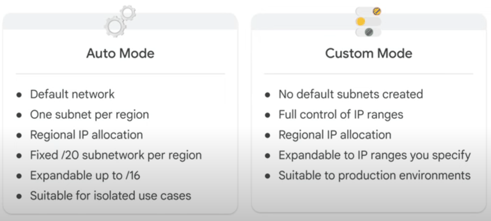
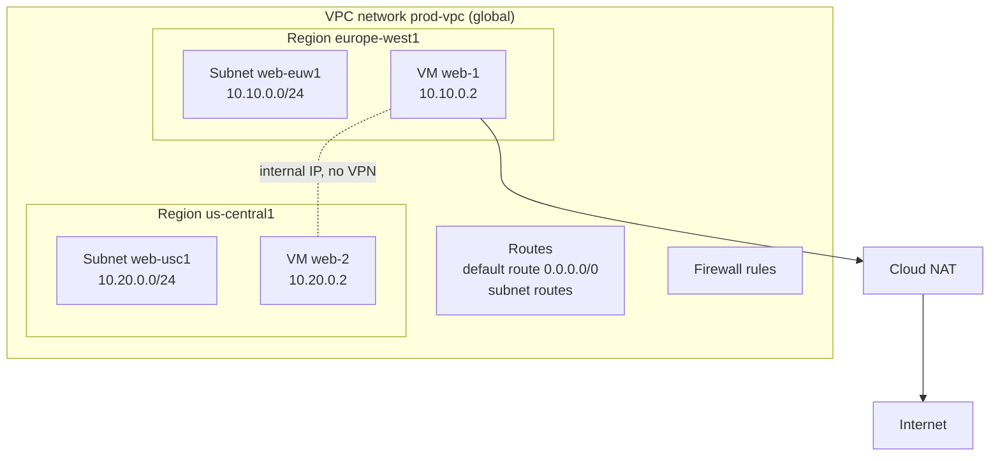
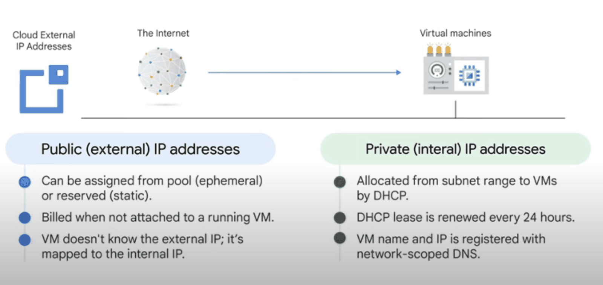

# VPC networks

## Summary

A Virtual Private Cloud (VPC) network is a virtual, isolated network for Google Cloud resources. It is global: one VPC spans every region, while its *subnets* are regional IP ranges. Administrators define IP ranges, routes and firewall rules, and connect the VPC to other VPCs and to on-premises networks. VPCs come in two modes, *auto mode* (one subnet per region created for you) and *custom mode* (you create every subnet), and production networks should use custom mode.

## Prerequisites

- [Google Cloud networking overview](../google-cloud-networking-overview.md).
- CIDR notation and private (RFC 1918) address ranges.

## Core concepts

### Key features

- **Global reach.** The network spans all regions; resources in different regions of the same VPC talk over internal IPs without VPNs.
- **Customizable subnets.** Subnets are CIDR ranges in a chosen region, which gives precise control over placement and addressing.
- **Private Google Access.** VMs without external IPs can reach Google APIs. See [Private Google Access](private-google-access.md).
- **Static and dynamic routing.** Custom static routes, or dynamic routes learned through Cloud Router and BGP (Border Gateway Protocol).
- **Peering and connectivity.** VPC Network Peering, Shared VPC, Cloud VPN and Cloud Interconnect. See [VPC Network Peering and Shared VPC](vpc-network-peering-and-shared-vpc.md).
- **Firewall rules.** Distributed, stateful rules applied per instance. See [VPC firewall](vpc-firewall.md).
- **Flow Logs.** Sampled records of VM traffic. See [VPC Flow Logs](vpc-flow-logs.md).

### Auto mode and custom mode



| Feature | Auto mode VPC | Custom mode VPC |
| --- | --- | --- |
| Subnet creation | One subnet per region, created automatically | Created manually |
| New regions | Subnets added automatically | No automatic additions |
| IP ranges | Predefined ranges from `10.128.0.0/9`, a `/20` per region | User defined, must not overlap within the network |
| Expansion | Subnets can be expanded up to `/16` | Any size the plan allows |
| Use cases | Proof of concept, testing, simple isolated cases | Production, complex networks, hybrid connectivity |
| Switching | Can be converted to custom mode | Cannot be converted back to auto mode |

Every new project gets a `default` network in auto mode with permissive firewall rules (see [VPC firewall](vpc-firewall.md#default-network-rules)). Auto mode ranges are the same in every project, so two auto mode networks cannot be peered or connected to on-premises without overlaps.

### Core components



The diagram shows one global network with subnets in two regions. The two VMs reach each other over internal IPs, and outbound internet traffic from VMs without external IPs goes through Cloud NAT.

- **Network.** A container for subnets, routes and firewall rules. Each project starts with the `default` network; you can create more (5 per project by default, a quota that can be raised).
- **Subnets.** Regional IP ranges. A subnet can have secondary ranges, used for example by GKE Pods and Services (alias IPs).
- **IP addresses.** *Internal* addresses for traffic inside the network, *external* addresses for internet-facing resources (ephemeral or reserved static). Private Google Access lets internal-only VMs reach Google APIs.
- **Routes.** Decide where packets go. Subnet routes are created automatically; the default route `0.0.0.0/0` points to the default internet gateway. Custom static routes and dynamic routes (Cloud Router) can be added.
- **Firewall rules.** Allow or deny traffic per instance, targeted by network tags or service accounts.
- **Cloud NAT.** Managed outbound NAT so VMs without external IPs can reach the internet without being reachable from it.

TODO: Verify the current default quota.



The figure summarizes the difference: an external IP is assigned from a pool (or reserved), is billed when reserved but unused, and is mapped to the internal IP by Google's network; the VM itself only knows its internal IP, which comes from the subnet range through DHCP and is registered in internal DNS.

### Advanced features

- **Shared VPC.** One host project owns the network; service projects in the same organization use its subnets. Network administration stays central.
- **VPC Network Peering.** Private connectivity between two VPCs, also across projects and organizations.
- **Hybrid connectivity.** Cloud Interconnect (dedicated, high bandwidth) and Cloud VPN (encrypted over the internet). See [hybrid connectivity](../hybrid-connectivity/README.md).
- **Private services access.** A peering between your VPC and a Google-managed producer network, used by services such as Cloud SQL and Memorystore to get private IPs.

## Worked example

A custom mode network for one application in two regions (untested commands):

```bash
gcloud compute networks create prod-vpc --subnet-mode=custom

gcloud compute networks subnets create web-euw1 --network=prod-vpc \
  --region=europe-west1 --range=10.10.0.0/24 --enable-private-ip-google-access

gcloud compute networks subnets create web-usc1 --network=prod-vpc \
  --region=us-central1 --range=10.20.0.0/24 --enable-private-ip-google-access
```

IP plan: `10.10.0.0/16` reserved for Europe and `10.20.0.0/16` for the US, with `/24` subnets carved out per tier. A `/24` gives 252 usable addresses, because Google Cloud reserves four addresses in every primary range (network, gateway, second-to-last and broadcast). Leaving room in each `/16` allows new subnets and GKE secondary ranges later without overlaps with the on-premises `192.168.0.0/16`.

## Trade offs and when to use it

- **Auto mode** is quick for labs, but its fixed ranges collide with other auto mode networks and often with on-premises ranges.
- **Custom mode** needs an IP plan up front, which pays off as soon as peering or hybrid connectivity is involved.
- **One VPC or many.** A single Shared VPC simplifies connectivity and central control; several VPCs give stronger isolation but need peering or Private Service Connect between them.
- **Cost.** VPC networks are free; you pay for egress, external IPs, NAT, VPN, Interconnect and logging.

## Common mistakes

- **Overlapping ranges.** Overlaps block peering and hybrid routing. Plan ranges for all environments and on-premises together.
- **Keeping the default network in production.** Delete it or block it with the `compute.skipDefaultNetworkCreation` organization policy.
- **External IPs on every VM.** Use internal IPs with Cloud NAT and Private Google Access instead.
- **Forgetting that auto to custom is one-way.** Decide before converting.

## Practice

1. Is a VPC network regional or global? What about a subnet?
2. Why can two auto mode VPCs not be peered?
3. How many usable addresses does a `/28` primary subnet range have in Google Cloud?
4. What gives a VM without an external IP outbound internet access?

Answers: 1. Global; regional. 2. They use the same predefined ranges, which overlap. 3. 12 (16 minus 4 reserved). 4. Cloud NAT.

## Further reading

- [VPC networks](https://docs.cloud.google.com/vpc/docs/vpc), Google Cloud documentation. Modes, subnets and quotas.
- [Subnets](https://docs.cloud.google.com/vpc/docs/subnets), Google Cloud documentation. Reserved addresses, secondary ranges and expansion.
- [Best practices and reference architectures for VPC design](https://docs.cloud.google.com/architecture/best-practices-vpc-design), Google Cloud Architecture Center. IP planning, Shared VPC and segmentation.
- [Cloud NAT overview](https://docs.cloud.google.com/nat/docs/overview), Google Cloud documentation. Outbound NAT for private VMs.
