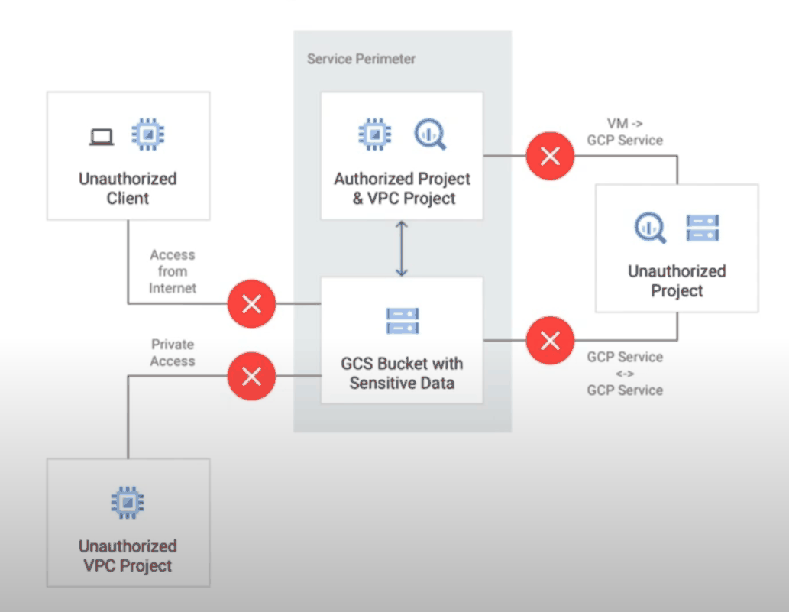
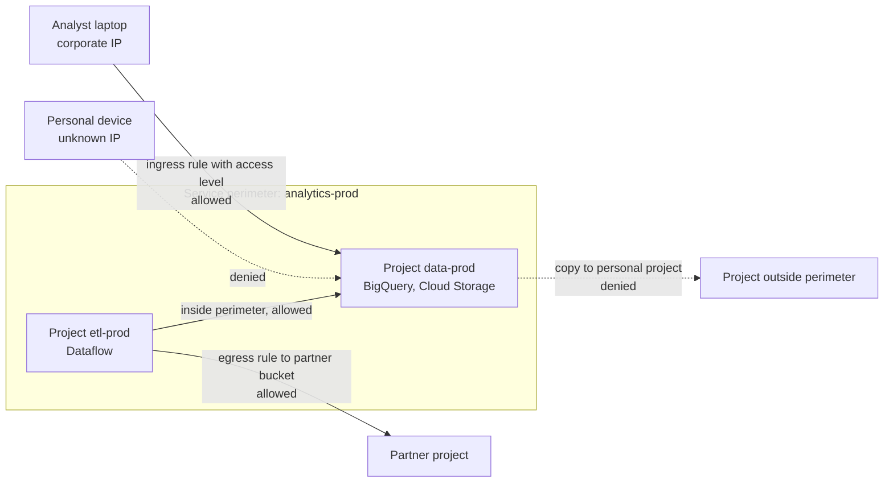
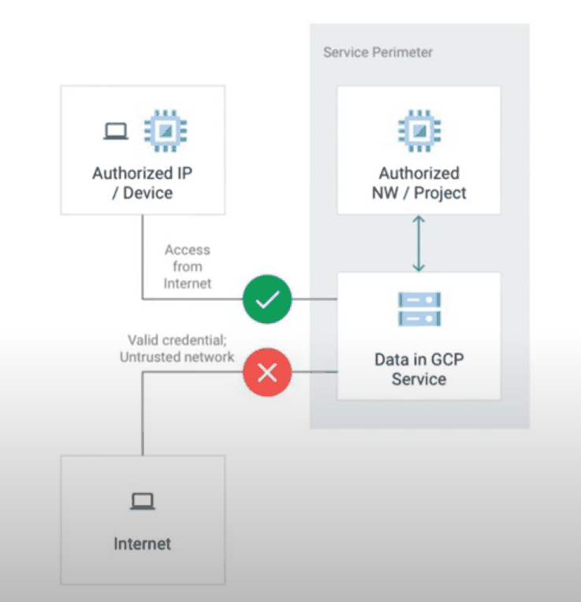
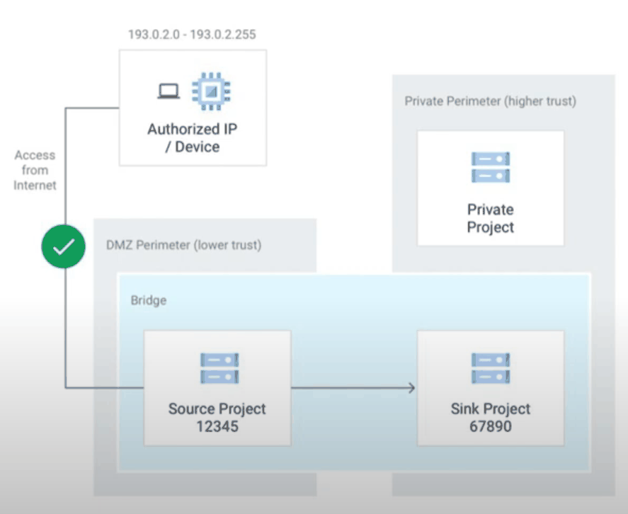
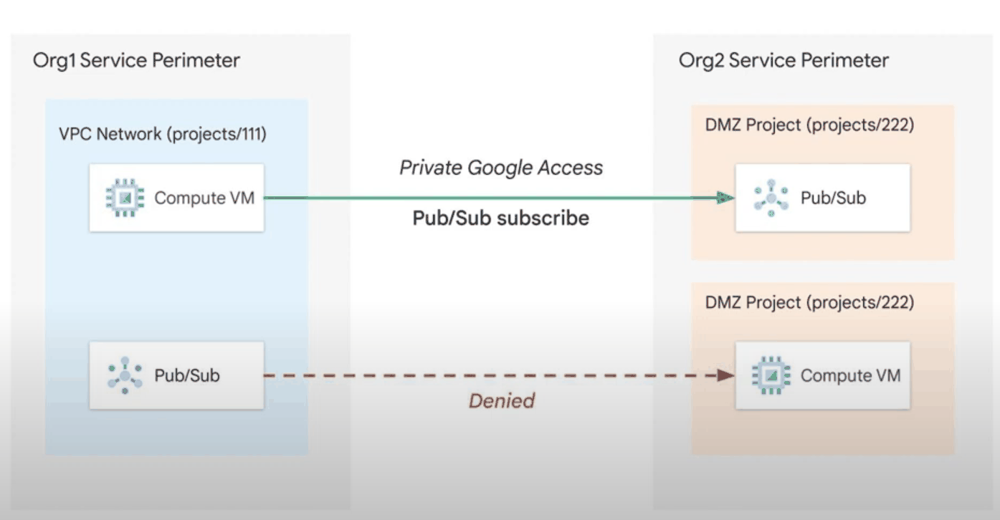
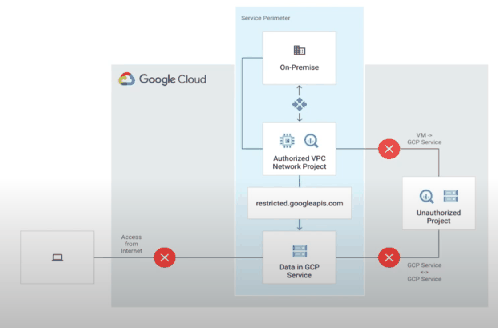

# VPC Service Controls

## Summary

VPC Service Controls draw a *service perimeter* around Google Cloud projects and the Google-managed services they use, such as Cloud Storage and BigQuery. API calls that would move data across the perimeter are blocked, even if IAM allows them. This protects against data exfiltration by stolen credentials, malicious insiders and misconfigured permissions. Controlled exceptions are made with access levels (from Access Context Manager) and ingress and egress rules.

## Prerequisites

- [IAM](../../security-and-identity/identity-and-access/iam.md), because VPC Service Controls work alongside it.
- [Private Google Access](private-google-access.md) and [Access Context Manager](access-context-manager.md).

## Core concepts

### The problem it solves

IAM answers "who may call this API". It does not answer "from where, and to where may the data go". A user with valid credentials can copy a sensitive bucket to a bucket in a personal project, or query BigQuery from a home laptop. A perimeter adds a context-based boundary that is independent of IAM.



### Key features

- **Service perimeters.** Projects (and their protected services) inside a perimeter can exchange data freely. Calls from outside, and copies to resources outside, are denied.
- **Independent of IAM.** Both must allow a request. IAM gives fine-grained identity control; the perimeter gives broader context control.
- **Ingress rules.** Allow specific clients outside the perimeter to access resources inside, filtered by identity, source (IP, access level, network) and method.
- **Egress rules.** Allow resources inside to access specific resources outside.
- **Access levels.** Context conditions from [Access Context Manager](access-context-manager.md): IP ranges, device attributes, identity.
- **Private connectivity.** On-premises and VPC clients reach protected services privately through the `restricted.googleapis.com` VIP.
- **Data movement controls.** Blocks copies to unauthorized projects and exports to public endpoints.
- **Perimeter bridges.** Let projects in two perimeters communicate. Google now recommends ingress and egress rules instead, which are more granular.
- **VPC accessible services.** Optionally restricts which APIs can be called from networks inside the perimeter.
- **Internet isolation.** By default, internet access to protected resources is denied unless an access level allows it.











### Configuration steps

1. **Create an access policy**, the organization-level container for perimeters and access levels.
2. **Define service perimeters**: which projects and which services are protected.
3. **Optionally restrict VPC accessible services** inside the perimeter.
4. **Optionally set up private connectivity** from on-premises with Private Google Access and the restricted VIP.
5. **Optionally create access levels** for context-aware access.
6. **Optionally add ingress and egress rules** for controlled exchange across the boundary.

Use **dry run mode** first: violations are logged but not enforced, so you can see what would break.

### Key considerations

- A project can belong to only one regular perimeter (it can be in several bridges).
- Perimeters protect Google APIs. They do not block access to third-party APIs or general internet services from VMs; use firewall rules and Cloud NAT policy for that.
- Requests from outside must match an access level or an ingress rule.
- Not every service is supported, and some features of supported services behave differently inside a perimeter.

TODO: Link the current supported products list with a check date.

## Worked example

Protect BigQuery and Cloud Storage in `data-prod` and allow analysts only from the corporate network (untested, `ACCESS_POLICY` is the policy number):

```bash
# Access level: corporate egress range
cat > corp.yaml <<'EOF'
- ipSubnetworks:
  - 203.0.113.0/24
EOF
gcloud access-context-manager levels create corp_network \
  --title="Corporate network" --basic-level-spec=corp.yaml --policy=ACCESS_POLICY

# Perimeter in dry run mode first
gcloud access-context-manager perimeters dry-run create analytics_prod \
  --title="analytics-prod" --perimeter-type=regular \
  --resources=projects/DATA_PROD_NUMBER \
  --restricted-services=bigquery.googleapis.com,storage.googleapis.com \
  --access-levels=corp_network --policy=ACCESS_POLICY
```

After a week of dry run logs (`protoPayload.metadata.dryRun=true` in Cloud Logging) show no unexpected violations, enforce the perimeter.

## Trade offs and when to use it

- **Benefits.** Reduced exfiltration risk, a second layer next to IAM, private hybrid access, and granular control based on IP, identity and device.
- **Costs.** Operational complexity: perimeters break integrations that cross them (CI/CD, logging exports, third-party tools) until rules are added. Plan, run dry run, and document rules.
- **When.** Regulated or sensitive data (PII, health, financial), analytics and AI training data. See also [AI/ML security](../../ai-and-machine-learning/ai-infrastructure/ai-security-operations-and-mlops.md).

## Common mistakes

- **Enforcing without dry run.** Production pipelines fail. Always observe first.
- **Using bridges for everything.** Prefer ingress and egress rules.
- **Assuming perimeters replace IAM.** Both are needed.
- **Forgetting the restricted VIP.** Clients that resolve the normal API endpoints from inside private networks may bypass the intended path.

## Practice

1. A user with `roles/storage.admin` tries to copy an object from a protected bucket to a bucket in a project outside the perimeter. What happens?
2. Why are ingress and egress rules preferred over perimeter bridges?
3. Does a perimeter stop a VM inside it from downloading a file from a public website?

Answers: 1. The copy is denied by VPC Service Controls even though IAM allows it. 2. They specify identities, sources, services and methods, so they are more granular. 3. No, perimeters protect Google APIs, not general internet traffic.

## Further reading

- [Overview of VPC Service Controls](https://docs.cloud.google.com/vpc-service-controls/docs/overview), Google Cloud documentation. Concepts and benefits.
- [Ingress and egress rules](https://docs.cloud.google.com/vpc-service-controls/docs/ingress-egress-rules), Google Cloud documentation. Rule syntax and examples.
- [Dry run mode](https://docs.cloud.google.com/vpc-service-controls/docs/dry-run-mode), Google Cloud documentation. Testing perimeters safely.
