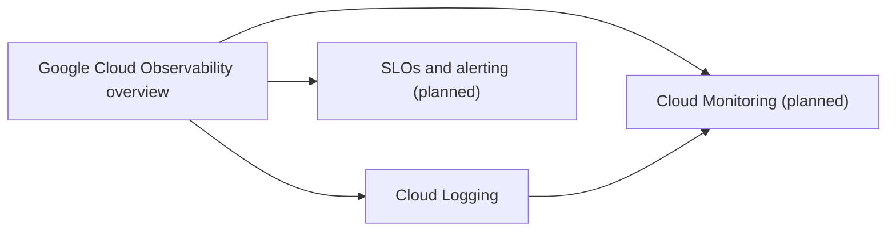

# Operations

Observability and operations on Google Cloud: monitoring, logging, tracing, profiling, error reporting and the SRE practices built on them. Security-focused logging and auditing is in [security monitoring and auditing](../security-and-identity/security-best-practices/security-monitoring-and-auditing.md).

## Map of the area

## Notes in reading order

1. [Google Cloud Observability overview](operations-suite-overview.md): Monitoring, Logging, Trace, Profiler, Error Reporting, Ops Agent and an SLO example.
2. [Cloud Logging](cloud-logging.md): ingestion, Log Router, sinks, buckets, log categories, analysis and access control.

## Planned topics

- Cloud Monitoring: metrics, dashboards, uptime checks and alerting
- SLOs, error budgets and burn rate alerts
- Google Cloud Managed Service for Prometheus
- Cloud Trace and OpenTelemetry
- Cloud Profiler
- Incident management and postmortems
- Cost management of logs and metrics
