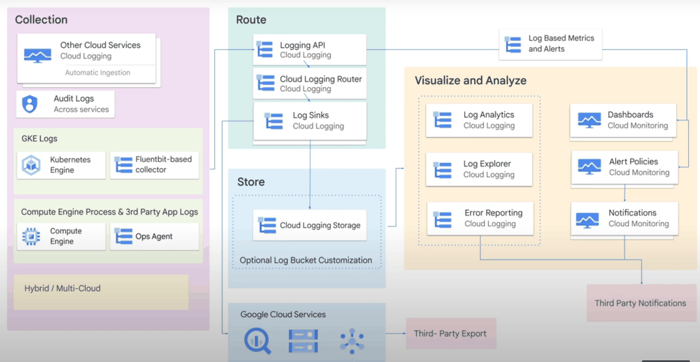
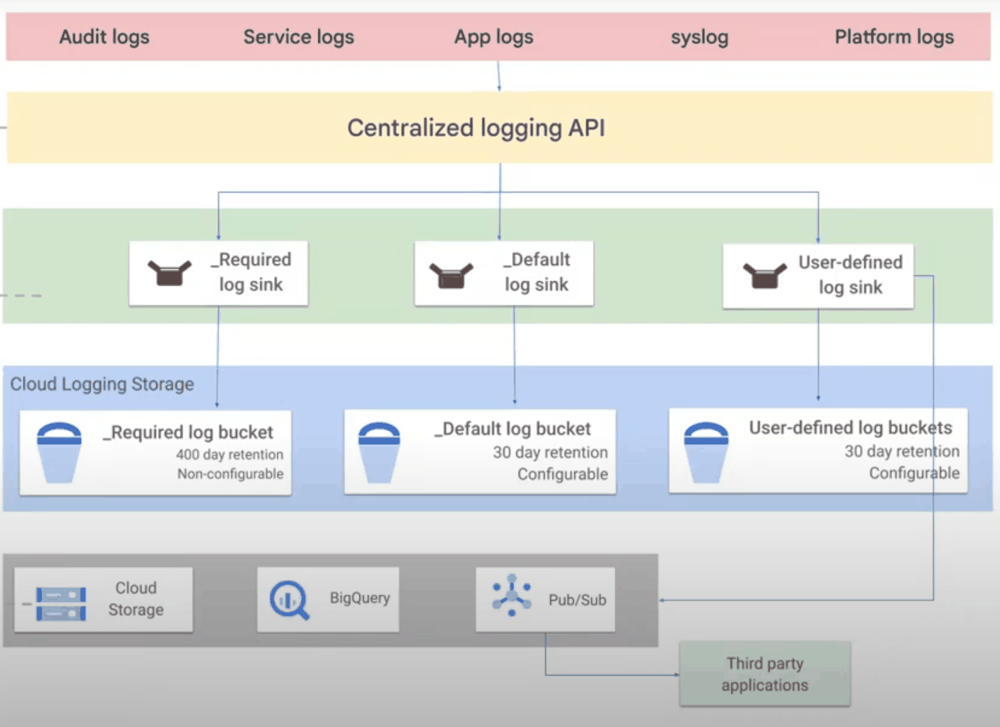
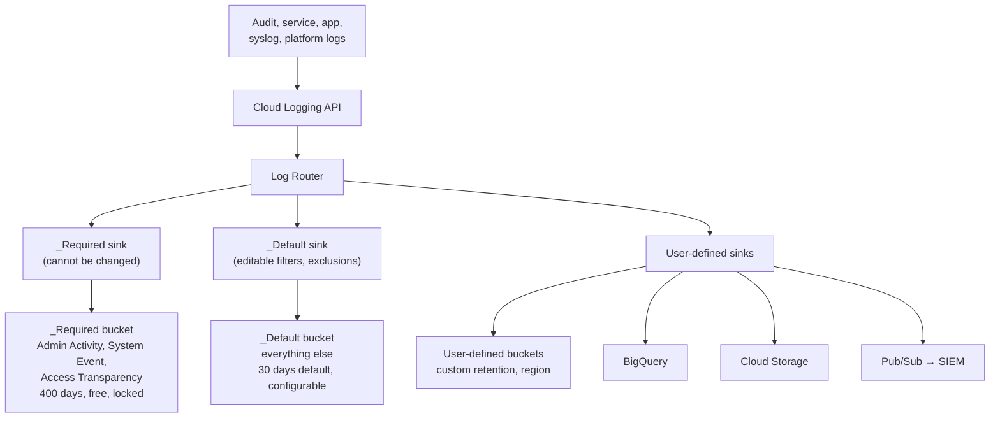
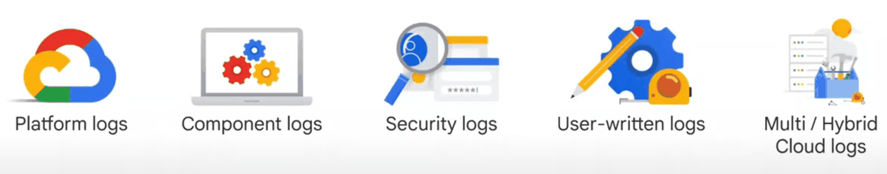

# Cloud Logging

## Summary

Cloud Logging is Google Cloud's managed log service. Every log entry, from Google Cloud services, VMs, containers, applications or other clouds, enters through the Cloud Logging API and passes the *Log Router*, which uses *sinks* with inclusion and exclusion filters to send it to destinations: log buckets inside Cloud Logging (`_Required`, `_Default` or user-defined), BigQuery, Cloud Storage, Pub/Sub or another project. Logs can be searched in Logs Explorer, analyzed with SQL in Log Analytics, turned into metrics and alerts, and exported to SIEMs. Designing routing, retention and access is what turns logs from a cost into a tool.

## Prerequisites

- [Google Cloud Observability overview](operations-suite-overview.md).
- [Resource hierarchy](../foundations/resource-hierarchy.md) for organization and folder sinks.

## Core concepts

### Architecture



**Ingestion.** Sources:

- Google Cloud services: Compute Engine (system and VM logs), App Engine (request and app logs), Cloud Run functions, GKE (container and node logs), Cloud Run, Cloud Load Balancing.
- Custom applications through the Logging API or client libraries.
- On-premises and other clouds through the Ops Agent, Fluent Bit or Fluentd based agents.

Structured JSON payloads make parsing and querying much easier than plain text.

**Log Router.** Every entry passes the router, which evaluates sinks: inclusion filters decide what a sink takes, exclusion filters drop what is not needed (to reduce cost). Routing is policy driven and can separate logs per team, service or compliance zone.

**Sinks and destinations.**

| Destination | Description |
| --- | --- |
| Log buckets | Storage inside Cloud Logging, regional, with retention settings; queryable in Logs Explorer and Log Analytics |
| BigQuery | SQL analytics, correlation with business data |
| Cloud Storage | JSON files for long-term, cheap archival |
| Pub/Sub | Real-time streaming to SIEMs, Splunk (through the Dataflow template), custom processors |
| Another project | Central logging projects with separate access control |

Sinks exist at project, folder, organization and billing account level. *Aggregated sinks* at folder or organization level collect logs from all child projects. Sinks run in parallel: an entry can go to the default buckets and to any number of other destinations.





### Log buckets

- **`_Required`**: Admin Activity audit logs, System Event audit logs and Access Transparency logs. Retention 400 days, cannot be changed or deleted, no charge.
- **`_Default`**: all other logs routed by the `_Default` sink. Retention 30 days by default, configurable (up to 3650 days); standard pricing.
- **User-defined buckets**: separate logs by workload, region or retention; can be upgraded to Log Analytics and linked to BigQuery datasets; retention can be locked.

### Log categories



| Category | Source | Examples |
| --- | --- | --- |
| Platform logs | Google Cloud services | VPC Flow Logs, load balancer request logs, Cloud NAT logs, Cloud Storage access logs |
| Component logs | Google-provided software in your environment | kubelet and kube-proxy logs, Ops Agent and Fluent Bit messages |
| Security logs | Security and access events | Cloud Audit Logs, Access Transparency logs, firewall and IAM deny logs |
| User-written logs | Your applications | Logs through agents, the API (`entries.write`), client libraries, `gcloud logging write`, or stdout and stderr on GKE and Cloud Run |
| Multicloud and hybrid logs | Other clouds and on-premises | Logs from AWS, Azure or data centers through agents, APIs or Pub/Sub |

Security logs answer the forensic question "who did what, where and when".

### Analysis

- **Logs Explorer**: query language, histogram, log stream, resource filters.
- **Log Analytics**: SQL over log buckets, powered by BigQuery, for ad hoc analysis and joins with other datasets.
- **Log-based metrics**: counters and distributions from log entries (errors per minute, latency from fields) for dashboards and alerts.
- **Log-based alerts**: notify on specific entries, for example an IAM change.
- **Error Reporting**: groups recurring exceptions and notifies on new ones.

### Access control and compliance

IAM roles at project, folder and organization level (`roles/logging.viewer`, `roles/logging.privateLogViewer` for Data Access and other sensitive logs, `roles/logging.admin`, `roles/logging.bucketWriter` for sink identities); log views restrict access to subsets of a bucket. Audit logs are generated for most services automatically and are essential for compliance.

### Integrations

SIEMs through Pub/Sub, Prometheus and Grafana through exporters and data sources, BigQuery and Looker Studio dashboards, and standard libraries and agents (Log4j, Fluent Bit, OpenTelemetry).

## Worked example

Goals: keep firewall and VPC Flow Logs for 10 years cheaply, send security events to a SIEM in real time, and stop paying for noisy debug logs (untested):

```bash
# Archive network logs to Cloud Storage (Coldline via lifecycle on the bucket)
gcloud logging sinks create net-archive storage.googleapis.com/example-net-logs-archive \
  --log-filter='logName:("compute.googleapis.com%2Fvpc_flows" OR "compute.googleapis.com%2Ffirewall")'

# Stream audit logs of the whole organization to Pub/Sub for the SIEM
gcloud logging sinks create org-audit-to-siem \
  pubsub.googleapis.com/projects/sec-logging/topics/siem-audit \
  --organization=ORG_ID --include-children \
  --log-filter='logName:"cloudaudit.googleapis.com"'

# Exclude debug logs from the _Default bucket (they are dropped, not stored)
gcloud logging sinks update _Default \
  --add-exclusion=name=no-debug,filter='severity<=DEBUG'
```

After each `create`, grant the sink's writer identity access to the destination (for example `roles/storage.objectCreator` on the bucket, `roles/pubsub.publisher` on the topic). Excluded logs are discarded permanently, so exclusions must be narrow.

## Trade offs and when to use it

- **Buckets** give fast search and Log Analytics; **BigQuery** gives the richest analysis; **Cloud Storage** is cheapest for long retention; **Pub/Sub** is for real-time consumers.
- Ingestion is billed per GiB beyond a free allotment per project; exclusions and sampling reduce cost but lose data.
- Central logging projects simplify security and audits but need careful IAM so teams can still see their own logs.

## Common mistakes

- **Exclusions that are too broad**, dropping logs needed in an incident.
- **Unstructured text logs** that cannot be filtered by field.
- **Forgetting the sink writer identity permissions**, so exports silently fail.
- **Relying on 30 day default retention** for compliance needs.

## Practice

1. Which logs go to the `_Required` bucket, and can you change its retention?
2. What is the difference between an exclusion and a sink filter?
3. How do you collect audit logs from every project in an organization into one place?

Answers: 1. Admin Activity, System Event and Access Transparency logs; no, retention is fixed at 400 days. 2. A sink's inclusion filter selects what the sink exports; an exclusion drops matching entries from that sink (on `_Default`, from storage entirely). 3. An organization-level aggregated sink with `--include-children` to a central destination.

## Further reading

- [Routing and storage overview](https://docs.cloud.google.com/logging/docs/routing/overview), Google Cloud documentation. Log Router, sinks and buckets.
- [Log Analytics](https://docs.cloud.google.com/logging/docs/log-analytics), Google Cloud documentation. SQL over logs.
- [Cloud Logging pricing](https://cloud.google.com/stackdriver/pricing), Google Cloud. Ingestion and retention costs.
- [Logging query language](https://docs.cloud.google.com/logging/docs/view/logging-query-language), Google Cloud documentation. Filter syntax.
