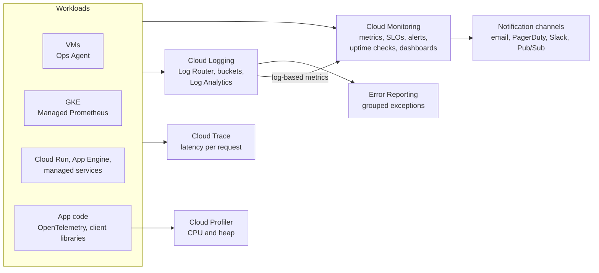
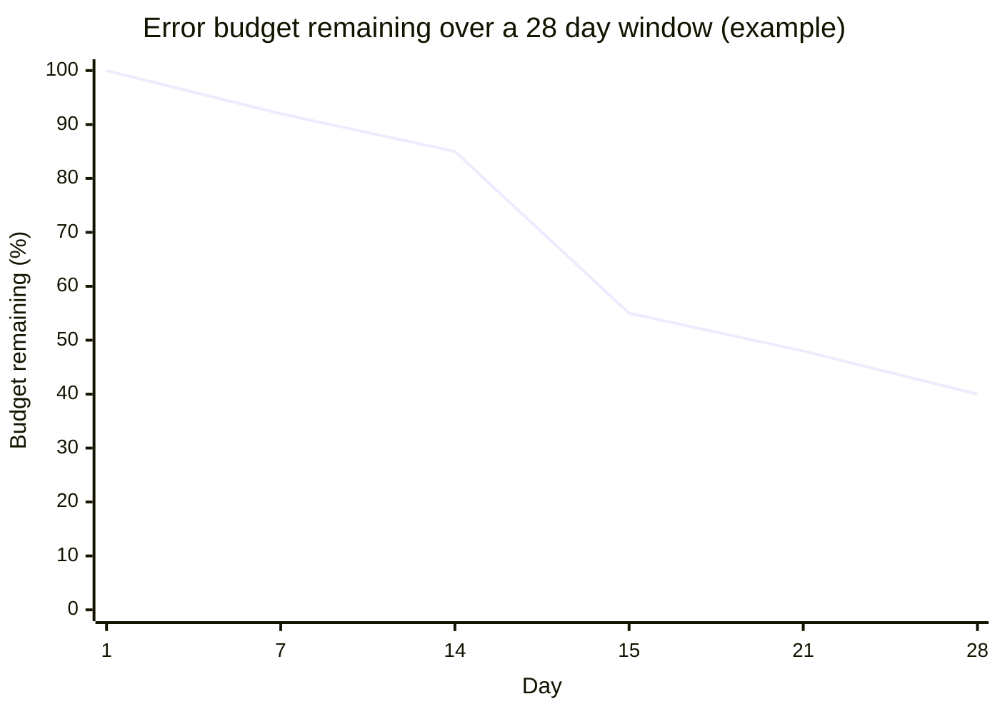

# Google Cloud Observability overview

## Summary

Google Cloud Observability (formerly the Operations Suite, and before that Stackdriver) is the integrated set of services for knowing what systems are doing: Cloud Monitoring (metrics, dashboards, uptime checks, alerting, SLOs), Cloud Logging (log collection, routing, storage and analysis), Cloud Trace (distributed tracing), Cloud Profiler (continuous profiling) and Error Reporting (grouped exceptions). The Ops Agent collects logs and metrics from VMs, and OpenTelemetry brings custom telemetry in. Together they support the core SRE practices: define SLOs, alert on symptoms, and correlate metrics, logs and traces to find causes quickly.

## Prerequisites

- [Google Cloud overview](../foundations/google-cloud-overview.md).
- Monitoring basics: metrics, logs, traces, alerts.

## Core concepts

### The three signals and the tools

Logs can become metrics (log-based metrics), errors in logs feed Error Reporting, and alerts from both reach on-call channels.

### Products

**Cloud Monitoring.** Managed metrics and dashboards. Visualizes system and application performance, defines SLIs and SLOs, alerts on thresholds, absence or anomalies. Native metrics for Compute Engine, GKE, Cloud Run and managed services; custom and Prometheus metrics; uptime checks (HTTP, HTTPS, TCP); metrics scopes to view several projects together. Use SLO-based alerting (burn rate) for critical services.

**Cloud Logging.** Central log collection, querying and analysis: logs from all services and VMs, Logs Explorer, Log Analytics with SQL, retention and exclusion settings, log-based metrics, export to BigQuery, Pub/Sub and Cloud Storage, IAM roles such as Logs Viewer and Private Logs Viewer. See [Cloud Logging](cloud-logging.md).

**Cloud Trace.** Distributed tracing for latency analysis: end-to-end request flows and latency bottlenecks in microservices. Automatic for some services (App Engine, Cloud Run requests), OpenTelemetry for custom tracing.

**Cloud Profiler.** Low overhead, continuous sampling profiler for production (CPU, heap, threads) for Java, Go, Node.js and Python. Use it to cut cost and improve performance, and combine with Trace to connect slow requests with CPU hotspots.

**Error Reporting.** Aggregates and groups exceptions from logs, links to stack traces, alerts on new or regressed errors.

**Cloud Debugger** (live snapshots of running code) was deprecated and shut down in 2023; the open source Snapshot Debugger replaced it. The original notes still list it.

**Ops Agent.** One agent for logs and metrics on VMs, replacing the legacy Logging and Monitoring agents, with third-party integrations (Apache, NGINX, MySQL, and more), deployable from the console, scripts, Terraform or VM Manager policies.

**Cloud Audit Logs.** Admin Activity, Data Access, System Event and Policy Denied logs. Admin Activity and System Event logs are kept 400 days; Data Access logs 30 days by default in the `_Default` bucket. See [security monitoring and auditing](../security-and-identity/security-best-practices/security-monitoring-and-auditing.md).

**Dashboards, alerting and uptime checks.** Dashboard builder, alert policies on metrics or logs, uptime checks, notification channels (email, SMS, Slack, PagerDuty, Opsgenie, webhooks, Pub/Sub), SLO visualizations.

### Summary table

| Product | Purpose | Value for DevOps and architects |
| --- | --- | --- |
| Cloud Monitoring | Metrics, dashboards | SLO alerting, uptime checks |
| Cloud Logging | Collect, search, export logs | Log-based metrics, long-term export, SIEM |
| Cloud Trace | Latency across services | Request path optimization |
| Cloud Profiler | CPU and memory hotspots | Performance and cost |
| Error Reporting | Exceptions | Regressions and prioritization |
| Ops Agent | VM telemetry | Logs and metrics from third-party software |
| Cloud Audit Logs | Admin, data and policy events | Compliance and investigations |
| Dashboards and alerts | Status and notification | Connects telemetry to incident response |

## Worked example

An availability SLO for a Cloud Run API: 99.9 percent of requests over 28 days must return a non-5xx status.

- Error budget: 0.1 percent of requests. At 1 million requests per day, that is 28,000 failed requests in 28 days.
- A fast burn alert fires when the error rate over 1 hour would use about 2 percent of the 28 day budget in that hour (a burn rate of about 14.4); a slow burn alert covers 6 hours at a lower rate.

The example line shows a steady burn and an incident on day 15 that used 30 percent of the budget in one day: the kind of event the fast burn alert should page for. The numbers are illustrative.

## Trade offs and when to use it

- Built-in metrics and logs for managed services cost nothing to set up; custom metrics, high log volumes and long retention cost money.
- OpenTelemetry keeps instrumentation portable across vendors.
- Third-party observability tools (Grafana, Datadog) can read Cloud Monitoring and Logging data when teams standardize on them.

## Common mistakes

- **Alerting on causes (CPU) instead of symptoms (errors, latency).**
- **No SLOs**, so there is no shared definition of "healthy".
- **Logs, metrics and traces in silos.** Use trace IDs in logs to correlate.
- **Missing Ops Agent on VMs**, so OS and application telemetry is absent.

## Practice

1. Which service replaced Cloud Debugger?
2. How does a log entry become something you can alert on as a rate?
3. What is an error budget for a 99.9 percent SLO over 1,000,000 requests?

Answers: 1. The open source Snapshot Debugger. 2. Through a log-based metric in Cloud Monitoring. 3. 1,000 failed requests.

## Further reading

- [Google Cloud Observability overview](https://docs.cloud.google.com/stackdriver/docs), Google Cloud documentation. All products.
- [Service monitoring and SLOs](https://docs.cloud.google.com/stackdriver/docs/solutions/slo-monitoring), Google Cloud documentation. SLOs and burn rate alerts.
- [Site Reliability Engineering: Service Level Objectives](https://sre.google/sre-book/service-level-objectives/), Google SRE book. SLI, SLO and error budgets.
- [Ops Agent overview](https://docs.cloud.google.com/stackdriver/docs/solutions/agents/ops-agent), Google Cloud documentation. VM telemetry.
