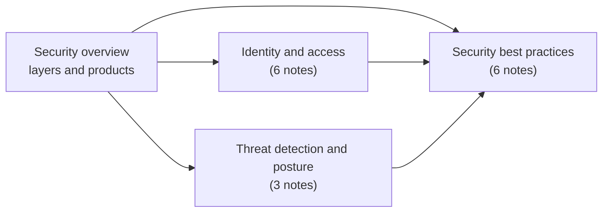

# Security and identity

Identity, access control, threat detection, posture management and security practices on Google Cloud. Network security controls that are part of the VPC (firewall, VPC Service Controls, Access Context Manager) live in [networking](../networking/vpc/README.md); GKE security lives in [containers and Kubernetes](../containers-and-kubernetes/gke-security/README.md).

## Map of the area

Read the overview first. Identity and access is the base of everything else; the best practices notes apply the other two subareas to concrete workloads and threats.

## Notes and subareas in reading order

1. [Google Cloud security overview](security-overview.md): shared responsibility, security layers and the product map.
2. [Identity and access](identity-and-access/README.md): Cloud Identity, GCDS, Managed Microsoft AD, IAM, service accounts and authentication.
3. [Threat detection and posture](threat-detection-and-posture/README.md): Security Command Center, Cloud IDS and CFT Scorecard.
4. [Security best practices](security-best-practices/README.md): VMs, data, applications, DDoS, ransomware and monitoring.

## Planned topics

- Cloud KMS, Cloud HSM and Cloud EKM
- Secret Manager
- Organization Policy Service constraints for security
- Access Transparency and Access Approval
- Confidential Computing
- Chrome Enterprise Premium (BeyondCorp)
- Compliance offerings and Assured Workloads
