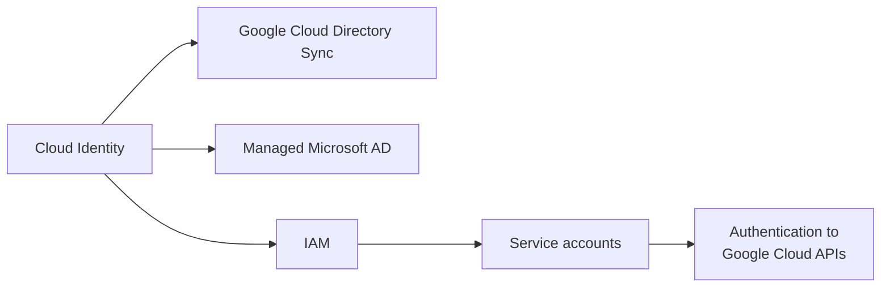

# Identity and access

Who the principals are (people, groups, workloads), where their identities come from, and how they are granted access to Google Cloud resources.

## Map of the subarea

The left side is about identity sources for people, the right side about access control and workload identities.

## Notes in reading order

1. [Cloud Identity](cloud-identity.md): the directory behind a Google Cloud organization, editions, MFA, SSO and devices.
2. [Google Cloud Directory Sync](google-cloud-directory-sync.md): one-way sync from Active Directory or LDAP.
3. [Managed Microsoft AD](managed-microsoft-ad.md): managed domain controllers for Windows workloads.
4. [Identity and Access Management](iam.md): principals, roles, allow and deny policies, conditions and inheritance.
5. [Service accounts](service-accounts.md): workload identities, types, keys and least privilege.
6. [Authentication to Google Cloud APIs](authentication-to-google-cloud-apis.md): ADC, Workload Identity Federation for GKE, Workload Identity Federation and keys.

## Planned topics

- Workforce Identity Federation
- Identity-Aware Proxy
- Identity Platform
- Policy Intelligence (IAM Recommender, Policy Analyzer, Policy Troubleshooter)
- Privileged Access Manager and just-in-time access
- Super admin and break-glass account practices
