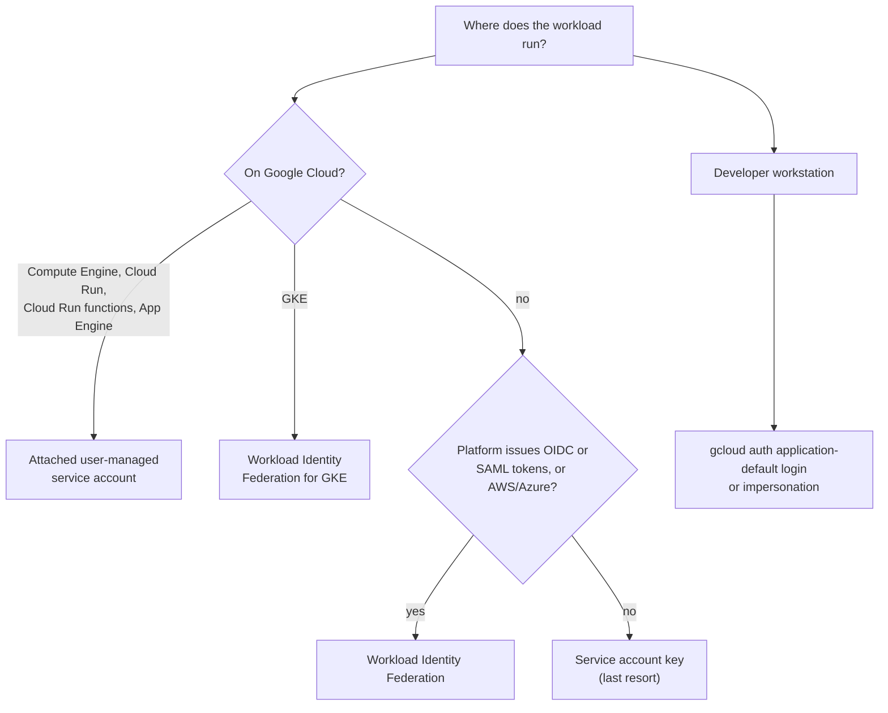
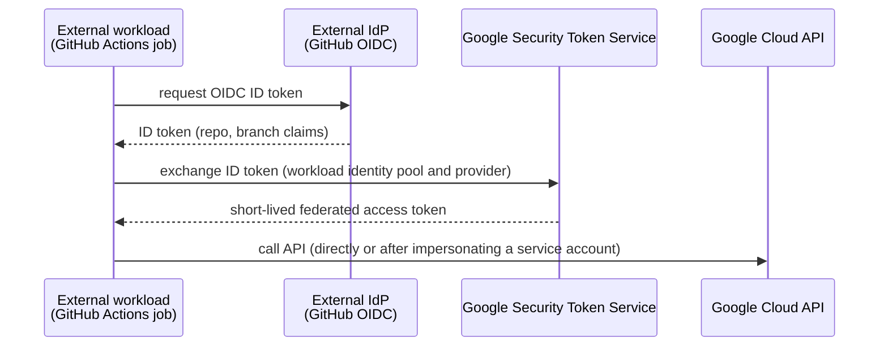

# Authentication to Google Cloud APIs

## Summary

Applications authenticate to Google Cloud APIs with credentials that depend on where they run. On Google Cloud, use an attached service account. On GKE, use Workload Identity Federation for GKE, which maps Kubernetes service accounts to IAM. Outside Google Cloud (on-premises, AWS, Azure, GitHub Actions), use Workload Identity Federation to exchange the platform's own token for a short-lived Google token. Service account keys are a last resort. Client libraries find credentials automatically through Application Default Credentials (ADC), so the same code works in every environment.

## Prerequisites

- [Service accounts](service-accounts.md) and [IAM](iam.md).
- OAuth 2.0 and OIDC basics: access tokens and ID tokens.

## Core concepts

### Decision by location



### Application Default Credentials

Client libraries look for credentials in this order:

1. The `GOOGLE_APPLICATION_CREDENTIALS` environment variable, pointing to a credential file (a key file or a federation configuration file).
2. User credentials created with `gcloud auth application-default login`.
3. The attached service account, from the metadata server (Compute Engine, GKE, Cloud Run and others).

Code written against ADC needs no authentication logic and works locally and in production. Do not confuse `gcloud auth login` (credentials for the `gcloud` CLI itself) with `gcloud auth application-default login` (credentials for client libraries in your code).

### Workload Identity Federation for GKE

Workload Identity Federation for GKE (formerly Workload Identity) lets Pods act as IAM principals without keys.

Setup flow:

1. Enable Workload Identity on the cluster (set the workload pool `PROJECT_ID.svc.id.goog`).
2. Create a Kubernetes service account (KSA).
3. Either grant IAM roles directly to the KSA principal, or create an IAM service account and let the KSA impersonate it (`roles/iam.workloadIdentityUser`) and annotate the KSA.
4. Run Pods with that KSA. The GKE metadata server exchanges the Pod's Kubernetes token for Google credentials.

Benefits: per-workload identity, auditability, no key secrets, multi-tenant isolation.

### Workload Identity Federation

For workloads outside Google Cloud:



No long-lived keys exist, access is revocable at the pool or provider, and attribute conditions (for example "only the `main` branch of repo `org/app`") restrict which external identities may authenticate. This aligns with zero trust principles.

*Workforce* Identity Federation is the human counterpart: employees sign in with an external IdP (Microsoft Entra ID, Okta) to the console and CLI without Cloud Identity accounts.

### Service account keys, last resort

Use keys only when neither attached accounts, Workload Identity Federation for GKE nor Workload Identity Federation is possible. Risks: long-lived, can leak through code, logs, images or Git. If you must: upload your own public key when possible, never embed keys in code or images, rotate regularly, grant minimal roles, and monitor key usage.

### Summary table

| Scenario | Recommended method | Mechanism |
| --- | --- | --- |
| GKE | Workload Identity Federation for GKE | KSA mapped to IAM |
| Cloud Run, Cloud Run functions, Compute Engine | Attached service account | Tokens from the metadata server |
| Local development | `gcloud auth application-default login` or impersonation | ADC with user credentials |
| Other clouds, on-premises, CI/CD | Workload Identity Federation | OIDC or SAML token exchanged for a Google token |
| No federation possible | Service account key | JSON key file, carefully managed |

## Worked example

GitHub Actions deploying to Cloud Run without a key (untested):

```bash
gcloud iam workload-identity-pools create github --location=global
gcloud iam workload-identity-pools providers create-oidc github-oidc \
  --location=global --workload-identity-pool=github \
  --issuer-uri="https://token.actions.githubusercontent.com" \
  --attribute-mapping="google.subject=assertion.sub,attribute.repository=assertion.repository,attribute.ref=assertion.ref" \
  --attribute-condition="assertion.repository=='example-org/orders-api' && assertion.ref=='refs/heads/main'"

gcloud iam service-accounts add-iam-policy-binding deployer@PROJECT_ID.iam.gserviceaccount.com \
  --role=roles/iam.workloadIdentityUser \
  --member="principalSet://iam.googleapis.com/projects/PROJECT_NUMBER/locations/global/workloadIdentityPools/github/attribute.repository/example-org/orders-api"
```

The workflow then uses the `google-github-actions/auth` action with the provider name and service account. Only jobs on `main` of that repository can get tokens.

## Trade offs and when to use it

- Identity-based authentication removes secret management, but requires one-time setup per platform (pools, providers, attribute conditions).
- Impersonation chains add a hop but give clean audit logs of who acted as which service account.

## Common mistakes

- **Using `gcloud auth login` and expecting client libraries to work.** Use `gcloud auth application-default login`.
- **Pool providers without attribute conditions.** Any repository on GitHub could then request tokens for your pool.
- **Reusing one service account for many services.** Create purpose-bound identities.
- **Keys "just for CI".** CI platforms almost always support OIDC federation.

## Practice

1. List the three ADC lookup steps in order.
2. What does a GitHub Actions job exchange to get Google credentials?
3. Which method should a Pod on GKE use?

Answers: 1. `GOOGLE_APPLICATION_CREDENTIALS`, gcloud application-default user credentials, attached service account via metadata server. 2. Its OIDC ID token, through the Security Token Service, for a short-lived Google access token. 3. Workload Identity Federation for GKE.

## Further reading

- [Authentication methods at Google](https://docs.cloud.google.com/docs/authentication), Google Cloud documentation. Choosing a method.
- [How Application Default Credentials works](https://docs.cloud.google.com/docs/authentication/application-default-credentials), Google Cloud documentation. Lookup order.
- [Workload Identity Federation](https://docs.cloud.google.com/iam/docs/workload-identity-federation), Google Cloud documentation. Pools, providers, attribute conditions.
- [Workload Identity Federation for GKE](https://docs.cloud.google.com/kubernetes-engine/docs/concepts/workload-identity), Google Cloud documentation. KSA to IAM mapping.
