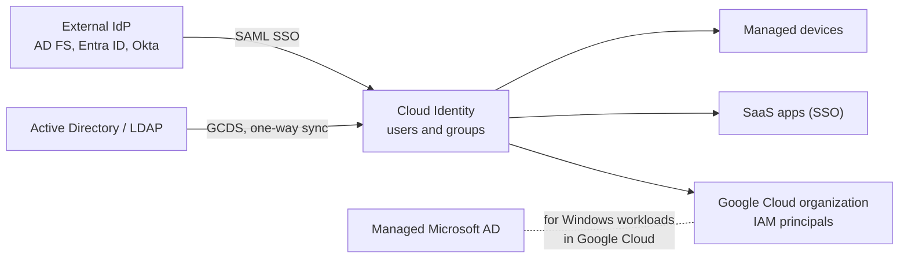

# Cloud Identity

## Summary

Cloud Identity is Google's identity as a service (IDaaS): a cloud directory of users and groups for a domain, with authentication (passwords, MFA, single sign-on), device management and application access. It is the identity source behind a Google Cloud organization when Google Workspace is not used. It comes in a Free and a Premium edition, is managed in the Admin console, and can be fed from Active Directory or LDAP with Google Cloud Directory Sync or federated with another identity provider.

## Prerequisites

- [Resource hierarchy](../../foundations/resource-hierarchy.md), because the organization node is tied to a Cloud Identity or Workspace account.
- Basics of SSO, SAML and OIDC.

## Core concepts

### Editions

- **Free edition.** Core identity and endpoint management for users who do not need Google Workspace apps: user provisioning, groups, basic security settings and MFA.
- **Premium edition.** Paid, adds enterprise features such as automated user provisioning to apps, application allow-listing, advanced mobile device management and security reporting.

TODO: Verify the current feature split between editions.

### Features

- **Cloud directory** of users and groups.
- **Authentication and authorization**: 2-Step Verification (MFA), security keys, SAML and OIDC single sign-on to third-party apps.
- **User lifecycle management**: provisioning and deprovisioning, synchronization from Active Directory or LDAP.
- **Endpoint management**: security policies for mobile and desktop devices, including personal devices (BYOD).
- **Multi-app support**: identities for SaaS apps, APIs and web platforms.

### Integration tools

- **Google Cloud Directory Sync (GCDS)** syncs users and groups from AD or LDAP. See [Google Cloud Directory Sync](google-cloud-directory-sync.md).
- **Managed Service for Microsoft Active Directory** runs real AD domain controllers for Windows workloads. See [Managed Microsoft AD](managed-microsoft-ad.md).
- **Identity Platform** is a different product: customer identity and access management (CIAM) for your own apps' end users (SaaS, mobile, gaming). It does not manage employees.

TODO: Write a note on Identity Platform.

### How it works

1. **Domain verification.** Prove ownership of `example.com` with a DNS record.
2. **User provisioning.** Manually, in bulk from CSV, through GCDS, or through an IdP with automatic provisioning.
3. **Central management** in the Admin console (`admin.google.com`): users, groups, security policies.
4. **Domains.** One account can manage a primary domain and secondary domains; the original notes record a limit of 600 domains.

TODO: Verify the current limit.

## Worked example

TODO: Document a sandbox setup: verify a domain, create a group `gcp-org-admins@example.com`, enforce 2-Step Verification for it, and grant it `roles/resourcemanager.organizationAdmin` on the new organization.

## Trade offs and when to use it

- **Advantages.** One console for users, groups and domains; integration with Google services and third-party apps; scale to large organizations; built-in MFA; device policy for corporate and personal devices; free edition for non-Workspace users.
- **Disadvantages.** Less customization than self-hosted identity systems; best value inside the Google ecosystem; initial setup (domain verification, sync, SSO) needs admin expertise.
- If an organization already uses Entra ID or Okta, federate with SAML and sync users, or use Workforce Identity Federation and skip Cloud Identity accounts for console access.

## Common mistakes

- **No MFA for admins.** Enforce 2-Step Verification, ideally security keys, for super admins and organization admins.
- **Using super admin accounts daily.** Keep two or three break-glass super admins, use separate daily accounts.
- **Granting IAM to users directly.** Use groups from the directory.
- **Manual provisioning at scale.** Automate with GCDS or IdP provisioning so leavers lose access quickly.

## Practice

1. What does Cloud Identity provide to a Google Cloud organization?
2. Which tool syncs Active Directory users into Cloud Identity?
3. What is the difference between Cloud Identity and Identity Platform?

Answers: 1. The directory of users and groups (and the organization's domain) used as IAM principals. 2. Google Cloud Directory Sync. 3. Cloud Identity manages workforce identities; Identity Platform manages end users of your own applications.

## Further reading

- [Cloud Identity overview](https://docs.cloud.google.com/identity/docs/overview), Google Cloud documentation. Features and editions.
- [Best practices for planning accounts and organizations](https://docs.cloud.google.com/architecture/identity/best-practices-for-planning), Google Cloud Architecture Center. Account and domain planning.
- [Reference architectures for identity](https://docs.cloud.google.com/architecture/identity/reference-architectures), Google Cloud Architecture Center. Federation patterns with AD and other IdPs.
