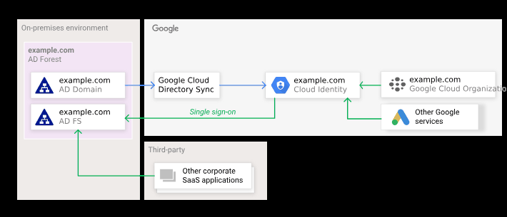
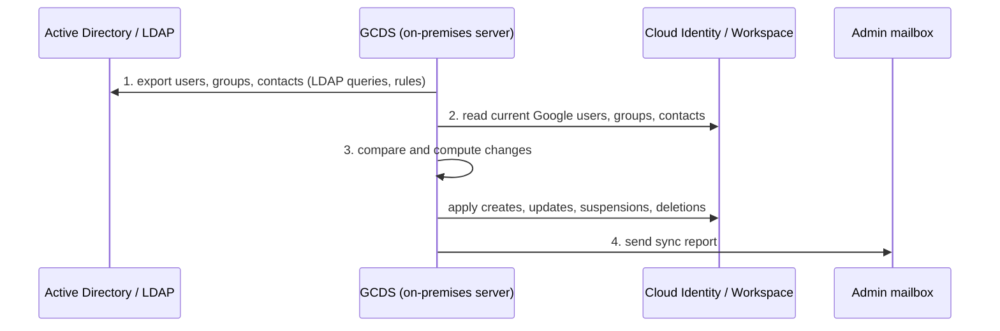

# Google Cloud Directory Sync

## Summary

Google Cloud Directory Sync (GCDS) is a free tool that copies users, groups and shared contacts from Microsoft Active Directory or an LDAP server into Cloud Identity or Google Workspace. The sync is one-way: the on-premises directory stays the source of truth and is never changed. GCDS runs on a server inside your network, compares both directories according to rules you define, applies the differences and emails a report. Combined with SAML single sign-on, it lets employees use their existing accounts in Google Cloud.

## Prerequisites

- [Cloud Identity](cloud-identity.md).
- Basic Active Directory or LDAP concepts: organizational units, groups, LDAP queries.

## Core concepts

### Architecture

### The four steps of a sync

### Features

- **One-way synchronization.** From the directory to Google. Changes made in Google are not written back.
- **Automated provisioning and deprovisioning.** Users added or removed in AD are added, suspended or deleted in Google, which closes access quickly when people leave.
- **Customizable rules.** LDAP search rules and exclusion rules decide which users, groups and attributes sync.
- **Reporting.** A report after each cycle lists the changes.
- **No inbound access.** GCDS runs locally and connects outbound to Google; the directory is not exposed.

Use cases: organizations with existing AD or LDAP, onboarding and offboarding automation, and hybrid IT where on-premises and cloud accounts must match.

### GCDS compared with Managed Microsoft AD

| Feature | GCDS | Managed Microsoft AD |
| --- | --- | --- |
| Purpose | Sync identities into Google accounts | Run actual AD domain controllers on Google Cloud |
| Data flow | One-way, AD or LDAP to Google | AD protocols (Kerberos, LDAP) for workloads, trusts with on-premises AD |
| Hosting | Your server | Managed service on Google Cloud |
| Maintenance | You maintain AD and the GCDS host | Google maintains the domain controllers |

## Worked example

TODO: Record a test configuration with Configuration Manager: an LDAP rule that syncs users from `OU=Employees,DC=example,DC=com`, a group rule for `OU=GCP-Groups`, a simulated sync with its report, and the scheduled task command line used for hourly syncs.

## Trade offs and when to use it

- **Advantages.** Central identity management, less manual work, fast deprovisioning, no external access to the directory, consistency between systems.
- **Disadvantages.** One-way only; setup needs directory expertise; errors in AD propagate to Google.
- **Alternatives.** If the IdP is Entra ID or Okta, their provisioning connectors can replace GCDS; Workforce Identity Federation avoids synced accounts entirely.

## Common mistakes

- **Running the first sync without simulation.** Always simulate and review the report; a bad rule can suspend many accounts.
- **Dirty source data.** Clean up AD attributes and duplicate emails before syncing.
- **No schedule.** Sync on a regular interval so changes arrive promptly; incremental syncs keep load low.
- **Unprotected GCDS host.** It holds credentials for both directories; harden it and restrict admin access.

## Practice

1. In which direction does GCDS sync, and what happens to a change made in Google?
2. Why does GCDS not need inbound firewall openings?
3. What should you do before the first production sync?

Answers: 1. From AD or LDAP to Google; the change is not written back, and may be overwritten on the next sync. 2. It runs inside your network and connects outbound to Google APIs. 3. Run a simulation and review the report, and back up both directories.

## Further reading

- [About Google Cloud Directory Sync](https://support.google.com/a/answer/106368), Google Workspace Admin Help. Features and requirements.
- [Federating Google Cloud with Active Directory](https://docs.cloud.google.com/architecture/identity/federating-gcp-with-active-directory-introduction), Google Cloud Architecture Center. GCDS together with SSO.
