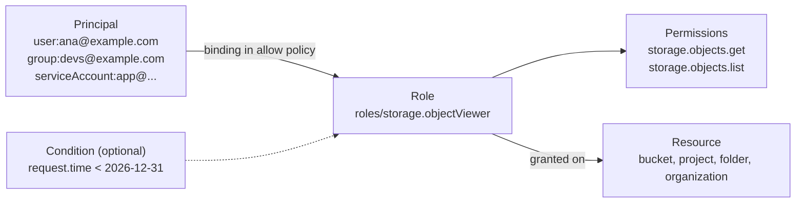
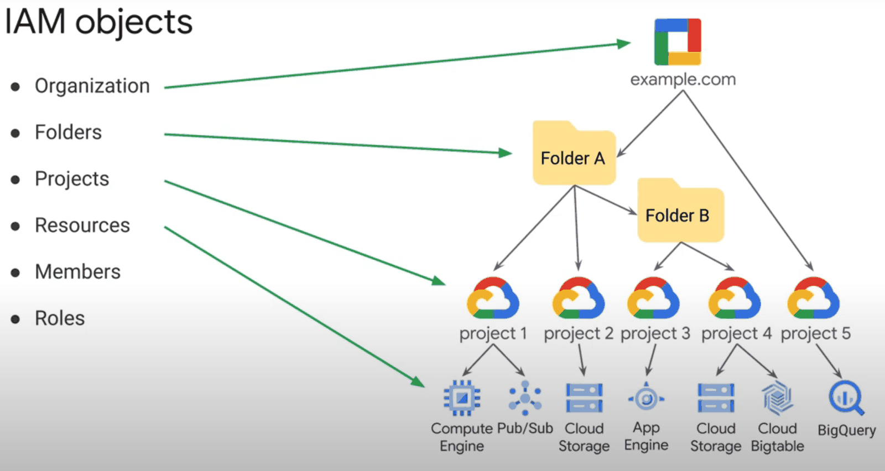
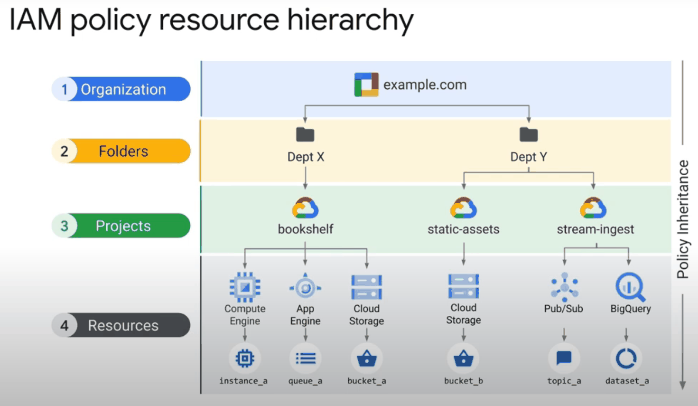
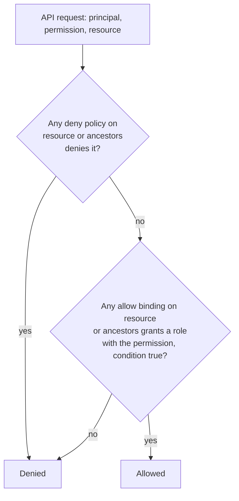
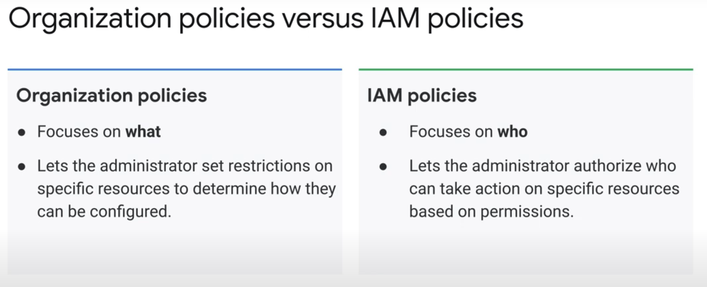

# Identity and Access Management

## Summary

Identity and Access Management (IAM) decides *who* can do *what* on *which* Google Cloud resource. A *principal* (user, group, service account, federated identity) is granted a *role* (a set of permissions) on a *resource* through an *allow policy*. Policies are inherited down the resource hierarchy, *deny policies* can block permissions regardless of grants, and *IAM Conditions* add context such as time or resource name. IAM is the central access control of Google Cloud and the first place to apply the principle of least privilege.

## Prerequisites

- [Resource hierarchy](../../foundations/resource-hierarchy.md).
- [Cloud Identity](cloud-identity.md) for where users and groups come from.

## Core concepts

### Use cases

- **Team collaboration.** Grant developers, operators and admins roles that match their responsibilities.
- **Service-to-service access.** Service accounts let applications call Google Cloud APIs securely.
- **Compliance and auditing.** Audit logs record who changed policies and who accessed resources.
- **Conditional access.** Restrict access by time, resource name or request attributes.

### The model



An allow policy is a list of *bindings*; each binding ties one role to a list of principals, optionally with a condition. Permissions are never granted directly, only through roles.



### How evaluation works

1. **Hierarchy.** Policies exist on the organization, folders, projects and many resources. A request is checked against the policy of the resource and all its ancestors.
2. **Inheritance.** Allow policies are additive. A role granted on a folder applies to every project below it; a lower level cannot take it away.
3. **Deny first.** Deny policies are evaluated before allow policies. A denied permission cannot be used, even if a role grants it.
4. **Conditions.** A conditional binding applies only when its expression is true.
5. **Organization policies** are a separate system: they restrict *what* configurations are allowed, not *who* can act.





### Role types

**Basic roles** (formerly primitive roles) are the coarse roles that existed before IAM:

- *Viewer*: read-only access to all resources in a project.
- *Editor*: Viewer plus changing most resources.
- *Owner*: Editor plus managing roles and permissions, and billing setup for the project.

They give very broad access and are not suitable for production. The original notes list "Billing Administrator" as a basic role; it is in fact a predefined role (`roles/billing.admin`) on billing accounts.

**Predefined roles** are fine-grained, service-specific roles curated and updated by Google, for example `roles/compute.networkAdmin`, `roles/iam.securityReviewer`, `roles/storage.admin`, `roles/compute.instanceAdmin.v1`. Google adds permissions for new features automatically. Example: `roles/browser` lets a user view the hierarchy (folders, organization, IAM policies) without access to resources inside projects.

**Custom roles** are user-defined sets of permissions for a job function no predefined role matches, for example a "Privacy Reviewer" that audits data across Cloud Storage, Bigtable and Spanner. They are created at the organization or project level, have a launch stage (`ALPHA`, `BETA`, `GA`, `DISABLED`), and must be updated manually when services add permissions. Some permissions cannot be used in custom roles. Commands are in the [gcloud CLI cheatsheet](../../foundations/gcloud-cli-cheatsheet.md#iam-custom-roles).

| Role type | Example | Scope | Use case |
| --- | --- | --- | --- |
| Basic | Owner | Project | Full project management |
| Basic | Viewer | Project | Read-only access to all resources |
| Predefined | Compute Network Admin | Compute Engine networking | Manage networks, not firewall rules or VMs |
| Predefined | Storage Admin | Cloud Storage | Manage buckets and objects |
| Predefined | Security Reviewer | Any resource | List all IAM policies |
| Custom | Privacy Reviewer | Storage, Bigtable, Spanner | Audit sensitive data across services |

### Deny policies

A deny policy contains deny rules: the *principals* denied, the *permissions* denied, optional *exception principals* and optional *conditions*. Deny policies are attached to the organization, folders or projects and are checked before allow policies. They are guardrails: for example, nobody except a break-glass group may delete projects or change org-level IAM, whatever roles they hold.

### IAM Conditions

Conditions are Common Expression Language (CEL) expressions on a binding:

- **Resource attributes**: resource name, type, service; for example only buckets whose names start with `logs-`.
- **Request attributes**: time and date, access levels, destination IP and port for IAP.

Typical uses: temporary access that expires, access during business hours, access to a subset of resources.

### Organization policies versus IAM



| | IAM policies | Organization policies |
| --- | --- | --- |
| Question | Who can act | What configurations are allowed |
| Example | Ana can create VMs in `shop-dev` | No VM anywhere may have an external IP |
| Types | Allow, deny | List constraints (allowed or denied values), boolean constraints (on or off) |
| Inheritance | Additive down the tree | Inherited, can be overridden or merged if allowed |

Combining deny policies, conditions and organization policies gives layered, fine-grained control.

### IAM compared with other identity services

| Feature | IAM | Cloud Identity | Managed Microsoft AD |
| --- | --- | --- | --- |
| Purpose | Control access to Google Cloud resources | Manage user identities and authentication | Run Active Directory for Windows workloads |
| Granularity | Roles on resources | Users, groups, devices, SSO | Domains, group policies |
| Integration | Google Cloud APIs | Google Workspace, SAML and OIDC apps | Microsoft AD and its tools |

## Worked example

Grant temporary, narrow access (untested):

```bash
# Ana can read objects only in buckets named logs-*, until the end of 2026
gcloud projects add-iam-policy-binding shop-prod \
  --member="user:ana@example.com" \
  --role="roles/storage.objectViewer" \
  --condition='expression=resource.name.startsWith("projects/_/buckets/logs-") && request.time < timestamp("2027-01-01T00:00:00Z"),title=logs-read-2026'

# Why can Ana not read gs://orders-prod? Ask the Policy Troubleshooter
gcloud policy-intelligence troubleshoot-policy iam \
  //storage.googleapis.com/projects/_/buckets/orders-prod \
  --principal-email=ana@example.com --permission=storage.objects.get
```

The troubleshooter shows which bindings were evaluated and that the condition did not match `orders-prod`.

## Trade offs and when to use it

- **Advantages.** Fine-grained control, predefined roles for common cases, least privilege, scale to thousands of users and resources, and full audit logging of policy changes.
- **Disadvantages.** Inheritance and many role types take time to learn; large organizations need governance to avoid sprawl; misconfiguration can grant too much or block work.
- **Predefined or custom.** Prefer predefined roles; create custom roles only when no predefined role is narrow enough, and review them as services evolve.

## Common mistakes

- **Basic roles in production.** Editor and Owner are far broader than needed.
- **Granting to individuals.** Grant to groups, so joiners and leavers are handled in the directory.
- **Granting high in the tree.** A grant on the organization reaches every project.
- **Never reviewing.** Use IAM Recommender (role recommendations based on usage) and Policy Analyzer regularly.
- **No alerts on policy changes.** Alert on `SetIamPolicy` in audit logs.

## Practice

1. A user has `roles/viewer` on the organization and a deny policy denies `compute.instances.list` on a folder. Can the user list VMs in a project in that folder?
2. Why must custom roles be maintained, while predefined roles need not?
3. What is the difference between an IAM policy and an organization policy?
4. Write a condition that limits a binding to resources whose name starts with `projects/_/buckets/tmp-`.

Answers: 1. No, deny is evaluated first. 2. Google adds new permissions to predefined roles; custom roles only change when you edit them. 3. IAM controls who can act; organization policy controls which configurations are allowed. 4. `resource.name.startsWith("projects/_/buckets/tmp-")`.

## Further reading

- [IAM overview](https://docs.cloud.google.com/iam/docs/overview), Google Cloud documentation. Principals, roles, policies and evaluation.
- [Roles and permissions](https://docs.cloud.google.com/iam/docs/roles-overview), Google Cloud documentation. Basic, predefined and custom roles.
- [Deny policies](https://docs.cloud.google.com/iam/docs/deny-overview), Google Cloud documentation. Structure and evaluation order.
- [IAM Conditions overview](https://docs.cloud.google.com/iam/docs/conditions-overview), Google Cloud documentation. Attributes and CEL syntax.
- [Use IAM securely](https://docs.cloud.google.com/iam/docs/using-iam-securely), Google Cloud documentation. Best practices.
