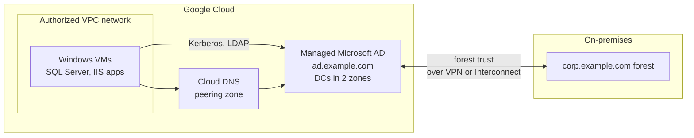

# Managed Microsoft AD

## Summary

Managed Service for Microsoft Active Directory (Managed Microsoft AD) runs real Microsoft Active Directory domain controllers on Google Cloud as a managed, highly available service. Google patches the servers, manages their firewall rules and keeps them available across zones and regions; you manage users, groups and Group Policy with the usual Microsoft tools. It serves Windows workloads and AD-dependent applications in Google Cloud, either as a standalone domain or connected to an on-premises forest through a trust.

## Prerequisites

- [Cloud Identity](cloud-identity.md) and [Google Cloud Directory Sync](google-cloud-directory-sync.md), to tell the products apart.
- Active Directory basics: domains, forests, trusts, Group Policy, DNS.

## Core concepts

### Features

- **Full compatibility.** Actual AD domain controllers, so AD-dependent apps work unchanged. Familiar tools such as Group Policy and Remote Server Administration Tools (RSAT) are supported.
- **Managed service.** Google handles patching, firewall rules for the domain controllers and high availability.
- **Deployment options.**
  - *Standalone domain*: a cloud-only domain, independent of on-premises.
  - *Connected domain*: a trust relationship with an on-premises AD forest.
- **High availability and recovery.** Hardened servers, domain controllers in multiple zones, more regions on demand, and snapshots (backups) for disaster recovery.
- **Cloud integration.** Domain discovery through Cloud DNS (DNS peering), low-latency access from VPC networks.

### Architecture

The VMs join `ad.example.com`; a trust lets on-premises users sign in to cloud workloads without duplicating accounts.

### Compared with GCDS

GCDS syncs identities *into* Google accounts for Google Cloud and Workspace access. Managed Microsoft AD provides AD *protocols* to workloads. Many organizations use both: GCDS for console identities, Managed Microsoft AD for Windows servers.

## Worked example

TODO: Create a domain in a sandbox (`gcloud active-directory domains create ad.example.com --reserved-ip-range=10.0.0.0/24 --region=europe-west1 --authorized-networks=projects/PROJECT_ID/global/networks/prod-vpc`), join a Windows VM, and record the time to provision and the delegated admin account details.

## Trade offs and when to use it

- **Use cases.** Hybrid environments, enterprise apps that need AD authentication, disaster recovery for AD, and low-latency domain access for cloud workloads.
- **Advantages.** Less administration (patching, firewall, HA), real AD compatibility, built-in snapshots, region scaling, Cloud DNS integration.
- **Disadvantages.** Higher cost than self-managed domain controllers on VMs; limited customization (no Domain Admin or Enterprise Admin rights, no schema changes beyond what is allowed); tighter coupling to Google Cloud.

## Common mistakes

- **Picking a reserved range that overlaps.** The `/24` for domain controllers must not overlap with VPC or on-premises ranges.
- **Skipping the trust planning.** Decide standalone versus connected early; adding a trust later needs network and DNS changes.
- **No snapshot schedule.** Schedule and test restores.

## Practice

1. Which Microsoft AD rights are not available to customers in Managed Microsoft AD?
2. When would you choose a connected domain over a standalone domain?
3. Does Managed Microsoft AD replace GCDS?

Answers: 1. Domain Admin and Enterprise Admin; a delegated admin account is provided instead. 2. When on-premises users must access cloud workloads with their existing AD accounts. 3. No; GCDS syncs identities into Google accounts, Managed Microsoft AD serves AD protocols to workloads.

## Further reading

- [Managed Service for Microsoft Active Directory overview](https://docs.cloud.google.com/managed-microsoft-ad/docs/overview), Google Cloud documentation. Features and limits.
