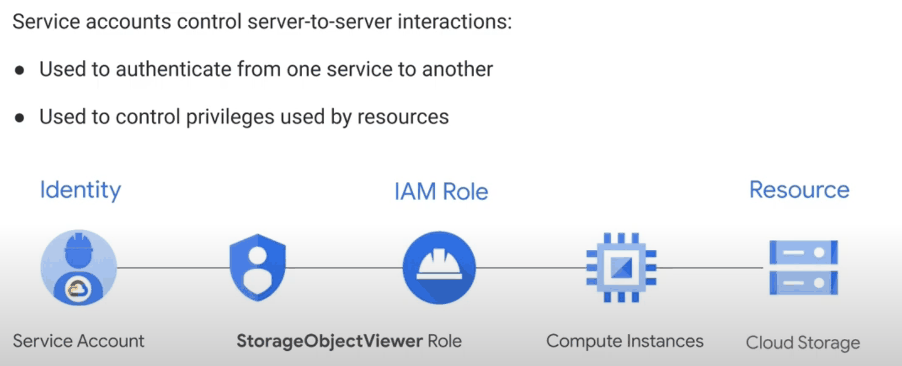
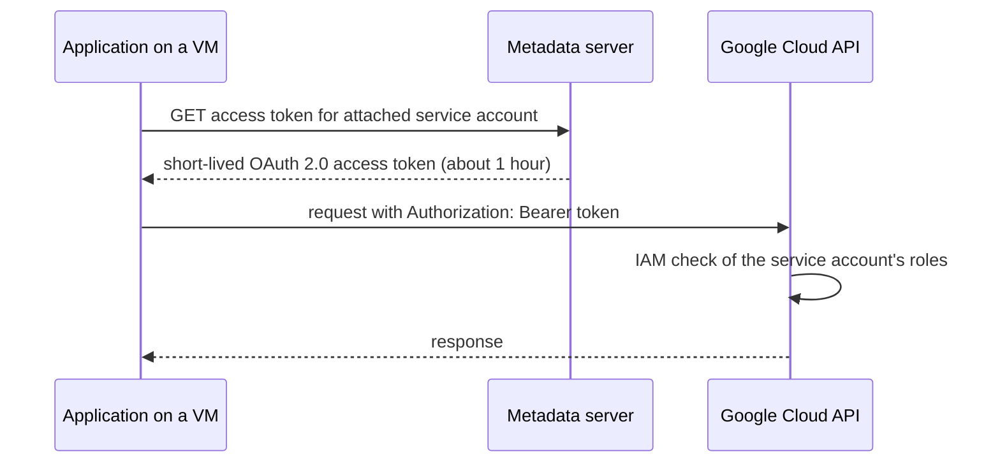

# Service accounts

## Summary

A service account is an identity for a workload, not a person. Applications running on Compute Engine, Cloud Run, GKE or elsewhere authenticate as a service account and receive the permissions granted to it through IAM. Service accounts are identified by an email address in the `gserviceaccount.com` domain and authenticate with key pairs instead of passwords. Google manages the keys of attached service accounts automatically; user-managed (downloaded) keys are long-lived secrets and should be avoided.

## Prerequisites

- [IAM](iam.md).

## Core concepts

### Purpose

- Authenticate an application or service to Google Cloud APIs.
- Control what an application can do, through the roles granted to its service account.



Example: an application on a VM must read files from a bucket. Create a service account, grant it `roles/storage.objectViewer` on the bucket, and attach it to the VM. The application reads the bucket without any stored credential.

### Two faces of a service account

A service account is both an *identity* (it can be granted roles on resources) and a *resource* (other principals can be granted roles on it, for example `roles/iam.serviceAccountUser` to attach it to a VM, or `roles/iam.serviceAccountTokenCreator` to impersonate it). Controlling who can act as a service account is as important as controlling what the service account can do.

### Types

| Type | Who creates it | Example | Notes |
| --- | --- | --- | --- |
| User-managed | You | `app@PROJECT_ID.iam.gserviceaccount.com` | Fully controlled: create, disable, delete, grant roles. A default quota of 100 per project. |
| Default service accounts | Google, when some APIs are enabled | `PROJECT_NUMBER-compute@developer.gserviceaccount.com` | User-managed but created automatically; historically granted Editor |
| Service agents (Google-managed) | Google | `service-PROJECT_NUMBER@gcp-sa-pubsub.iam.gserviceaccount.com` | Let Google services act on your resources; not in the service accounts list but visible in IAM |

The **Google APIs service agent** `PROJECT_NUMBER@cloudservices.gserviceaccount.com` runs internal Google processes for the project (for example managed instance groups). It is granted the Editor role by default, is deleted only with the project, and its role must not be removed or changed.

TODO: Verify whether the default user-managed service account quota is still 100 per project.

### Authentication



- Service accounts use RSA key pairs. A private key signs a JWT, which is exchanged for an access token.
- **Google-managed keys.** Google stores both halves and rotates them; they are used for attached service accounts, impersonation and signing. The original notes record that public keys are valid for signing for up to two weeks.
- **User-managed keys.** Google stores only the public key; you hold the private key (a JSON key file). Up to 10 keys per service account. The private key is as sensitive as a password; Google cannot recover it, and it does not expire unless you set an expiry.

TODO: Verify the rotation period.

Preferred alternatives to keys, in order: attached service accounts on Google Cloud, Workload Identity Federation for GKE, Workload Identity Federation for workloads outside Google Cloud, and impersonation for humans. See [authentication to Google Cloud APIs](authentication-to-google-cloud-apis.md).

## Worked example

A least privilege identity for a Cloud Run service (untested):

```bash
gcloud iam service-accounts create orders-api --display-name="orders-api runtime"

# What the service may do
gcloud storage buckets add-iam-policy-binding gs://orders-exports \
  --member="serviceAccount:orders-api@PROJECT_ID.iam.gserviceaccount.com" \
  --role="roles/storage.objectCreator"

# Who may deploy services that run as it
gcloud iam service-accounts add-iam-policy-binding \
  orders-api@PROJECT_ID.iam.gserviceaccount.com \
  --member="group:orders-deployers@example.com" \
  --role="roles/iam.serviceAccountUser"

# Audit: list user-managed keys (expected: none)
gcloud iam service-accounts keys list \
  --iam-account=orders-api@PROJECT_ID.iam.gserviceaccount.com --managed-by=user
```

## Trade offs and when to use it

- One service account per workload gives clear audit trails and small blast radius, at the cost of more identities to manage (automate with Terraform).
- Keys are sometimes unavoidable for third-party tools without federation support. Then: rotate, store in a secrets manager, never commit, set expiry, and monitor key usage.
- The organization policy `iam.disableServiceAccountKeyCreation` blocks key creation; new organizations have it enforced by default.

TODO: Verify the secure-by-default organization policies list.

## Common mistakes

- **Using the default Compute Engine service account.** It may have Editor. Create dedicated accounts and remove Editor from the default.
- **Sharing one service account across services.** Any compromise exposes all of them.
- **Keys in code, images or Git.** Leaked keys are a leading cause of cloud incidents.
- **Forgetting `serviceAccountUser`.** Anyone who can attach a highly privileged service account to a VM can use its permissions.

## Practice

1. What two kinds of IAM bindings involve a service account?
2. Where does an application on Compute Engine get its access token from?
3. Why are user-managed keys risky?

Answers: 1. Roles granted to the service account on resources, and roles granted to others on the service account (for example serviceAccountUser). 2. The metadata server. 3. They are long-lived, can leak, and the private key is managed by the user.

## Further reading

- [Service accounts overview](https://docs.cloud.google.com/iam/docs/service-account-overview), Google Cloud documentation. Types, keys and use.
- [Best practices for using service accounts securely](https://docs.cloud.google.com/iam/docs/best-practices-service-accounts), Google Cloud documentation. Least privilege and key avoidance.
- [Service agents](https://docs.cloud.google.com/iam/docs/service-agents), Google Cloud documentation. Google-managed service accounts.
