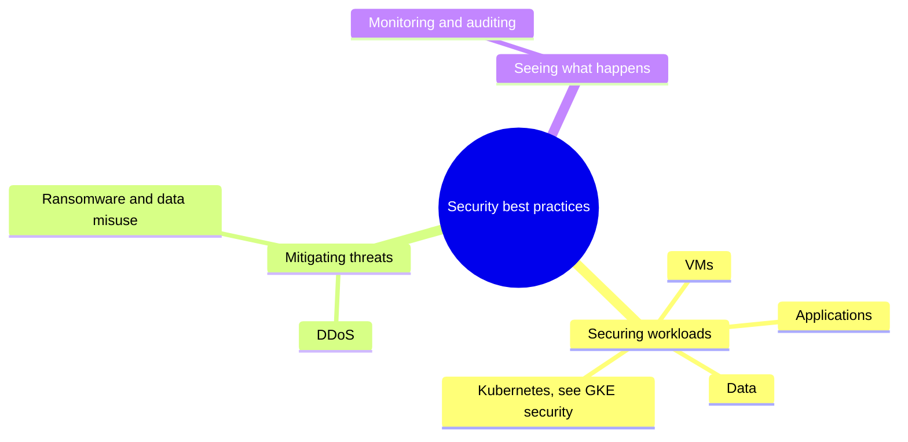

# Security best practices

How to secure the main kinds of workloads and how to mitigate common threats on Google Cloud. GKE hardening lives with GKE, in [GKE security](../../containers-and-kubernetes/gke-security/README.md).

## Map of the subarea

## Notes in reading order

1. [Securing VMs](securing-vms.md): IAP and OS Login access, Shielded and Confidential VMs, trusted images, patching.
2. [Securing data](securing-data.md): access control, envelope encryption and key options, audit logs and lifecycle.
3. [Securing applications](securing-applications.md): OWASP risks, IAP, Secret Manager, Web Security Scanner and DevSecOps.
4. [DDoS mitigation](ddos-mitigation.md): load balancers, Cloud Armor, Cloud CDN, API throttling and attack surface.
5. [Content security: ransomware and data misuse](content-security.md): backups, Sensitive Data Protection and content moderation APIs.
6. [Security monitoring and auditing](security-monitoring-and-auditing.md): Cloud Audit Logs, SCC, central logging and automation.

## Planned topics

- Cloud KMS and key rotation
- Secret Manager in depth
- Supply chain security (SLSA, Artifact Analysis, Binary Authorization)
- Incident response on Google Cloud
- Security foundations blueprint walkthrough
