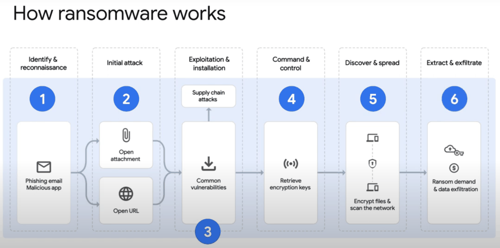
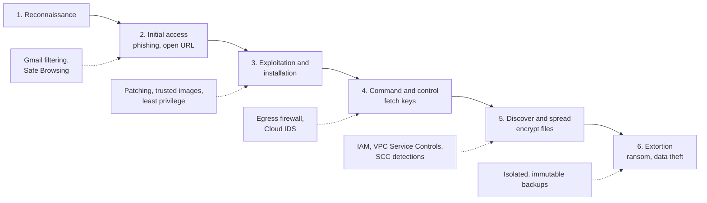

# Content security: ransomware and data misuse

## Summary

Content-related threats are threats to the data itself: ransomware that encrypts or steals data for extortion, misuse of data that leads to privacy violations, and exposure of sensitive or inappropriate content. The defenses combine isolated backups and least privilege (against ransomware), classification and redaction of sensitive data with Sensitive Data Protection (against misuse), and automatic scanning of user content with the Vision, Video Intelligence and Natural Language APIs (against inappropriate content).

## Prerequisites

- [Securing data](securing-data.md).
- [IAM](../identity-and-access/iam.md).

## Core concepts

### Ransomware

Ransomware is malicious software that blocks access to data until a ransom is paid, often in cryptocurrency, and increasingly also threatens to publish stolen data (double extortion). The main technique is *cryptoviral extortion*: data is encrypted with a key only the attacker holds. Entry points are phishing emails with malicious links or attachments, and exploitation of software vulnerabilities in the organization or its supply chain. Impact: loss of access to critical data, ransom and recovery costs, legal and reputational damage.





The dotted arrows show where each control breaks the chain. No single control stops ransomware; the aim is to break it at as many stages as possible, and to be able to restore without paying.

### Mitigating ransomware

- **Google's built-in protections.** Google labels malware sites globally, Safe Browsing warns users about dangerous links, Gmail filters malicious attachments and links, and Google Drive scans files for malware before sharing or download.
- **Backups.** Frequent backups stored in isolated locations: a separate project with separate admins, Cloud Storage with object versioning, retention policies and bucket lock, or the Backup and DR service with immutable vaults. Test restores.
- **IAM practices.** Restrict and audit admin access, disable unneeded administrator accounts, control access to temporary and data folders.
- **Sensitive Data Protection** (formerly Cloud DLP API) scans and redacts sensitive data in documents and images before it is exposed.
- **People and patching.** Train employees on phishing and social engineering; patch software vulnerabilities promptly.

### Data misuse

Data misuse is inappropriate use of data that leads to privacy violations, regulatory breaches or unintended use. Examples: showing full credit card numbers instead of the last four digits, sensitive data in public screenshots or documents, and faulty permissions that expose restricted data.

Mitigations:

- **Content classification** with the Cloud Natural Language API to detect and categorize sensitive content and align controls with the value of the data.
- **Scanning and redaction:**
  - Sensitive Data Protection finds and masks PII in text, files and images.
  - The Vision API detects adult and violent content in images (SafeSearch).
  - The Video Intelligence API flags explicit content in videos.
- **Exposure prevention.** Scan files and data entering the system; moderate user-submitted content.

### Tools summary

| Tool | Use |
| --- | --- |
| Sensitive Data Protection | Detect, classify and de-identify PII and other sensitive data in many file types |
| Vision API | Flag inappropriate content in images |
| Video Intelligence API | Flag explicit content in videos |
| Cloud Natural Language API | Classify text and identify sensitive categories |

## Worked example

Redact email addresses and card numbers in a support ticket before storing it (untested request to the DLP API):

```bash
curl -s -X POST \
  -H "Authorization: Bearer $(gcloud auth print-access-token)" \
  -H "Content-Type: application/json" \
  "https://dlp.googleapis.com/v2/projects/PROJECT_ID/content:deidentify" \
  -d '{
    "item": {"value": "Customer jan@example.com paid with 4111 1111 1111 1111"},
    "inspectConfig": {"infoTypes": [{"name": "EMAIL_ADDRESS"}, {"name": "CREDIT_CARD_NUMBER"}]},
    "deidentifyConfig": {"infoTypeTransformations": {"transformations": [
      {"primitiveTransformation": {"replaceWithInfoTypeConfig": {}}}]}}
  }'
```

Expected output value: `Customer [EMAIL_ADDRESS] paid with [CREDIT_CARD_NUMBER]`. The test card number is a public test value.

## Trade offs and when to use it

- Immutable backups (bucket lock) cannot be deleted early even by admins; plan retention carefully.
- Automated content moderation has false positives and negatives; keep a human review path for borderline cases.
- Scanning large volumes with Sensitive Data Protection is billed per GB; sample or scope scans.

## Common mistakes

- **Backups in the same project with the same admins.** Ransomware operators delete them first.
- **Never testing restores.** A backup that cannot be restored is not a backup.
- **Showing full sensitive values in UIs and logs.** Mask by default.

## Practice

1. Why should backups live in a separate project with separate administrators?
2. Which service redacts PII from a text before it is stored?
3. At which ransomware stage do egress firewall rules help, and how?

Answers: 1. So that an attacker with access to production cannot delete or encrypt them. 2. Sensitive Data Protection (DLP API). 3. Command and control: they block the malware from reaching its servers to fetch keys or exfiltrate data.

## Further reading

- [Sensitive Data Protection overview](https://docs.cloud.google.com/sensitive-data-protection/docs/sensitive-data-protection-overview), Google Cloud documentation. Inspection and de-identification.
- [Mitigating ransomware attacks](https://docs.cloud.google.com/architecture/security/mitigating-ransomware-attacks), Google Cloud Architecture Center. Google's guidance across the kill chain.
- [SafeSearch detection](https://docs.cloud.google.com/vision/docs/detecting-safe-search), Google Cloud documentation. Vision API content moderation.
