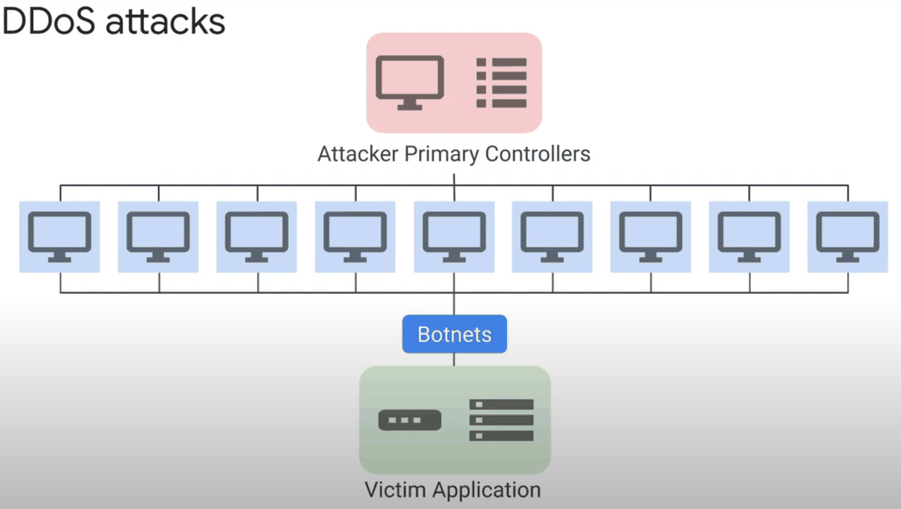
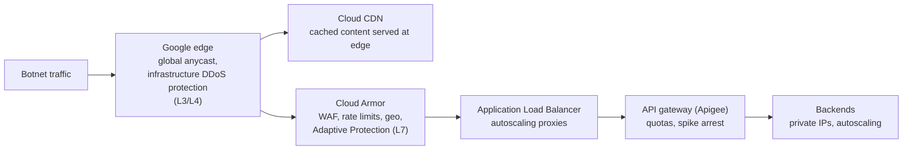
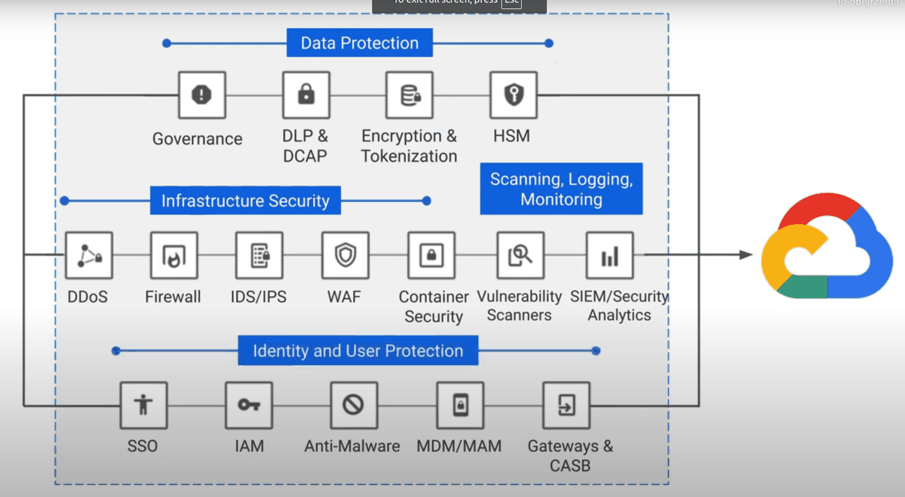

# DDoS mitigation

## Summary

A distributed denial-of-service (DDoS) attack tries to make a service unavailable by flooding it with traffic from many sources, usually a botnet of compromised devices. On Google Cloud, the defense is layered: global load balancers absorb and filter volumetric layer 3 and 4 attacks at Google's edge, Cloud Armor filters layer 7 attacks with WAF rules, rate limiting and machine-learning based Adaptive Protection, Cloud CDN serves cached content from the edge, API gateways throttle clients, and a small attack surface leaves attackers few targets.

## Prerequisites

- [Application Load Balancers](../../networking/load-balancing/application-load-balancers.md).
- [VPC firewall](../../networking/vpc/vpc-firewall.md).

## Core concepts

### How DDoS attacks work



- **Mechanism.** Attackers infect machines with malware to build a botnet, sometimes of millions of devices, then direct floods at a target.
- **Types.** Volumetric and protocol floods at layers 3 and 4 (TCP SYN floods, UDP floods, amplification), and application layer attacks at layer 7 (HTTP floods, Slowloris that holds connections open).
- **Scale.** Attacks grow in size and frequency. In 2022 Google reported mitigating an HTTPS attack that peaked at 46 million requests per second with Cloud Armor; in 2023 Google reported a larger one of 398 million requests per second using the HTTP/2 Rapid Reset technique (CVE-2023-44487).
- **Impact.** Unavailable services, reputational damage, financial loss.

### Defense in layers



Each layer removes a class of traffic: the edge absorbs floods, Cloud Armor drops malicious requests, the CDN answers what it can, the API layer throttles per client, and backends never face the internet directly.

### Mitigation techniques

1. **Google Cloud load balancers.** Layer 4 protection against SYN and UDP floods; layer 7 protection against HTTP attacks including Slowloris on proxy load balancers; automatic scaling to absorb traffic; Google's global mitigation drops or throttles attack traffic at the edge.
2. **Reduce the attack surface.** Private IPs for VMs, IAP or bastion hosts for admin access, separate subnets per tier (web, services, database), firewall rules that block unused ports and restrict sources, tags and service accounts for precise targeting.
3. **Cloud CDN.** Caches content across Google's edge locations, absorbs traffic at the edge and reduces backend load. Best for static and semi-dynamic content.
4. **API management.** Apigee or API Gateway in front of backends: per-client throttling, central access control and monitoring prevent API-level overload.
5. **Cloud Armor.** Edge enforcement close to the source; allow and deny rules by IP and geography; preconfigured WAF rules for SQL injection, XSS and other OWASP risks; rate-based rules and bans; Adaptive Protection, which learns normal traffic and suggests rules for layer 7 attacks; bot management with reCAPTCHA Enterprise. Cloud Armor Enterprise adds DDoS response support and advanced network protection.
6. **Secure networking.** VPN or Interconnect for hybrid links, private GKE clusters.

### Complementary solutions

Third-party or partner tools for data protection (encryption, DLP, HSM), infrastructure protection (WAF, IDS and IPS, endpoint and container security), monitoring and policy alerting, and vulnerability management.



## Worked example

A Cloud Armor policy for an API behind a global external Application Load Balancer (untested):

```bash
gcloud compute security-policies create api-armor

# OWASP SQL injection and XSS rules
gcloud compute security-policies rules create 1000 --security-policy=api-armor \
  --expression="evaluatePreconfiguredWaf('sqli-v33-stable') || evaluatePreconfiguredWaf('xss-v33-stable')" \
  --action=deny-403

# Rate limit: more than 100 requests per minute per client IP gets 429, ban for 5 minutes
gcloud compute security-policies rules create 2000 --security-policy=api-armor \
  --src-ip-ranges="*" --action=rate-based-ban \
  --rate-limit-threshold-count=100 --rate-limit-threshold-interval-sec=60 \
  --ban-duration-sec=300 --conform-action=allow --exceed-action=deny-429 \
  --enforce-on-key=IP

gcloud compute security-policies update api-armor --enable-layer7-ddos-defense
gcloud compute backend-services update api-bs --global --security-policy=api-armor
```

TODO: Verify the current preconfigured rule names (`sqli-v33-stable`, `xss-v33-stable`) and run the policy in preview mode first.

## Trade offs and when to use it

- WAF rules can block legitimate requests (false positives). Start rules in preview mode and tune sensitivity levels.
- Rate limits keyed on IP hurt users behind shared NAT; consider keys such as headers or cookies.
- Passthrough Network Load Balancers do not get layer 7 filtering; use advanced network DDoS protection where needed.

## Common mistakes

- **Backends with public IPs.** Attackers bypass the load balancer and Cloud Armor.
- **No rate limits on expensive endpoints** such as login or search.
- **Never testing.** Run authorized load tests and attack simulations to validate defenses; Google's acceptable use policy requires following its rules for such tests.
- **Single layer of defense.** Combine edge, WAF, CDN, API and architecture controls.

## Practice

1. Which Google Cloud component absorbs a UDP flood aimed at a global load balancer?
2. Which Cloud Armor feature uses machine learning to detect layer 7 attacks?
3. Why do backends with external IPs weaken DDoS protection?

Answers: 1. Google's edge infrastructure DDoS protection in front of the global load balancer. 2. Adaptive Protection. 3. Attackers can send traffic directly to them, bypassing the load balancer and Cloud Armor.

## Further reading

- [Cloud Armor overview](https://docs.cloud.google.com/armor/docs/cloud-armor-overview), Google Cloud documentation. Policies, WAF rules and Adaptive Protection.
- [Best practices for DDoS protection and mitigation](https://cloud.google.com/files/GCPDDoSprotection-04122016.pdf), Google Cloud whitepaper. Layered approach (older but still relevant).
- [Google mitigated the largest DDoS attack to date, peaking above 398 million rps](https://cloud.google.com/blog/products/identity-security/google-cloud-mitigated-largest-ddos-attack-peaking-above-398-million-rps), Google Cloud blog, 2023. The HTTP/2 Rapid Reset attack.
- [CVE-2023-44487](https://nvd.nist.gov/vuln/detail/CVE-2023-44487), NIST NVD. HTTP/2 Rapid Reset.
