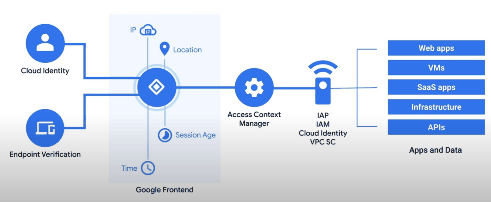
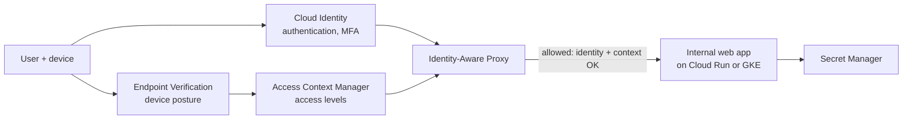

# Securing applications

## Summary

Application security on Google Cloud combines secure coding against common vulnerabilities (injection, cross-site scripting, broken authentication), Google Cloud services that remove whole classes of risk (Secret Manager for credentials, Identity-Aware Proxy for access, Web Security Scanner for testing, Cloud Armor for filtering), and processes around them: DevSecOps, threat modeling, monitoring, incident response and backups. The zero trust BeyondCorp model replaces network location with user and device context as the basis for access.

## Prerequisites

- [Security overview](../security-overview.md).
- Web application basics and the OWASP Top 10.

## Core concepts

### Common vulnerabilities and fixes

| Vulnerability | Fix |
| --- | --- |
| Injection (SQL, LDAP, HTML) | Validate input, use parameterized queries, escape special characters |
| Cross-site scripting (XSS) | Sanitize input, encode output, Content Security Policy (CSP) |
| Broken authentication and access control | OAuth 2.0 or SAML, MFA, context-aware access, secure session tokens, HTTPS only |
| Sensitive data exposure | Encrypt at rest and in transit; secrets in Secret Manager |
| Security misconfiguration | Review configuration, disable unused features and services |
| Vulnerable third-party components | Keep libraries current, scan dependencies and images |

### Google Cloud tools

- **Web Security Scanner** crawls App Engine, Compute Engine and GKE apps and reports XSS, mixed content, outdated libraries and similar issues. Schedule regular scans. It is part of Security Command Center.
- **Identity-Aware Proxy (IAP)** replaces VPN access to internal web apps with central authentication and authorization, using context-aware access (identity, device posture).
- **Secret Manager** stores API keys, passwords and certificates with IAM access control, versions, rotation schedules and audit logs.
- **Cloud Armor** filters attacks at the load balancer. See [DDoS mitigation](ddos-mitigation.md).





The figure and the diagram show the BeyondCorp model: access is decided per request from identity and device context, not from network location.

### Phishing and identity threats

- **OAuth phishing.** Attackers trick users into granting a malicious app access. Educate users, limit OAuth scopes, and control which third-party apps may access Workspace data.
- **General phishing.** Train users, verify links, and authenticate mail domains with SPF, DKIM and DMARC.

### Secure development lifecycle

- **DevSecOps.** Security in every stage of the pipeline: static and dynamic application security testing (SAST, DAST), dependency and image scanning (Artifact Analysis), signed and verified images (Binary Authorization).
- **Secure coding.** Follow the OWASP Top 10 and secure coding guidelines; audit code regularly.
- **Threat modeling.** Identify threats during design and assess risks of components and their interactions.

### Monitoring, incident response and recovery

- Log critical application events; use Cloud Logging and Cloud Monitoring for visibility and alerts.
- Maintain an incident response plan and rehearse it with tabletop exercises.
- Back up application data and configuration, test restores, and design for disaster recovery with geographically distributed storage and failover.
- Patch dependencies, OS images and libraries automatically; scan environments periodically.

### Data loss prevention

Chrome Enterprise Premium (formerly BeyondCorp Enterprise) adds data loss prevention controls in the browser, such as blocking copy and paste or downloads of sensitive data. Sensitive Data Protection finds and redacts sensitive data in storage and streams.

## Worked example

Read a database password from Secret Manager in a Cloud Run service instead of an environment variable in the image (untested):

```bash
printf 's3cr3t-value' | gcloud secrets create orders-db-password --data-file=- \
  --replication-policy=user-managed --locations=europe-west1

gcloud secrets add-iam-policy-binding orders-db-password \
  --member="serviceAccount:orders-api@PROJECT_ID.iam.gserviceaccount.com" \
  --role="roles/secretmanager.secretAccessor"

gcloud run deploy orders-api --image=IMAGE --region=europe-west1 \
  --service-account=orders-api@PROJECT_ID.iam.gserviceaccount.com \
  --set-secrets=DB_PASSWORD=orders-db-password:latest
```

The secret value never appears in the image, the repository or the service configuration; access is logged; rotation is a new secret version.

## Trade offs and when to use it

- IAP gives strong access control for internal apps without VPN, but only for HTTP(S) and TCP forwarding, and requires users in an IdP Google trusts.
- Pinning secret versions (instead of `latest`) gives reproducible deployments but needs a redeploy on rotation.

## Common mistakes

- **Secrets in environment variables baked into images or in Git.**
- **Internal tools exposed publicly** with only an app-level login.
- **Scanning once.** Vulnerability scanning must run continuously, because new CVEs appear for old code.

## Practice

1. Which service replaces a VPN for internal web apps?
2. Name two controls against XSS.
3. Where should an API key used by a Cloud Run service be stored?

Answers: 1. Identity-Aware Proxy. 2. Output encoding and Content Security Policy (and input sanitization). 3. Secret Manager, accessed by the service's service account.

## Further reading

- [OWASP Top 10](https://owasp.org/www-project-top-ten/), OWASP Foundation. The reference list of web application risks.
- [Identity-Aware Proxy overview](https://docs.cloud.google.com/iap/docs/concepts-overview), Google Cloud documentation. How IAP authorizes requests.
- [Secret Manager overview](https://docs.cloud.google.com/secret-manager/docs/overview), Google Cloud documentation. Secrets, versions and rotation.
- [BeyondCorp: A New Approach to Enterprise Security](https://research.google/pubs/beyondcorp-a-new-approach-to-enterprise-security/), Ward and Beyer, Google, 2014. The original zero trust paper.
