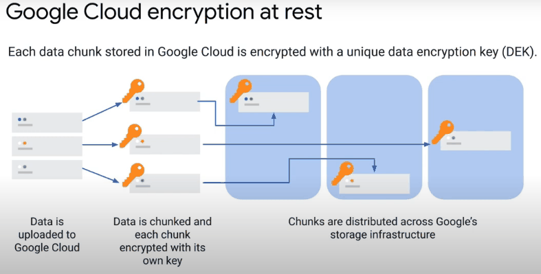
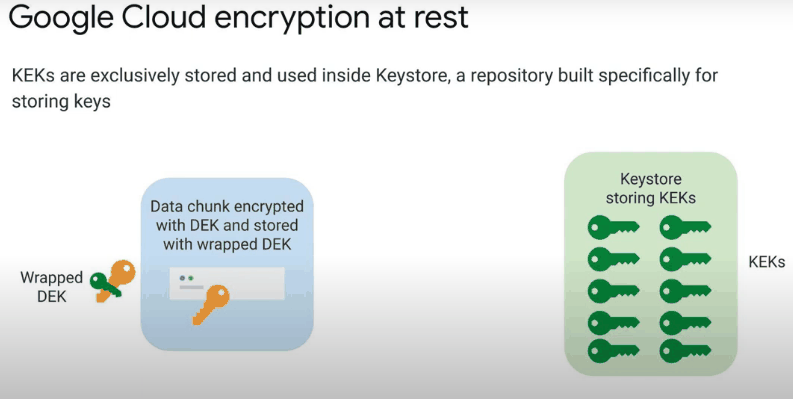
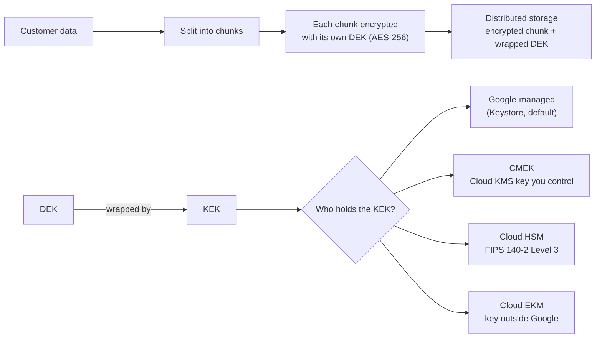

# Securing data

## Summary

Data in Google Cloud is encrypted at rest and in transit by default, but encryption alone does not secure it. Protecting data means controlling access (IAM, uniform bucket-level access, authorized views, signed URLs), choosing who holds the keys (Google-managed, CMEK, CSEK, Cloud HSM, Cloud EKM), monitoring access (Data Access audit logs), managing the lifecycle (retention, expiration, deletion) and organizing data so sensitive sets are separated. This note explains Google's envelope encryption and maps the controls to the main storage services.

## Prerequisites

- [IAM](../identity-and-access/iam.md).
- [Cloud Storage](../../storage-and-databases/cloud-storage.md) and [BigQuery](../../data-analytics/bigquery.md).

## Core concepts

### Access control

- **IAM** at organization, folder, project, bucket or dataset level, following least privilege.
- **ACLs** in Cloud Storage give object-level control, but uniform bucket-level access (IAM only) is recommended.
- **Public access.** Avoid it unless hosting public content; if needed, read-only. The organization policy `storage.publicAccessPrevention` blocks it.
- **Signed URLs and signed policy documents.** Time-limited access to an object without a Google account, and controlled uploads with constraints on type, size and expiry.
- **BigQuery.** Roles per job function (`roles/bigquery.dataViewer`, `roles/bigquery.admin`), authorized views, row-level access policies and column-level security with policy tags.
- **Deny policies** to block access to specific resources regardless of grants.

### Encryption at rest: envelope encryption







Each chunk of data gets a unique data encryption key (DEK). DEKs are encrypted ("wrapped") by key encryption keys (KEKs). By default KEKs live in Google's internal Keystore. With customer-managed encryption keys (CMEK), the KEK is a Cloud KMS key you control: you can rotate it, restrict who uses it, and disable it, which makes the data unreadable.

| Option | Who manages the key | When |
| --- | --- | --- |
| Google default encryption | Google | Default for everything |
| CMEK (Cloud KMS) | You, in Cloud KMS | Control over rotation, access and revocation; audit of key use |
| Cloud HSM | You, in FIPS 140-2 Level 3 hardware | Regulations that require HSM-protected keys |
| Cloud EKM | You, in an external key manager | Keys must never be stored at Google |
| CSEK | You supply the raw key with each request | Cloud Storage and Compute Engine only; you must never lose the key |

### Encryption in transit and in use

- **In transit.** TLS between clients and Google, and encryption between Google data centers.
- **In use.** Confidential VMs and Confidential GKE nodes encrypt memory during processing.

### Auditing and monitoring

- **Cloud Audit Logs.** Admin Activity logs are always on; enable Data Access logs for sensitive services to record reads and writes. Store logs in a dedicated project and bucket; analyze them in BigQuery.
- **VPC Flow Logs** for forensic network analysis.
- **Security Command Center** for posture: public buckets, missing CMEK, overly broad access.

### Lifecycle management

- **Cloud Storage lifecycle rules** move objects to colder classes or delete them by age.
- **BigQuery table expiration** at dataset level controls retention and cost.
- **Retention.** Purge data that is no longer needed; less data means less to protect. Use retention policies and bucket lock where regulations require immutability.

### Naming and organization

- No personally identifiable information (PII) in bucket or object names; bucket names are globally visible.
- Use GUIDs or domain-style names with a consistent convention.
- Separate sensitive and non-sensitive data into different buckets, datasets or projects.

### Advanced controls

- Private Google Access for VMs without public IPs.
- VPC Service Controls around sensitive projects.
- Trusted image policies for VMs that process data.
- Cloud HSM and Cloud EKM for compliance; Keystore and Cloud KMS audit trails for tamper-evident key use records.
- Backups and tested recovery plans for critical datasets.

## Worked example

Protect a bucket of exports with CMEK and short-lived sharing (untested):

```bash
gcloud kms keyrings create data --location=europe-west1
gcloud kms keys create exports --keyring=data --location=europe-west1 \
  --purpose=encryption --rotation-period=90d --next-rotation-time=2027-01-01T00:00:00Z

gcloud storage buckets create gs://example-exports-7f3a --location=europe-west1 \
  --uniform-bucket-level-access --public-access-prevention \
  --default-encryption-key=projects/PROJECT_ID/locations/europe-west1/keyRings/data/cryptoKeys/exports

# Share one file for 1 hour without granting IAM
gcloud storage sign-url gs://example-exports-7f3a/report.csv --duration=1h \
  --impersonate-service-account=signer@PROJECT_ID.iam.gserviceaccount.com
```

The Cloud Storage service agent needs `roles/cloudkms.cryptoKeyEncrypterDecrypter` on the key. Disabling the key version makes every object in the bucket unreadable until it is re-enabled.

## Trade offs and when to use it

- CMEK adds key management work and a dependency: a deleted or disabled key means unreadable data.
- CSEK puts all key custody on you and is supported by few services.
- Data Access logs can be large and costly; enable them where the data is sensitive.

## Common mistakes

- **Public buckets by accident.** Enforce public access prevention.
- **Mixing sensitive and public data in one bucket.**
- **Deleting a CMEK key** before re-encrypting or deleting data that uses it.
- **No Data Access logs on sensitive data.** Reads are then invisible.

## Practice

1. What is the difference between a DEK and a KEK?
2. Which option keeps encryption keys outside Google entirely?
3. How do you give an external partner one-hour access to one object without a Google account?

Answers: 1. A DEK encrypts a data chunk; a KEK encrypts (wraps) DEKs. 2. Cloud External Key Manager (EKM). 3. A signed URL with a one-hour expiry.

## Further reading

- [Default encryption at rest](https://docs.cloud.google.com/docs/security/encryption/default-encryption), Google Cloud. Chunking, DEKs, KEKs and Keystore.
- [Customer-managed encryption keys](https://docs.cloud.google.com/kms/docs/cmek), Google Cloud documentation. CMEK across services.
- [Cloud External Key Manager](https://docs.cloud.google.com/kms/docs/ekm), Google Cloud documentation. Keys outside Google.
- [Best practices for Cloud Storage security](https://docs.cloud.google.com/storage/docs/best-practices#security), Google Cloud documentation. Access and naming advice.
