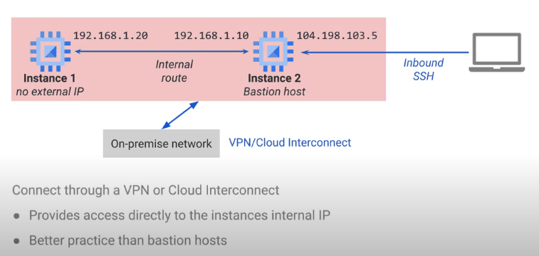
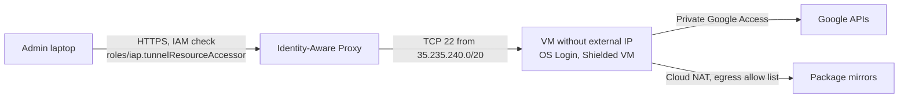
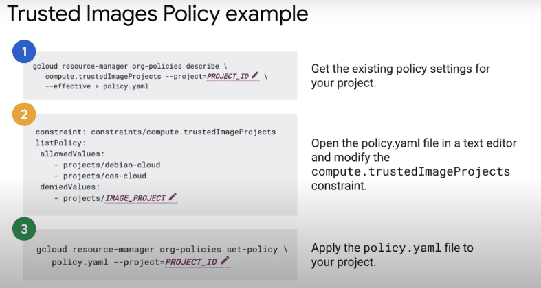

# Securing VMs

## Summary

Securing Compute Engine VMs means controlling how people reach them, hardening what runs on them, limiting what they can reach, and keeping them patched and observed. In practice: no external IPs, SSH through Identity-Aware Proxy with OS Login, Shielded VMs from trusted images, a dedicated least privilege service account, restrictive firewall rules, and immutable instances that are replaced rather than patched in place.

## Prerequisites

- [VPC firewall](../../networking/vpc/vpc-firewall.md), [Private Google Access](../../networking/vpc/private-google-access.md).
- [Service accounts](../identity-and-access/service-accounts.md).

## Core concepts

### Secure access

- **Linux.** SSH keys only, no password authentication.
- **Windows.** RDP with strong, randomly generated passwords, changed after first login.
- **Built-in access.** The console SSH button or `gcloud compute ssh`.
- **No external IP.** Use IAP TCP forwarding, or a hardened bastion host as a last resort.
- **Restrict SSH and RDP.** Firewall rules allow TCP 22 and 3389 only from trusted ranges (the IAP range `35.235.240.0/20`, corporate ranges).
- **OS Login.** Manage SSH access with IAM roles (`roles/compute.osLogin`, `roles/compute.osAdminLogin`) instead of individual keys in metadata. Supports central identity, 2-step verification and automatic revocation when users leave.





The admin never needs a VPN or bastion: IAP checks identity and context, and the firewall only accepts the IAP range.

### Harden instances

- **Shielded VM.** Secure Boot, virtual Trusted Platform Module (vTPM) and integrity monitoring protect against boot-level and kernel-level malware; integrity monitoring alerts when boot components change.
- **Confidential VM.** Encrypts memory in use with AMD SEV (and other technologies on newer machine types), for highly sensitive workloads.
- **Trusted images.** The organization policy `constraints/compute.trustedImageProjects` limits which image projects VMs can boot from. Build hardened images, patch them, and replace instances.
- **Least privilege identity.** Run with a dedicated service account with minimal roles; do not use the default Compute Engine service account.



### Secure networking

- Private Google Access for subnets with internal-only VMs.
- No external IPs unless needed; Cloud VPN or Interconnect for hybrid access.
- Ingress and egress firewall rules that allow only required traffic; harden bastion hosts if used.

### Operational security

- **Patch by replacing.** Build new images regularly and roll managed instance groups to them, rather than patching long-lived servers. VM Manager can patch where replacement is not possible.
- **Audit and monitor.** Cloud Audit Logs for who changed what, VPC Flow Logs for traffic, the Ops Agent for OS logs and metrics.
- **Updates.** Subscribe to the `gce-image-notifications` group for public image announcements.
- **IAM.** Only authorized users can manage or access VMs.

### Additional tools

- Certificate Authority Service for managed private CAs.
- Endpoint Verification to enforce device conditions for admin access.

## Worked example

Create a hardened VM (untested):

```bash
gcloud compute instances create app-1 --zone=europe-west1-b \
  --machine-type=e2-standard-2 --subnet=web-euw1 --no-address \
  --image-family=debian-12 --image-project=debian-cloud \
  --shielded-secure-boot --shielded-vtpm --shielded-integrity-monitoring \
  --service-account=app-1@PROJECT_ID.iam.gserviceaccount.com --scopes=cloud-platform \
  --metadata=enable-oslogin=TRUE

gcloud compute ssh app-1 --zone=europe-west1-b --tunnel-through-iap
```

`--no-address` removes the external IP; access works only through IAP for users with the right IAM roles, and the scope `cloud-platform` defers access control fully to IAM roles on the service account.

## Trade offs and when to use it

- Immutable instances need an image pipeline, but remove configuration drift and make rollbacks easy.
- Confidential VMs have some performance overhead and machine type limits.
- Bastion hosts are a single point of compromise; prefer IAP.

## Common mistakes

- **SSH open to `0.0.0.0/0`.** Allow only IAP or known ranges.
- **Project-wide SSH keys in metadata.** Use OS Login.
- **Default service account with Editor.** Create a dedicated account.
- **Patching snowflake servers forever.** Rebuild from images.

## Practice

1. How can an admin SSH into a VM without an external IP and without a bastion host?
2. Which organization policy limits the images VMs can boot from?
3. What do Secure Boot, vTPM and integrity monitoring protect against?

Answers: 1. IAP TCP forwarding (`gcloud compute ssh --tunnel-through-iap`), with a firewall rule for `35.235.240.0/20`. 2. `constraints/compute.trustedImageProjects`. 3. Boot-level and kernel-level malware such as rootkits and bootkits.

## Further reading

- [Shielded VM](https://docs.cloud.google.com/compute/shielded-vm/docs/shielded-vm), Google Cloud documentation. Secure Boot, vTPM and integrity monitoring.
- [OS Login](https://docs.cloud.google.com/compute/docs/oslogin), Google Cloud documentation. IAM-based SSH access.
