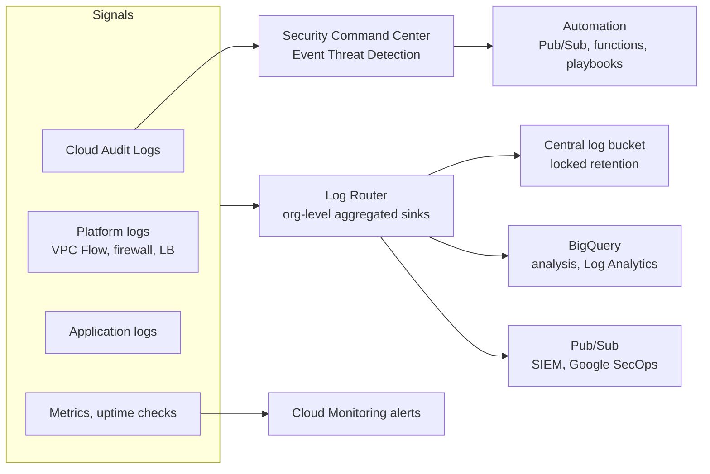

# Security monitoring and auditing

## Summary

Prevention always fails eventually, so security also depends on seeing what happens. On Google Cloud that means Cloud Audit Logs for "who did what, where and when", Cloud Logging and Cloud Monitoring for events, metrics and alerts, Security Command Center for findings, and automation that turns signals into fast responses. Logs must be retained long enough, centralized, protected from tampering and analyzed, usually in BigQuery or a SIEM.

## Prerequisites

- [Cloud Logging](../../operations/cloud-logging.md).
- [Security Command Center](../threat-detection-and-posture/security-command-center.md).

## Core concepts

### The detection pipeline



### Cloud Audit Logs

| Log type | Records | Default | Cost |
| --- | --- | --- | --- |
| Admin Activity | Configuration and metadata changes (create VM, change IAM) | Always on, cannot be disabled | Free |
| System Event | Google system actions on resources (live migration) | Always on | Free |
| Data Access | Reads of configuration or data, and writes of user data | Off, except BigQuery | Billed by volume |
| Policy Denied | Access denied by a security policy (VPC Service Controls) | On | Billed, can be excluded |

Admin Activity and System Event logs are kept 400 days in the `_Required` bucket; other logs 30 days by default in the `_Default` bucket (configurable). Export to Cloud Storage, BigQuery or Pub/Sub for longer retention and analysis. Use `roles/logging.privateLogViewer` to control who can read Data Access logs.

### Security Command Center in monitoring

- **Central dashboard** of assets, vulnerabilities and threats; historical scans show changes.
- **Threat detection.** Event Threat Detection reads Cloud Logging and Google Workspace logs for botnets, cryptomining, suspicious network traffic and anomalous IAM grants.
- **Vulnerability management.** Security Health Analytics for misconfigurations; third-party scanners can report into SCC.
- **Compliance and posture.** Assessments against standards and attack path simulation.
- **Real-time alerts** through Pub/Sub.

### Monitoring and logging tools

- **Cloud Monitoring.** Metrics, events and metadata across Google Cloud and other environments; dashboards, alerting policies, uptime checks, Metrics Explorer.
- **Cloud Logging.** Collects logs from Google Cloud services, VMs, GKE, other clouds and on-premises; log-based metrics; Log Analytics with SQL; export to BigQuery.
- **Cloud Trace, Cloud Profiler and Error Reporting** help find anomalies in application behavior. See [operations suite overview](../../operations/operations-suite-overview.md).

### Security automation

Automation brings consistency (fewer human errors), speed (faster response) and scale. Built-in examples: SCC scans continuously, Web Security Scanner crawls applications, Binary Authorization and Artifact Registry make sure only approved images run on Kubernetes. Best practices: descriptive playbooks with peer review, testing in controlled environments, and monitoring the automation itself.

### Ecosystem

Partner integrations (for example Cloudflare, Tenable, Trellix) send findings into SCC. Combining Cloud Logging data with BigQuery enables long-term analysis and proactive hunting.

## Worked example

Centralize audit logs of the whole organization in a security project (untested):

```bash
gcloud logging buckets create org-audit --location=europe-west1 \
  --retention-days=730 --project=sec-logging

gcloud logging sinks create org-audit-sink \
  logging.googleapis.com/projects/sec-logging/locations/europe-west1/buckets/org-audit \
  --organization=ORG_ID --include-children \
  --log-filter='logName:"cloudaudit.googleapis.com"'
```

Then grant the sink's writer identity `roles/logging.bucketWriter` on the bucket, and lock the bucket retention so that nobody, including admins, can shorten it. An alert on `protoPayload.methodName="SetIamPolicy"` for the organization resource notifies the security team of every org-level IAM change.

## Trade offs and when to use it

- Data Access logs give the most forensic value and cost the most. Enable them for sensitive services and projects.
- A central log project simplifies investigations and separation of duties, but every team then needs read access to its own logs through views or linked datasets.

## Common mistakes

- **Relying on the 30 day default.** Many investigations start months after the intrusion.
- **Logs in the same project as the workload, writable by the same admins.**
- **Alert fatigue.** Alert on high-signal events (IAM changes at org level, key creation, firewall opened to the internet) rather than everything.

## Practice

1. Which audit log type is disabled by default and why?
2. How long are Admin Activity logs kept by default?
3. Which IAM role controls access to Data Access logs?

Answers: 1. Data Access logs, because they can be very large and are billed. 2. 400 days. 3. `roles/logging.privateLogViewer`.

## Further reading

- [Cloud Audit Logs overview](https://docs.cloud.google.com/logging/docs/audit), Google Cloud documentation. Log types and retention.
- [Aggregated sinks](https://docs.cloud.google.com/logging/docs/export/aggregated_sinks), Google Cloud documentation. Organization-level export.
- [Security log analytics](https://docs.cloud.google.com/architecture/security-log-analytics), Google Cloud Architecture Center. Detection queries over logs.
