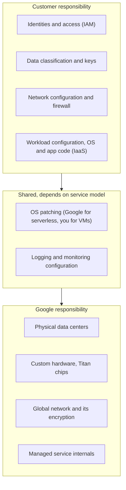

# Google Cloud security overview

## Summary

Security in Google Cloud is a *shared responsibility*: Google secures the physical infrastructure, hardware, network and the managed parts of each service, and the customer secures identities, access, data, configuration and workloads. Google Cloud's controls are layered (infrastructure, identity, data, applications, detection and response, governance, users and endpoints), and a secure design uses several independent layers so that the failure of one does not lead to a breach. This note maps the layers to the products that implement them and links to the detailed notes.

## Prerequisites

- [Resource hierarchy](../foundations/resource-hierarchy.md).
- The idea of defense in depth: several independent security controls, so that one failure does not lead to a full compromise.

## Core concepts

### Shared responsibility

The higher a service sits (serverless, SaaS), the more moves to Google. On Compute Engine the customer patches the OS; on Cloud Run Google does.

### The layers

**Infrastructure security (Google).** Data centers with layered physical controls (surveillance, biometric access, strict need-to-access), custom server and network hardware running hardened software, Titan security chips that verify boot integrity against firmware attacks, and a private global fiber network with encryption, DDoS protection and intrusion detection.

**Identity and access management.** IAM roles for users, groups and service accounts following least privilege; Identity-Aware Proxy for application and VM access without VPN; service accounts and OAuth 2.0 tokens for workloads; multi-factor authentication (MFA), which Google Cloud now requires for user accounts. See [identity and access](identity-and-access/README.md).

**Data security.** Encryption at rest by default (AES-256), encryption in transit with TLS and Google's own protocols, customer-managed keys in Cloud KMS, external keys (Cloud EKM) and Confidential Computing that encrypts data in use inside trusted execution environments. See [securing data](security-best-practices/securing-data.md).

**Application security.** Cloud Armor (WAF and DDoS), Apigee API security (OAuth, rate limiting, IP allow lists), vulnerability scanning of images (Artifact Analysis) and web apps (Web Security Scanner), and reCAPTCHA Enterprise for bot detection. See [securing applications](security-best-practices/securing-applications.md).

**Threat detection and incident response.** Security Command Center, Cloud Logging and Monitoring with Cloud Audit Logs, Google Threat Intelligence (including Mandiant), and Google Security Operations (formerly Chronicle), a SIEM and SOAR platform for large-scale analysis. See [threat detection and posture](threat-detection-and-posture/README.md).

**Compliance and data governance.** Certifications and attestations such as ISO/IEC 27001, SOC 2, GDPR support, HIPAA and FedRAMP; the resource hierarchy for policy inheritance; Sensitive Data Protection (formerly Cloud DLP) to find and de-identify PII.

**User protection and endpoints.** The Advanced Protection Program for high-risk accounts, endpoint management to require encryption and screen locks, and the BeyondCorp zero trust model (now Chrome Enterprise Premium) that checks identity and device context on every request.

**Continuous improvement.** Machine learning based detection, Google's Vulnerability Reward Program, and security blueprints and best practice guides.

### Product map

| Product | Purpose | Notes for DevOps and architects |
| --- | --- | --- |
| IAM | Access control (RBAC) | Least privilege, audit roles, predefined roles first |
| Cloud Identity | User and device directory | MFA, SSO, endpoint management |
| Workforce and Workload Identity Federation | Federated identity for people and workloads | Google Cloud access without service account keys |
| Security Command Center | Central posture and threat dashboard | Misconfiguration and threat detection |
| Cloud KMS and Cloud HSM | Key management and encryption | CMEK, rotation, FIPS 140-2 Level 3 HSM keys |
| Secret Manager | API keys, passwords, certificates | IAM access, versions, rotation |
| Cloud Audit Logs | Who did what, where and when | Export for compliance and investigations |
| VPC Service Controls | Data perimeter | Exfiltration protection for regulated data |
| Cloud Armor | WAF and DDoS protection | Rate limiting, geo-blocking |
| Identity-Aware Proxy | Context-aware access to apps and VMs | Access without VPN |
| Organization Policy | Organization-wide constraints | Hygiene, compliance, guardrails |
| Access Transparency | Logs of Google personnel access | Trust and regulatory evidence |

Notes on individual products that are not written yet (Cloud KMS, Secret Manager, Workload Identity Federation, Organization Policy, Access Transparency) are listed as planned in the area README.

## Worked example

A healthcare API on Cloud Run, mapped to the layers:

| Layer | Control |
| --- | --- |
| Edge | Global external Application Load Balancer, Cloud Armor OWASP rules and rate limits |
| Identity | IAP for the admin UI; one service account per service with narrow roles; Workforce Identity Federation for staff |
| Network | No external IPs on backends; Private Service Connect to the database |
| Data | Cloud SQL with CMEK in Cloud KMS; Sensitive Data Protection scans exports |
| Perimeter | VPC Service Controls around the data projects |
| Detection | Security Command Center Premium; audit logs exported to a central project |
| Governance | Organization policies: no external IPs, resource locations limited to the EU |

If an attacker steals a developer's credentials, IAM limits what they can do, the perimeter blocks copying data out, and audit logs plus SCC detect the anomaly.

## Trade offs and when to use it

- Each layer adds cost and operational work. Prioritize by risk: identity and data controls first, then detection, then advanced perimeters.
- Premium tiers (SCC Premium or Enterprise, Cloud Armor Enterprise) add detections and support at a significant price.

## Common mistakes

- **Assuming the cloud provider secures everything.** Misconfiguration is the customer's responsibility and the most common cause of cloud incidents.
- **Five controls that share one failure point.** Layers must be independent; a single admin account that can disable all of them is one control.
- **No detection layer.** Prevention fails eventually; logs and alerts are needed to notice.

## Practice

1. On Compute Engine, who patches the guest OS? On Cloud Run?
2. Which product would stop a user with valid IAM permissions from copying a dataset to a personal project?
3. Name one control in each of the identity, data and detection layers.

Answers: 1. The customer; Google. 2. VPC Service Controls. 3. For example IAM or IAP; Cloud KMS CMEK; Security Command Center or Cloud Audit Logs.

## Further reading

- [Google infrastructure security design overview](https://docs.cloud.google.com/docs/security/infrastructure/design), Google Cloud. How Google secures hardware, boot, network and services.
- [Shared responsibilities and shared fate](https://docs.cloud.google.com/architecture/framework/security/shared-responsibility-shared-fate), Google Cloud Architecture Framework. The responsibility model.
- [Google Cloud security foundations guide](https://docs.cloud.google.com/architecture/security-foundations), Google Cloud Architecture Center. A reference secure baseline.
