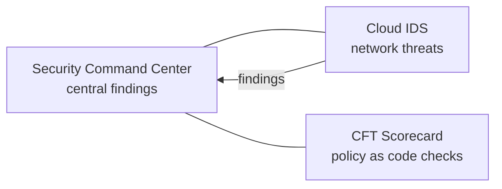

# Threat detection and posture

Services that find misconfigurations, vulnerabilities and active threats, and tools that check configuration against benchmarks.

## Map of the subarea

Security Command Center is the hub. Cloud IDS sends its findings into it; CFT Scorecard is an independent, self-run check of the same resources.

## Notes in reading order

1. [Security Command Center](security-command-center.md): assets, findings, sources, tiers and automated response.
2. [Cloud IDS](cloud-ids.md): managed intrusion detection with Packet Mirroring.
3. [CFT Scorecard](cft-scorecard.md): Rego policy checks over Cloud Asset Inventory exports.

## Planned topics

- Google Security Operations (SIEM and SOAR)
- Web Security Scanner
- Sensitive Data Protection
- Cloud Asset Inventory for security
- Assured Workloads and data residency controls
