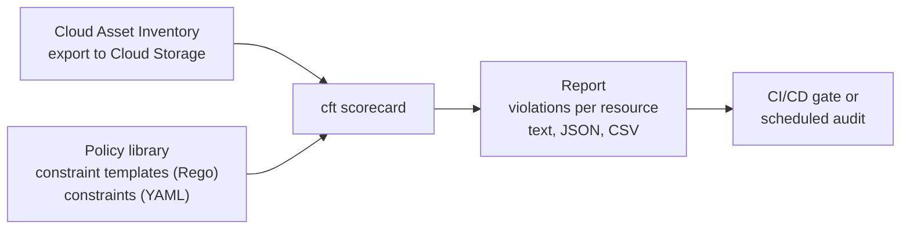

# CFT Scorecard

## Summary

CFT Scorecard is a command line tool from Google's Cloud Foundation Toolkit (CFT) that checks the configuration of Google Cloud resources against a library of policies, for example the CIS Google Cloud Foundations Benchmark. It reads an export of Cloud Asset Inventory, evaluates every asset against policies written in Rego (the language of Open Policy Agent), and reports violations. Because it is a CLI, it can run in CI/CD pipelines or on a schedule as a lightweight, code-based posture check.

## Prerequisites

- [Resource hierarchy](../../foundations/resource-hierarchy.md).
- [Policy Controller](../../containers-and-kubernetes/fleet-management/policy-controller.md) for an introduction to Rego and constraint templates.

## Core concepts

### Features

- **Policy evaluation** against predefined compliance and security policies (CIS, security best practices) and custom policies in Rego.
- **Centralized insights.** A report of compliant and non-compliant resources with reasons.
- **Extensibility.** Custom constraint templates and constraints for organization-specific rules.
- **Automation.** Reports in machine-readable formats for audits and pipelines.

### How it works



CFT Scorecard uses the same policy library format as Config Validator and `gcloud beta terraform vet`, so one library can check both deployed resources (Scorecard) and planned changes (Terraform validation).

The original notes describe installation with `git clone` and `npm install` and a `cft-scorecard run --project ... --policy-dir ...` command. That does not match the current tool, which is part of the Go-based `cft` CLI. The commands below follow the CFT repository documentation and were not run.

TODO: Verify flags against the current `cft scorecard --help`.

### Example policy

A Rego rule that flags buckets without a customer-managed encryption key (illustrative; the real library uses constraint templates with a `violation` rule):

```rego
package templates.gcp.GCPStorageCMEKEncryptionConstraintV1

violation[{"msg": message, "details": metadata}] {
  asset := input.asset
  asset.asset_type == "storage.googleapis.com/Bucket"
  not asset.resource.data.encryption.defaultKmsKeyName
  message := sprintf("%v has no default CMEK key.", [asset.name])
  metadata := {"resource": asset.name}
}
```

## Worked example

Scenario: a company must show that its project meets the CIS Benchmark.

```bash
# Policy library with CIS samples
git clone https://github.com/GoogleCloudPlatform/policy-library.git
cp policy-library/samples/*.yaml policy-library/policies/constraints/

# Export assets and score them (untested)
cft scorecard --policy-path=./policy-library --project=example-project \
  --bucket=example-cai-exports --output-format=json --output-path=./reports
```

Review the report, fix flagged resources and rerun. In CI, a step fails the pipeline when the report contains high-severity violations.

## Trade offs and when to use it

- **Benefits.** Configuration checks as code, audit-ready reports, custom policies, easy CI/CD integration, no additional paid service.
- **Limits.** Point-in-time checks, not continuous monitoring; you maintain the policy library. For continuous, managed posture management use Security Health Analytics in [Security Command Center](security-command-center.md) and its compliance reports.

## Common mistakes

- **Running against the wrong asset export.** Exports are snapshots; refresh before scoring.
- **Enabling every sample constraint.** Start with a small set that matches your standards, then grow.
- **Not testing custom Rego.** Write unit tests for templates before using them as gates.

## Practice

1. What input does CFT Scorecard evaluate?
2. Which language are the policy templates written in?
3. How does CFT Scorecard differ from Security Health Analytics?

Answers: 1. A Cloud Asset Inventory export of the resources. 2. Rego. 3. Scorecard is a self-run, point-in-time CLI with your own policy library; SHA is a managed, continuous detector in SCC.

## Further reading

- [Cloud Foundation Toolkit](https://github.com/GoogleCloudPlatform/cloud-foundation-toolkit), Google Cloud on GitHub. The `cft` CLI including Scorecard.
- [Policy library](https://github.com/GoogleCloudPlatform/policy-library), Google Cloud on GitHub. Constraint templates and CIS samples.
- [Cloud Asset Inventory overview](https://docs.cloud.google.com/asset-inventory/docs/overview), Google Cloud documentation. Asset exports.
