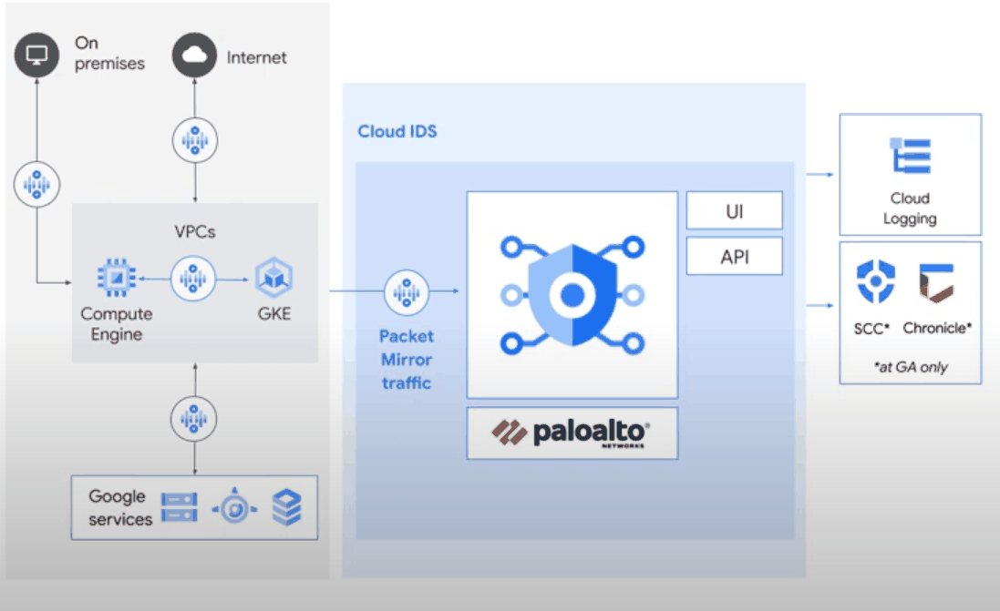
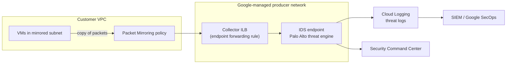

# Cloud IDS

## Summary

Cloud IDS (Cloud Intrusion Detection System) is a managed network threat detection service. Traffic from your VPC is copied with Packet Mirroring to an *IDS endpoint*, where Palo Alto Networks threat detection inspects it for intrusions, malware, spyware, command-and-control traffic and lateral movement. It inspects both north-south and east-west traffic, updates its signatures automatically, and reports threats to Cloud Logging and Security Command Center. It detects; it does not block.

## Prerequisites

- [VPC networks](../../networking/vpc/vpc-networks.md) and [private services access](../../networking/vpc/vpc-networks.md#advanced-features).
- [Security Command Center](security-command-center.md).

## Core concepts

### How it works



- **Google-managed peered network.** IDS endpoints run in a Google-managed producer network connected to your VPC through private services access.
- **Packet Mirroring.** A mirroring policy copies traffic of selected subnets, instances or tags and sends it to the endpoint's internal load balancer (the collector).
- **IDS endpoints.** Zonal resources that inspect mirrored traffic from their region. Each endpoint has a minimum alert severity.
- **Detection.** Palo Alto Networks signatures identify threats; alerts appear in the Cloud IDS console, in Cloud Logging and in SCC.



### Features

- **Threat detection** of intrusions, malware, spyware, command-and-control and lateral movement, for north-south (external) and east-west (VM to VM) traffic.
- **Palo Alto Networks technology** for detection quality.
- **Automatic signature updates.**
- **Compliance support**, for example PCI DSS requirement 11 on intrusion detection.

### Configuration steps

1. Enable the Service Networking and Cloud IDS APIs and set up private services access.
2. Create an IDS endpoint in the zone and network to inspect.
3. Attach a Packet Mirroring policy that sends selected traffic to the endpoint.
4. Review threats and logs, and route alerts to the incident process.

## Worked example

The lab commands are in the [gcloud CLI cheatsheet](../../foundations/gcloud-cli-cheatsheet.md#cloud-ids-and-packet-mirroring). Test traffic: from a VM in the mirrored subnet, request a known test signature, for example:

```bash
# Benign test: fetch a URL that matches a test signature (lab only, authorized environment)
curl http://SERVER_IP/cgi-bin/../../../..//bin/cat%20/etc/passwd
```

After a few minutes the Cloud IDS threats page should show a directory traversal attempt with severity and the source and destination IPs.

TODO: Record the actual threat name and log entry from a lab run.

## Trade offs and when to use it

- **Benefits.** Visibility into external and internal traffic, no IDS appliances to run, early warning of breaches, help with compliance, zonal deployment that follows the architecture.
- **Costs.** Billed per endpoint hour and per inspected GB; mirror only what matters.
- **Limits.** Detection only, no inline prevention. For prevention use Cloud NGFW Enterprise intrusion prevention or third-party appliances.

TODO: Verify Cloud NGFW Enterprise IPS capabilities.

## Common mistakes

- **Mirroring everything.** Costs rise; mirror critical subnets and use filters.
- **Endpoints in the wrong zone or region.** An endpoint inspects traffic from its region.
- **Alerts nobody reads.** Route threat logs to SCC, a SIEM and on-call alerting.

## Practice

1. How does traffic reach Cloud IDS?
2. Can Cloud IDS block an attack?
3. Which network setup is required before creating an endpoint?

Answers: 1. Packet Mirroring copies it to the IDS endpoint's collector. 2. No, it only detects and alerts. 3. Private services access (a peering with the Service Networking producer network).

## Further reading

- [Cloud IDS overview](https://docs.cloud.google.com/intrusion-detection-system/docs/overview), Google Cloud documentation. Architecture and features.
- [Packet Mirroring overview](https://docs.cloud.google.com/vpc/docs/packet-mirroring), Google Cloud documentation. Mirroring policies and filters.
