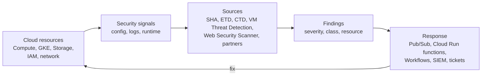
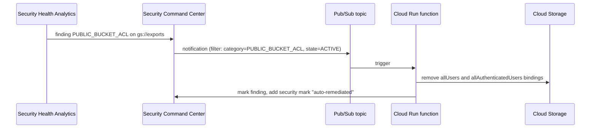

# Security Command Center

## Summary

Security Command Center (SCC) is Google Cloud's central security and risk management platform. It inventories assets, finds misconfigurations and vulnerabilities, detects active threats and prioritizes the results as *findings*, across the whole organization. Built-in *sources* such as Security Health Analytics, Event Threat Detection, Container Threat Detection and Web Security Scanner produce findings; third-party tools can add their own. SCC is both a cloud security posture management (CSPM) tool and a threat detection platform, and it is most useful when its findings feed automated response and a SIEM.

## Prerequisites

- [Resource hierarchy](../../foundations/resource-hierarchy.md) and [IAM](../identity-and-access/iam.md).
- [Cloud Logging](../../operations/cloud-logging.md), since threat detection reads logs.

## Core concepts

### Position in the security architecture

SCC addresses four gaps: no visibility of assets, unknown vulnerabilities, misconfigurations and active threats. "You cannot secure what you cannot see."



### Core concepts

- **Assets.** Continuously inventoried resources: instances, clusters, buckets, IAM policies, networks. Historical views show changes over time.
- **Findings.** Detected issues, for example a public bucket, overly broad IAM, a vulnerable image or suspicious activity. Finding classes include misconfiguration, vulnerability, threat, observation and compliance violation.
- **Sources.** Detectors that produce findings: native Google services and third-party integrations (for example Qualys, Tenable or other SIEM, EDR and XDR products).

### Built-in services

| Service | Detects | Examples |
| --- | --- | --- |
| Security Health Analytics (SHA) | Misconfigurations, insecure defaults, policy violations | Public buckets, overly permissive IAM, logging disabled, open firewall |
| Event Threat Detection (ETD) | Threats in Cloud Logging and Workspace logs | Cryptomining, data exfiltration, anomalous IAM grants, malware domains |
| Container Threat Detection (CTD) | Runtime attacks in GKE containers | Added binaries, reverse shells, malicious scripts |
| VM Threat Detection | Threats in VM memory, from the hypervisor | Cryptomining, kernel rootkits |
| Vulnerability scanning | CVEs in images and OS packages | Outdated libraries |
| Web Security Scanner | Web app vulnerabilities | XSS, mixed content, outdated libraries, OWASP Top 10 classes |

Other capabilities: compliance reports against CIS, NIST SP 800-53, ISO/IEC 27001 and PCI DSS; attack path simulation and attack exposure scores that show how an attacker could reach high value resources; real-time notifications through Pub/Sub.

### Tiers

SCC has Standard, Premium and Enterprise tiers. Standard covers a subset of SHA detectors and basic features; Premium adds ETD, CTD, VM Threat Detection, attack path simulation and compliance reporting; Enterprise adds multicloud and Google Security Operations integration. The original notes list Event Threat Detection and Container Threat Detection as Premium features.

TODO: Verify the current feature split and pricing model per tier.

### Scope

SCC can be activated at the organization level (recommended, full visibility and all detectors) or at the project level. Findings can be filtered by folder and project for decentralized teams.

## Worked example

Automated remediation of public buckets:



```bash
# Notification config (untested)
gcloud scc notifications create public-buckets \
  --organization=ORG_ID --pubsub-topic=projects/SEC_PROJECT/topics/scc-findings \
  --filter='category="PUBLIC_BUCKET_ACL" AND state="ACTIVE"'
```

TODO: Add and test the remediation function code.

## Trade offs and when to use it

- **Use cases.** CSPM (continuous configuration monitoring and compliance), threat detection and response, vulnerability management and multi-project governance with a central security team and decentralized execution.
- **Costs.** Premium and Enterprise tiers are priced on usage or as a subscription and can be significant for large organizations.
- **Comparison.** Equivalent services exist in other clouds (AWS Security Hub with GuardDuty, Microsoft Defender for Cloud). SCC's strength is deep integration with GKE and Google Cloud logs.

## Common mistakes

- **Treating SCC as a passive dashboard.** Without notification and remediation workflows, findings pile up.
- **Ignoring low and medium findings.** Attack paths often combine several medium issues.
- **Not enabling all relevant detectors** or activating only at project level.
- **No SIEM integration.** Export findings and correlate them with logs.

## Practice

1. Which SCC service would report a firewall rule that allows SSH from `0.0.0.0/0`?
2. Which service detects a reverse shell inside a GKE container?
3. How do findings reach an automated remediation function?

Answers: 1. Security Health Analytics. 2. Container Threat Detection. 3. Through a notification configuration that publishes matching findings to Pub/Sub, which triggers the function.

## Further reading

- [Security Command Center overview](https://docs.cloud.google.com/security-command-center/docs/security-command-center-overview), Google Cloud documentation. Services and tiers.
- [Security Health Analytics findings](https://docs.cloud.google.com/security-command-center/docs/concepts-vulnerabilities-findings), Google Cloud documentation. Detector list.
- [Set up finding notifications](https://docs.cloud.google.com/security-command-center/docs/how-to-notifications), Google Cloud documentation. Pub/Sub export.
