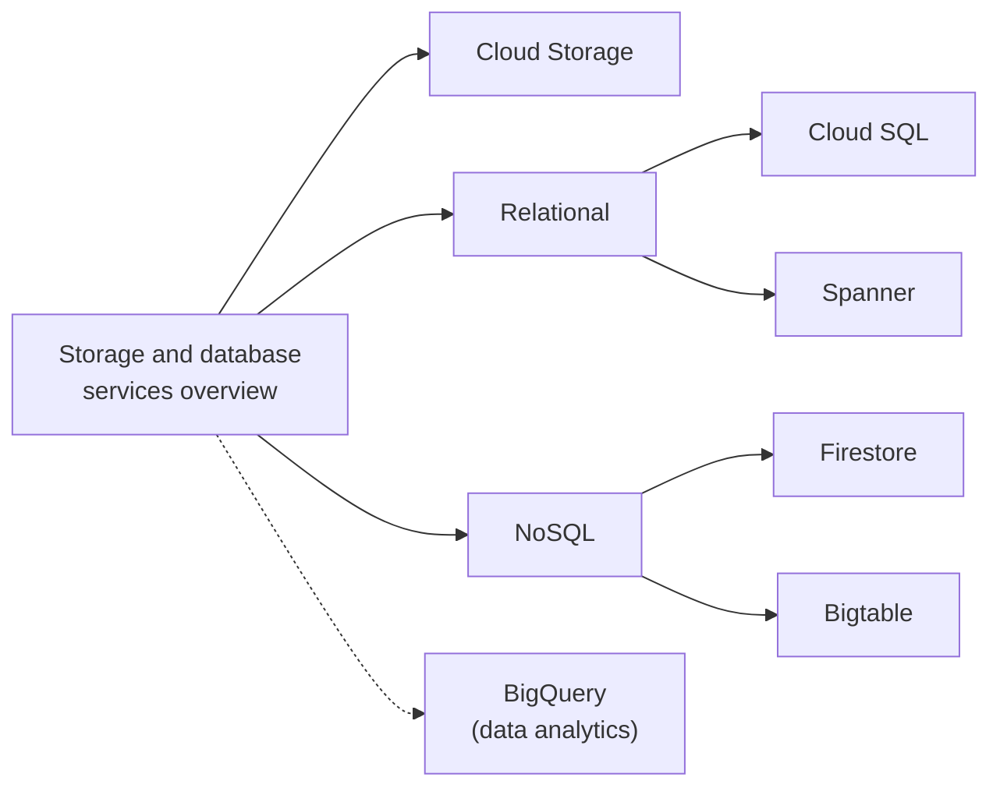

# Storage and databases

Object, file and block storage, relational and NoSQL databases, caches and data transfer. BigQuery, the analytical warehouse, lives in [data analytics](../data-analytics/bigquery.md).

## Map of the area

Read the overview first: it contains the decision tree for choosing a database. Then read product notes in any order.

## Notes in reading order

1. [Storage and database services overview](storage-and-database-services-overview.md): all products, a decision tree and a summary table.
2. [Cloud Storage](cloud-storage.md): buckets, storage classes, locations, lifecycle, security and pricing.
3. [Cloud SQL](cloud-sql.md): managed MySQL, PostgreSQL and SQL Server, HA, backups, PITR and connections.
4. [Spanner](spanner.md): globally distributed SQL, splits, Paxos, TrueTime and key design.
5. [Bigtable](bigtable.md): wide-column NoSQL, row key design and scale.
6. [Firestore](firestore.md): serverless document database, real-time sync, security rules.

## Planned topics

- AlloyDB for PostgreSQL
- Memorystore (Redis, Valkey, Memcached)
- Filestore
- Persistent Disk and Hyperdisk
- Database Migration Service
- Backup and DR Service
- Storage Transfer Service and Transfer Appliance
- Datastream (change data capture)
