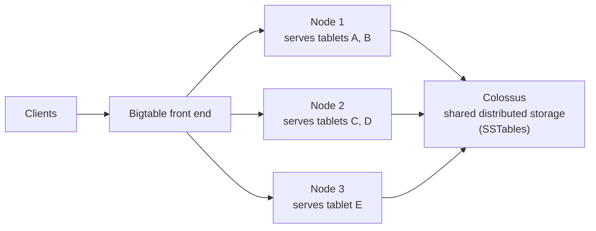

# Bigtable

## Summary

Bigtable is a fully managed, wide-column NoSQL database for very large, low-latency workloads: millions of operations per second over terabytes to petabytes. Rows are sorted by a single *row key*, columns are grouped into *column families*, and each cell can hold several timestamped versions. Performance depends almost entirely on row key design, because the key decides how data is split across nodes and which reads are cheap. It is the database behind many Google services and is compatible with the Apache HBase API.

## Prerequisites

- [Storage and database services overview](storage-and-database-services-overview.md).
- Key-value and wide-column data model basics.

## Core concepts

### Data model

- **Row key.** The only index. Rows are stored sorted by key, so range scans over a key prefix are fast and lookups by other attributes require a full scan (or a secondary structure).
- **Column families.** Groups of related columns, with their own garbage collection policies (maximum versions, time-to-live).
- **Columns.** Dynamic: rows can have different columns, up to very many per row; no schema change needed to add one.
- **Cells and versions.** Each cell can store multiple timestamped versions, useful for history.
- **Consistency.** Strong consistency within a single cluster; single-row mutations are atomic. There are no multi-row transactions and no SQL joins (a GoogleSQL interface for queries exists). With multi-cluster replication, consistency between clusters is eventual unless routing is single-cluster.

### Architecture



- **Clusters of nodes** handle requests; nodes do not store data themselves.
- **Storage** is on Colossus, Google's distributed file system, as sorted key-value files (SSTables).
- **Tablets** are contiguous row key ranges; Bigtable rebalances tablets between nodes automatically, so adding a node is fast (no data copy).
- **Replication** across clusters in different zones or regions gives high availability, with app profiles that choose single-cluster or multi-cluster routing.

### Row key design

- **Prefix keys** group related data: `device#1234#2026-11-07T10:00`.
- **Avoid hotspots**: keys that start with a timestamp or a sequential ID send all writes to one tablet. Put a high-cardinality field first, or add a hashed prefix (salting).
- **Reverse timestamps** (`Long.MAX - ts`) put the newest data first in a scan.

### Integration and pricing

- Integrates with BigQuery (external tables and federated queries), Dataflow, Pub/Sub, Vertex AI, Looker; HBase clients.
- Pricing: nodes per hour (or autoscaling), storage per GB month (SSD or HDD), replication network, backups.

### Comparison

| Feature | Bigtable | BigQuery | Cloud SQL |
| --- | --- | --- | --- |
| Type | NoSQL wide-column | Analytical warehouse | Relational OLTP |
| Access | Key lookups and range scans, ms latency | SQL scans over columns, seconds | SQL with joins |
| Transactions | Single-row atomic | Limited | Full ACID |
| Scale | Horizontal, petabytes | Serverless, petabytes | Vertical |
| Use case | Real-time IoT, time series, personalization | Analytics | Transactional apps |

## Worked example

Telemetry from 50,000 devices, one reading per second each (50,000 writes per second). Query: last hour of readings for one device.

| Row key choice | Write distribution | Last hour for one device |
| --- | --- | --- |
| `2026-11-07T10:00:01#device-1234` | All writes hit the newest time range: hotspot | Scattered across many ranges: slow |
| `device-1234#2026-11-07T10:00:01` | Spread across devices: even | One contiguous range: one fast scan |

```text
row key: device-1234#9223370242809175807    (Long.MAX minus epoch ms of 2026-11-07T10:00:00Z, newest first)
  family "m" (TTL 30 days):  temp=21.4  humidity=40  battery=88
  family "meta" (1 version): model=TX-3  site=warsaw
```

A scan with prefix `device-1234#` and a limit of 3600 returns the last hour.

## Trade offs and when to use it

- **Use cases.** IoT and time series, real-time analytics and fraud detection, ML feature serving, graph and geospatial data at scale, personalization and ad tech.
- **Advantages.** Very high throughput and low latency, linear scaling, flexible schema, ecosystem integration.
- **Limits.** Careful row key design is required; no multi-row transactions or joins; a minimum of one node makes it expensive for small datasets (often under about 1 TB other databases fit better).

## Common mistakes

- **Timestamp or sequential row key prefixes** (hotspots).
- **Full table scans** for queries by non-key attributes.
- **Too many column families** or very large rows (keep rows under the recommended size).
- **Using Bigtable for small data.** Firestore or Cloud SQL is cheaper.

## Practice

1. Why does `timestamp#device` make a poor row key for high-rate writes?
2. Which operations are atomic in Bigtable?
3. How can a scan return the newest data first?

Answers: 1. All new writes share the newest key range, so one tablet and node take all the load. 2. Mutations within a single row. 3. Use a reverse timestamp in the key.

## Further reading

- [Bigtable overview](https://docs.cloud.google.com/bigtable/docs/overview), Google Cloud documentation. Architecture and data model.
- [Schema design best practices](https://docs.cloud.google.com/bigtable/docs/schema-design), Google Cloud documentation. Row keys and families.
- [Bigtable: A Distributed Storage System for Structured Data](https://research.google/pubs/bigtable-a-distributed-storage-system-for-structured-data/), Chang and others, OSDI 2006. The original paper.
