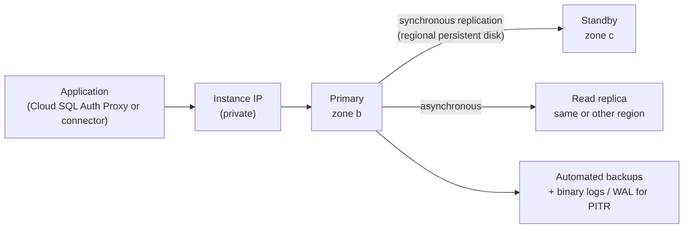

# Cloud SQL

## Summary

Cloud SQL is a fully managed relational database service for MySQL, PostgreSQL and SQL Server. Google provisions the instance, patches it, takes backups, replicates it and fails it over; you design the schema, tune queries and choose the size. A high availability (HA) instance keeps a synchronous standby in another zone of the same region and fails over automatically. Cloud SQL scales up (bigger machine) and out for reads (read replicas), not out for writes; when one primary is no longer enough, the next steps are AlloyDB or Spanner.

## Prerequisites

- [Storage and database services overview](storage-and-database-services-overview.md).
- Relational database basics: transactions, replication, backups.

## Core concepts

### Engines

MySQL, PostgreSQL and SQL Server, each in several major versions. The original notes list MySQL 5.6 to 8.0, PostgreSQL 9.6 to 15 and SQL Server 2017 and 2019; current versions are newer and old ones reach end of support.

TODO: Record the currently supported versions with a check date.

- **MySQL**: native replication, InnoDB for OLTP, read replicas.
- **PostgreSQL**: JSONB, PostGIS and many extensions, logical and streaming replication, good for complex queries.
- **SQL Server**: SQL Server Management Studio (SSMS) and Windows authentication through Managed Microsoft AD; licensing included in the price.

### Editions

Cloud SQL has *Enterprise* and *Enterprise Plus* editions. Enterprise Plus adds faster machines, a data cache, near-zero downtime maintenance and a 99.99 percent SLA; Enterprise HA has a 99.95 percent SLA.

TODO: Verify edition features and SLAs.

### Architecture of an HA instance



When the primary's zone fails, the standby takes over the same IP; clients reconnect after a short interruption (typically under a minute). Read replicas serve read traffic and can be promoted, for example in a cross-region DR plan.

### Features

- **Managed operations.** Provisioning, patching, maintenance windows, storage auto-increase.
- **High availability.** Regional instances with automatic failover.
- **Backups and recovery.** Automated daily backups with retention settings, on-demand backups, point-in-time recovery (PITR) within the log retention window.
- **Performance.** Query Insights for query analysis; configurable vCPU, memory and SSD or HDD storage.
- **Security.** Encryption at rest and in transit; CMEK; IAM database authentication; SSL/TLS enforcement; private IP through private services access or Private Service Connect; authorized networks for public IP (avoid).
- **Scalability.** Vertical scaling of the machine; read replicas (MySQL, PostgreSQL, SQL Server); cascading replicas.
- **Integration.** Compute Engine, GKE, Cloud Run, App Engine; BigQuery federated queries; Datastream for change data capture.
- **Migration.** Database Migration Service for moving from on-premises or other clouds with minimal downtime.

### Connecting

The recommended path is the Cloud SQL Auth Proxy or the Cloud SQL language connectors: they use IAM for authorization and TLS automatically, without managing certificates or allow lists.

### Pricing

- Instance: vCPU and memory per hour, by edition and engine.
- Storage: SSD or HDD provisioned capacity (including auto-increase).
- Network: egress charged, ingress free.
- Backups beyond the included amount.
- SQL Server license fees included.

### Comparison

| Feature | Cloud SQL | Spanner | BigQuery |
| --- | --- | --- | --- |
| Type | Managed relational (OLTP) | Distributed relational (OLTP) | Analytical warehouse (OLAP) |
| Scaling | Vertical, read replicas | Horizontal, global | Serverless |
| Typical size | Up to tens of TB | Petabytes | Petabytes |
| Use case | Web and business apps | Global transactional apps | Analytics and BI |

## Worked example

A private, HA PostgreSQL instance with PITR (untested):

```bash
gcloud sql instances create orders-db \
  --database-version=POSTGRES_16 --edition=ENTERPRISE \
  --tier=db-custom-2-8192 --region=europe-west1 \
  --availability-type=REGIONAL \
  --network=projects/PROJECT_ID/global/networks/prod-vpc --no-assign-ip \
  --backup-start-time=02:00 --enable-point-in-time-recovery \
  --retained-backups-count=14 --storage-auto-increase \
  --database-flags=cloudsql.iam_authentication=on

# Restore to a new instance as of a time before a bad deployment
gcloud sql instances clone orders-db orders-db-restore \
  --point-in-time='2026-11-06T09:59:00Z'
```

The failover can be tested with `gcloud sql instances failover orders-db`, while measuring how long the application is unable to write.

## Trade offs and when to use it

- **Use cases.** Web application backends, CMS and e-commerce, ERP and CRM, reporting stores, game data and leaderboards, mobile backends.
- **Limits.** Maximum storage and connections depend on engine and machine size; some engine features are unavailable (for example superuser access, certain extensions, MySQL Group Replication); scaling or restoring large instances takes time.
- **When to move on.** Write throughput beyond one primary or multi-region writes point to Spanner; heavy PostgreSQL analytics point to AlloyDB.

## Common mistakes

- **Public IP with `0.0.0.0/0` in authorized networks.** Use private IP and the Auth Proxy.
- **No HA for production.** A zonal instance is down for the duration of a zone outage.
- **Never testing restores.** Practice PITR and measure RTO.
- **Too many connections from serverless apps.** Use connection pooling and limit max instances of Cloud Run.

## Practice

1. What is the difference between the HA standby and a read replica?
2. How do you recover from a bad `DELETE` executed 20 minutes ago?
3. Why is the Cloud SQL Auth Proxy recommended?

Answers: 1. The standby is synchronous, in another zone, not readable, and takes over on failover; a read replica is asynchronous and serves reads. 2. Point-in-time recovery: clone the instance to a time just before the statement. 3. It authorizes with IAM and encrypts with TLS without managing certificates or IP allow lists.

## Further reading

- [Cloud SQL overview](https://docs.cloud.google.com/sql/docs/introduction), Google Cloud documentation. Engines and features.
- [About high availability](https://docs.cloud.google.com/sql/docs/postgres/high-availability), Google Cloud documentation. Failover mechanics.
- [Cloud SQL editions](https://docs.cloud.google.com/sql/docs/mysql/editions-intro), Google Cloud documentation. Enterprise and Enterprise Plus.
- [Cloud SQL Auth Proxy](https://docs.cloud.google.com/sql/docs/postgres/sql-proxy), Google Cloud documentation. Secure connections.
