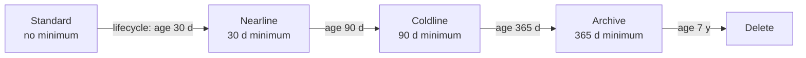
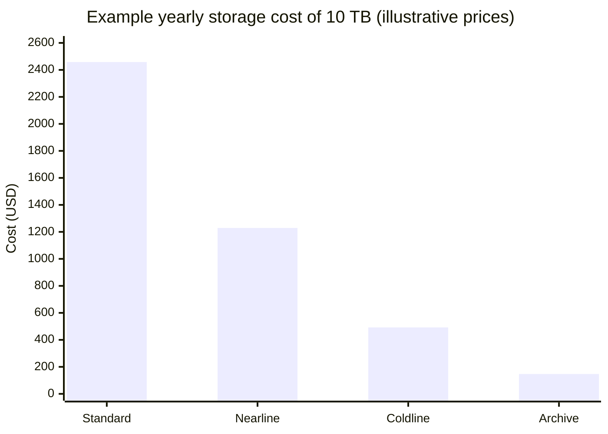

# Cloud Storage

## Summary

Cloud Storage (GCS) is Google Cloud's object storage: unlimited, highly durable storage for blobs of any size, organized in *buckets* and accessed over an API. Data is stored in a location (region, dual-region or multi-region) and a *storage class* (Standard, Nearline, Coldline, Archive) that trades storage price against access price. All classes offer millisecond access and the same 11 nines of durability. Lifecycle rules, versioning, retention policies, IAM and encryption options make it the default place for backups, data lakes, media, logs and ML datasets.

## Prerequisites

- [Storage and database services overview](storage-and-database-services-overview.md).
- [IAM](../security-and-identity/identity-and-access/iam.md).

## Core concepts

### Storage classes

Checked against the Cloud Storage storage classes page, 2026-11:

| Class | Minimum storage duration | Retrieval fee | Typical access | Availability SLA (multi or dual-region / region) |
| --- | --- | --- | --- | --- |
| Standard | None | No | Hot data: websites, active content, mobile apps | 99.95 % / 99.9 % |
| Nearline | 30 days | Yes | About once a month: backups, DR | 99.9 % / 99.0 % |
| Coldline | 90 days | Yes | About once a quarter: older backups | 99.9 % / 99.0 % |
| Archive | 365 days | Yes | Less than once a year: compliance archives, DR | 99.9 % / 99.0 % |

All classes have a designed durability of 99.999999999 percent (11 nines) and serve data within milliseconds. The original notes say Archive retrieval can take up to 15 hours; that is true of some other clouds' archive tiers, not of Cloud Storage. Autoclass can move objects between classes automatically based on access.



Storage price falls from left to right; retrieval and operation prices rise.

### Locations

- **Region** (`europe-west1`): lowest latency for compute in that region, lowest price.
- **Dual-region** (pairs such as `EUR4`, or configurable pairs): geo-redundancy with known locations, optional turbo replication with a 15 minute RPO target.
- **Multi-region** (`EU`, `US`, `ASIA`): highest availability for content served widely.

### Key features

- **Durability and integrity.** Checksums and self-healing.
- **Security.** Encryption at rest and in transit by default; CMEK and CSEK; IAM with uniform bucket-level access; signed URLs and signed cookies; public access prevention.
- **Compliance.** Retention policies and Bucket Lock (WORM), object holds; certifications such as ISO/IEC 27001, support for GDPR and HIPAA workloads.
- **Integration.** BigQuery external tables, Dataflow, Vertex AI, GKE (Cloud Storage FUSE CSI driver), Cloud CDN through backend buckets.
- **Scale.** No capacity planning; performance scales with request rate distribution across object names.

### Data management

- **Lifecycle management.** Rules that change class or delete objects by age, version count, creation date or other conditions.
- **Object versioning.** Keeps noncurrent versions after overwrite or delete; protects against accidental deletion. Soft delete keeps deleted objects for a retention window by default.
- **Retention policies.** Objects cannot be deleted or replaced until they reach the retention period; Bucket Lock makes the policy permanent.
- **Transfers.** Storage Transfer Service (from other clouds and on-premises), Transfer Appliance (physical, petabytes), and the CLI: `gcloud storage` (current) or `gsutil` (legacy).

TODO: Verify the default soft delete window.

### Networking features

- Cloud CDN for low latency global delivery; signed URLs and cookies for protected content.
- VPC Service Controls to prevent exfiltration.
- **Requester Pays** shifts access and egress costs to the requester, useful for public datasets.

### Pricing components

- **Storage** by class and location (multi-region costs more than region).
- **Retrieval** fees for Nearline, Coldline and Archive.
- **Operations** (Class A such as writes and lists, Class B such as reads), more expensive in colder classes.
- **Network egress** out of Google Cloud or across regions; free to other services in the same region.
- **Early deletion** charges if objects are removed before the minimum duration.

### Tools and APIs

Cloud console, `gcloud storage` (and legacy `gsutil`), client libraries (Python, Java, Go, Node.js, C# and more), JSON and XML REST APIs.

## Worked example

Cost of keeping 10 TB of backups for one year, comparing classes. Prices are illustrative placeholders, not current list prices.

| Class | Storage price per GB month (example) | Year of storage | Restore 1 TB once (example retrieval price per GB) |
| --- | --- | --- | --- |
| Standard | 0.020 | 10,240 GB x 0.020 x 12 = 2,458 | 0 |
| Nearline | 0.010 | 1,229 | 1,024 x 0.01 = 10 |
| Coldline | 0.004 | 492 | 1,024 x 0.02 = 20 |
| Archive | 0.0012 | 147 | 1,024 x 0.05 = 51 |



The pattern holds regardless of exact prices: for data read rarely, colder classes are far cheaper even with retrieval fees.

TODO: Replace the example prices with current list prices for one region and record the date.

Lifecycle configuration for the backup bucket:

```json
{
  "rule": [
    {"action": {"type": "SetStorageClass", "storageClass": "COLDLINE"}, "condition": {"age": 30}},
    {"action": {"type": "SetStorageClass", "storageClass": "ARCHIVE"}, "condition": {"age": 365}},
    {"action": {"type": "Delete"}, "condition": {"age": 2555}}
  ]
}
```

```bash
gcloud storage buckets update gs://example-backups --lifecycle-file=lifecycle.json
```

## Trade offs and when to use it

- **Use cases.** Media and entertainment content, data lakes queried by BigQuery, backup and archival, content delivery with CDN, AI and ML datasets.
- **Choose the class by access pattern,** not by data age alone; Autoclass helps when patterns are unknown.
- Object storage is not a file system: no partial in-place updates, no POSIX locks. Use Filestore or Parallelstore when POSIX semantics are needed.

## Common mistakes

- **Deleting cold objects early** and paying early deletion fees.
- **Public buckets by mistake.** Enable public access prevention.
- **Sequential object names at very high request rates** create hotspots; spread names.
- **Large uploads in one request.** Use parallel composite or resumable uploads.

## Practice

1. Which class fits monthly restored backups, and what is its minimum duration?
2. Is Archive data available within hours or milliseconds?
3. How do you give a user without a Google account temporary download access to one object?

Answers: 1. Nearline, 30 days. 2. Milliseconds. 3. A signed URL.

## Further reading

- [Storage classes](https://docs.cloud.google.com/storage/docs/storage-classes), Google Cloud documentation. Classes, minimum durations and SLAs (checked 2026-11).
- [Object Lifecycle Management](https://docs.cloud.google.com/storage/docs/lifecycle), Google Cloud documentation. Rules and conditions.
- [Cloud Storage pricing](https://cloud.google.com/storage/pricing), Google Cloud. Current prices.
- [Best practices for Cloud Storage](https://docs.cloud.google.com/storage/docs/best-practices), Google Cloud documentation. Naming, performance and security.
