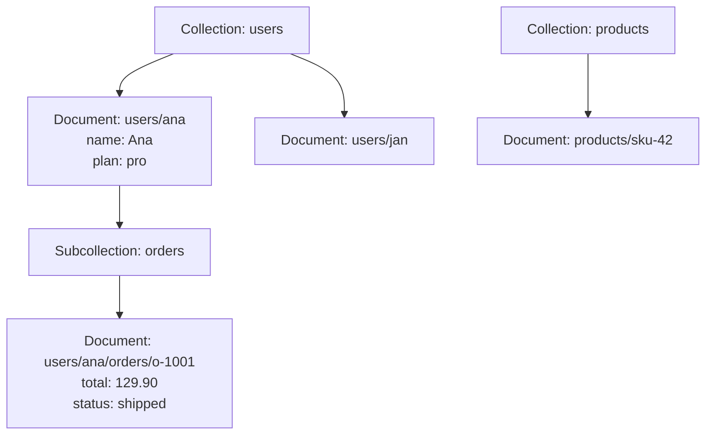

# Firestore

## Summary

Firestore is a serverless NoSQL document database for mobile, web and server applications. Data lives in *documents* (JSON-like sets of fields) grouped into *collections*, and documents can have *subcollections*. Every query is served from an index, so query time depends on the size of the result, not the size of the data. Clients can listen to documents and queries and receive changes in real time, keep working offline and sync later. Firestore offers ACID transactions and strong consistency, scales automatically and is billed per document read, write and delete.

## Prerequisites

- [Storage and database services overview](storage-and-database-services-overview.md).
- JSON and basic NoSQL modeling.

## Core concepts

### Data model



- **Collections** contain documents and cannot hold data directly.
- **Documents** hold fields: strings, numbers, booleans, arrays, maps, timestamps, geo points, references. Maximum size 1 MiB.
- **Subcollections** nest related data under a document.
- **Schema-less.** Documents in one collection can differ.

### Querying

- Automatic single-field indexes; composite indexes for multi-field queries.
- Equality, range (`<`, `>`, between), `in`, `array-contains`, compound conditions, ordering and limits, collection group queries.
- **Real-time listeners** push updates to clients.

### Features

- **Real-time synchronization** across clients for collaborative and dynamic apps.
- **Offline support.** Client SDKs cache data locally and sync when connectivity returns, resolving conflicts (last write wins by default).
- **Serverless scaling** with no capacity planning; regional or multi-regional locations for high availability.
- **ACID transactions and batched writes** across documents; strong consistency.
- **Security.** Firestore Security Rules for client access (for example "a user can read only their own documents"), integrated with Firebase Authentication; IAM for server access.
- **Integration.** Firebase SDKs, Cloud Run functions triggers, Eventarc, export to BigQuery, Dataflow.
- **Backups** with scheduled backups and point-in-time recovery.

TODO: Verify PITR window.

Firestore also has a Datastore mode (server-side, no real-time features) for Datastore compatibility, and an Enterprise edition with MongoDB compatibility.

TODO: Verify current editions.

### Pricing

Document reads, writes and deletes are billed per operation; storage per GB month; network egress; a free daily quota. Data modeling decides cost: a screen that reads 200 documents costs 200 reads every time it loads.

### Comparison

| Feature | Firestore | Realtime Database | Bigtable | Cloud SQL |
| --- | --- | --- | --- | --- |
| Type | Document | JSON tree | Wide-column | Relational |
| Scaling | Automatic, horizontal | Per instance, sharding by hand | Horizontal (nodes) | Vertical |
| Real-time sync | Yes | Yes | No | No |
| Schema | Flexible | Flexible | Flexible | Fixed |
| Use case | Apps with offline and real-time needs | Simple real-time apps | Large-scale analytics and IoT | Transactional apps |

## Worked example

Security rule that lets users read and write only their own profile and orders:

```text
rules_version = '2';
service cloud.firestore {
  match /databases/{database}/documents {
    match /users/{userId} {
      allow read, write: if request.auth != null && request.auth.uid == userId;
      match /orders/{orderId} {
        allow read: if request.auth.uid == userId;
        allow create: if request.auth.uid == userId
                      && request.resource.data.total is number;
      }
    }
  }
}
```

Modeling for cost: an order list page shows 20 orders with customer names. Storing `customerName` inside each order document (denormalization) costs 20 reads per page; looking up each customer separately would cost 40.

## Trade offs and when to use it

- **Use cases.** Mobile and web apps (chat, collaboration), e-commerce carts and order tracking, IoT with intermittent connectivity, game state and leaderboards, with analytics exported to BigQuery.
- **Advantages.** Real-time sync, offline support, serverless operations, deep Firebase integration.
- **Limits.** Cost grows with read and write volume; query capabilities are narrower than SQL (no joins, limits on inequality filters); not an analytics engine; sustained write rate to a single document is limited (about one per second recommended).

TODO: Verify the current per-document write guidance.

## Common mistakes

- **Relational modeling.** Joins do not exist; denormalize for read patterns.
- **Hot documents.** A single counter updated by many clients; use distributed counters.
- **Open security rules** left from development (`allow read, write: if true`).
- **Unbounded listeners and queries** that read thousands of documents.

## Practice

1. What decides query latency in Firestore?
2. How would you model a counter updated hundreds of times per second?
3. Which mechanism controls client access when apps talk to Firestore directly?

Answers: 1. The size of the result set, because every query uses an index. 2. A distributed counter: several shard documents updated randomly and summed on read. 3. Firestore Security Rules (with Firebase Authentication).

## Further reading

- [Firestore overview](https://docs.cloud.google.com/firestore/docs/overview), Google Cloud documentation. Data model and features.
- [Best practices for Firestore](https://docs.cloud.google.com/firestore/docs/best-practices), Google Cloud documentation. Hotspots, indexes and limits.
- [Get started with Security Rules](https://firebase.google.com/docs/firestore/security/get-started), Firebase documentation. Rule syntax.
