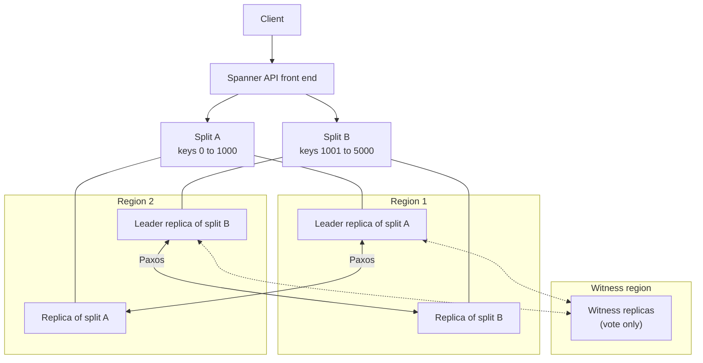

# Spanner

## Summary

Spanner is Google Cloud's globally distributed relational database. It offers SQL, schemas and ACID transactions like a traditional database, and scales horizontally across nodes, zones and regions like a NoSQL system. Data is split automatically into ranges (*splits*) that are replicated with the Paxos consensus protocol, and Google's TrueTime clock API gives globally consistent timestamps, so transactions are externally consistent (the strongest form of consistency) even across continents. Multi-region configurations have a 99.999 percent availability SLA. It is chosen when a single relational database must outgrow one machine or one region.

## Prerequisites

- [Cloud SQL](cloud-sql.md), for the contrast with a single-primary database.
- Distributed systems basics: replication, consensus, consistency.

## Core concepts

### Key features

- **Global distribution and scale.** Add compute capacity (nodes or processing units) and Spanner rebalances data; storage grows automatically.
- **Relational model.** GoogleSQL (ANSI 2011 based) or PostgreSQL dialect; joins, indexes, foreign keys; ACID transactions.
- **High availability.** Synchronous replication across zones (regional) or regions (multi-region); 99.99 percent SLA regional, 99.999 percent multi-region.
- **External consistency** using TrueTime.
- **Managed.** No patching or maintenance downtime; not serverless in the billing sense, because you provision compute capacity (with autoscaling options).
- **Change streams** for real-time capture of data changes into Dataflow, Pub/Sub or BigQuery.
- **Integration** with BigQuery (federated queries, Data Boost), Dataflow, Vertex AI.

### Architecture



- **Sharding.** Tables are divided into splits by primary key ranges; splits move between servers as load changes.
- **Replication.** Each split is a Paxos group with one leader; writes commit when a majority of voting replicas agree.
- **TrueTime.** An API backed by GPS receivers and atomic clocks that returns a time interval with bounded uncertainty; commits wait out the uncertainty, which makes timestamp order match real-time order.
- **Distributed queries.** Queries run in parallel across splits.
- **Interleaving.** Child tables can be stored physically with their parent rows (for example order items with their order), keeping related data in the same split.

### Data model

Strongly enforced schemas with primary keys, foreign keys and interleaved tables; standard types (INT64, STRING, TIMESTAMP, NUMERIC, JSON) and arrays.

### Pricing

- Compute capacity: nodes or processing units per hour (1 node = 1000 processing units), by configuration.
- Storage per GB month, backups.
- Network egress; intra-region traffic free.
- Small instances (100 processing units) lower the entry price.

TODO: Verify current minimum compute and editions.

### Comparison

| Feature | Spanner | Cloud SQL | BigQuery |
| --- | --- | --- | --- |
| Type | Distributed relational | Managed relational | Analytical |
| Scaling | Horizontal, global | Vertical, read replicas | Serverless |
| Transactions | ACID, externally consistent | ACID | Limited multi-statement transactions |
| Use case | Global OLTP | Regional OLTP | Warehousing |

## Worked example

Primary key design. Bad: a monotonically increasing key (`order_id` from a sequence or a timestamp) sends all inserts to the last split, creating a hotspot. Good: a UUID version 4 or a bit-reversed sequence spreads writes; interleave children under the parent.

```sql
CREATE TABLE Orders (
  OrderId STRING(36) NOT NULL,        -- UUIDv4, spreads inserts
  CustomerId STRING(36) NOT NULL,
  CreatedAt TIMESTAMP NOT NULL OPTIONS (allow_commit_timestamp = true),
) PRIMARY KEY (OrderId);

CREATE TABLE OrderItems (
  OrderId STRING(36) NOT NULL,
  ItemNo INT64 NOT NULL,
  Sku STRING(64),
  Quantity INT64,
) PRIMARY KEY (OrderId, ItemNo),
  INTERLEAVE IN PARENT Orders ON DELETE CASCADE;
```

Reading an order with its items touches one split instead of two tables on different servers.

## Trade offs and when to use it

- **Use cases.** Global apps that need consistency (gaming, e-commerce, financial ledgers), high throughput transactional systems (payments, supply chain), enterprise apps with strict availability, globally distributed IoT data.
- **Advantages.** Global scale with strong consistency; fully managed; no manual sharding.
- **Limits.** Higher cost than simpler databases at small scale; schema and key design matter for performance; multi-region writes have higher latency than regional ones because of consensus across regions.
- **Best practices.** Start regional and move to multi-region when needed; design keys to avoid hotspots; use interleaving for hierarchies; monitor with Query Insights and Key Visualizer; test point-in-time recovery.

## Common mistakes

- **Sequential primary keys.** Hotspots on one split.
- **Using Spanner for a small regional app.** Cloud SQL is cheaper and simpler.
- **Large read-write transactions spanning many splits.** They are slower; keep transactions small.

## Practice

1. What does TrueTime provide, and why does it matter?
2. Why can a timestamp primary key hurt write throughput?
3. What availability SLA does a multi-region Spanner instance have?

Answers: 1. A globally synchronized time with bounded uncertainty, which lets Spanner order transactions consistently across regions (external consistency). 2. All new rows go to the same key range, so one split takes all writes. 3. 99.999 percent.

## Further reading

- [Spanner overview](https://docs.cloud.google.com/spanner/docs), Google Cloud documentation. Features and configurations.
- [Schema design best practices](https://docs.cloud.google.com/spanner/docs/schema-design), Google Cloud documentation. Keys, hotspots and interleaving.
- [Spanner: Google's Globally-Distributed Database](https://research.google/pubs/spanner-googles-globally-distributed-database-2/), Corbett and others, OSDI 2012. The original paper on TrueTime and Paxos replication.
