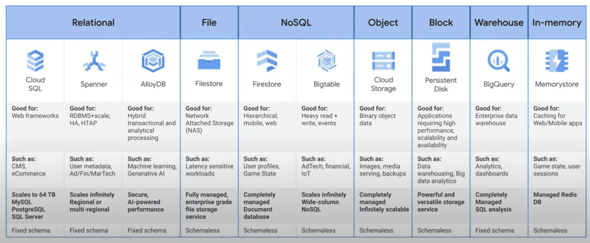
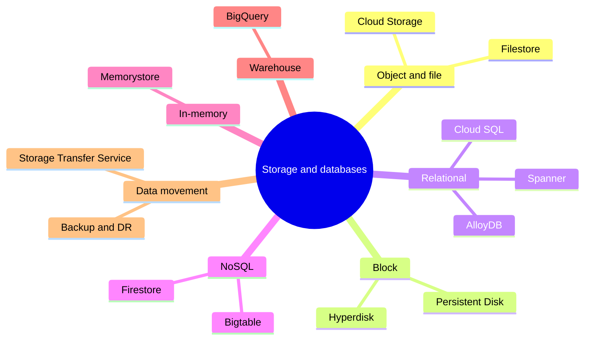
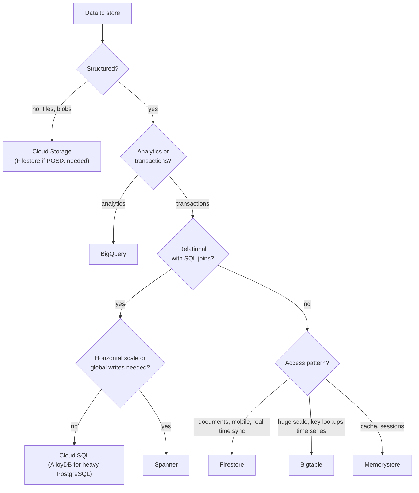

# Storage and database services overview

## Summary

Google Cloud offers storage for every data shape: object storage (Cloud Storage), file storage (Filestore), block storage (Persistent Disk and Hyperdisk), relational databases (Cloud SQL, AlloyDB, Spanner), NoSQL databases (Firestore, Bigtable), in-memory caches (Memorystore) and an analytical warehouse (BigQuery). Choosing well depends on four questions: is the data structured, is the workload transactional or analytical, how much scale and global reach is needed, and how strong must consistency be. A wrong choice is expensive to undo, so the decision deserves a deliberate process.

## Prerequisites

- [Global infrastructure](../foundations/global-infrastructure.md) for regional and multi-regional resources.
- Basic database concepts: OLTP versus OLAP, ACID, replication.

## Core concepts

### The product matrix

### Object and file storage

- **Cloud Storage.** Object storage for unstructured data: media, logs, backups, ML datasets, static websites, data lakes. Storage classes (Standard, Nearline 30 days, Coldline 90 days, Archive 365 days minimum), lifecycle rules, versioning, CMEK, signed URLs, CDN integration. See [Cloud Storage](cloud-storage.md).
- **Filestore.** Managed NFS file shares for applications that need a POSIX file system: GKE shared volumes, Compute Engine apps, content management systems, lift and shift. Tiers range from basic to high scale and enterprise.

TODO: Verify current Filestore tiers and NFS versions.

### Block storage

- **Persistent Disk and Hyperdisk.** Network block storage for VM boot disks, databases and GKE `StatefulSets`. SSD, balanced and standard Persistent Disk types; Hyperdisk types with independently tuned IOPS and throughput (including Hyperdisk ML for model weights). Snapshots, encryption and regional (synchronously replicated) disks. Disks can be attached and detached dynamically. Local SSD gives the lowest latency but data is lost when the VM stops.

### Relational databases

- **Cloud SQL.** Managed MySQL, PostgreSQL and SQL Server for standard OLTP: web apps, business systems. Backups, HA failover, replicas, IAM authentication, private IP. See [Cloud SQL](cloud-sql.md).
- **Spanner.** Globally distributed, horizontally scalable relational database with strong consistency and up to 99.999 percent availability. Expensive at small scale but removes sharding logic. See [Spanner](spanner.md).
- **AlloyDB for PostgreSQL.** PostgreSQL-compatible, high performance for mixed transactional and analytical workloads, with vector search for AI. Google claims up to 4 times faster transactions than standard PostgreSQL; this is a vendor benchmark.

TODO: Write a note on AlloyDB.

### NoSQL databases

- **Firestore.** Serverless document database with real-time updates, offline support, ACID transactions and strong consistency, integrated with Firebase. See [Firestore](firestore.md).
- **Bigtable.** Wide-column database for very large, low-latency workloads: time series, IoT, telemetry, personalization. HBase API compatible. See [Bigtable](bigtable.md).

### In-memory

- **Memorystore.** Managed Redis (and Valkey) and Memcached for caching, sessions and leaderboards, with high availability and private networking. Reduces database latency.

TODO: Write a note on Memorystore.

### Warehouse

- **BigQuery.** Serverless data warehouse for SQL analytics, BI and ML. Its home is [data analytics](../data-analytics/bigquery.md).

### Data movement and protection

- **Storage Transfer Service.** Online transfers from AWS S3, Azure, HTTP sources and on-premises file systems, scheduled and resumable. **Transfer Appliance** is a physical device for offline transfers of very large data.
- **Backup and DR Service.** Central backup and disaster recovery for Compute Engine, GKE and databases, with policies, cross-region copies and point-in-time recovery; supports compliance and RTO and RPO targets.

### Choosing a database

### Summary

| Product | Type | Best for |
| --- | --- | --- |
| Cloud Storage | Object | General purpose, ML datasets, backups |
| Filestore | File (NFS) | Shared POSIX workloads, GKE volumes |
| Persistent Disk, Hyperdisk | Block | VM disks, databases, Kubernetes volumes |
| Cloud SQL | Relational | Standard SQL applications |
| Spanner | Distributed relational | Global, transactional apps at large scale |
| AlloyDB | PostgreSQL-compatible | Fast OLTP plus analytics |
| Firestore | NoSQL document | Real-time mobile and web apps |
| Bigtable | NoSQL wide-column | IoT, time series, large ingest |
| Memorystore | In-memory | Low latency caching |
| BigQuery | Warehouse | Analytics, BI, SQL and ML |

## Worked example

An e-commerce platform:

| Data | Product | Reason |
| --- | --- | --- |
| Product images | Cloud Storage + Cloud CDN | Unstructured, read-heavy, global |
| Orders and payments | Cloud SQL for PostgreSQL (HA) | Relational, ACID, regional scale is enough |
| Shopping carts and sessions | Memorystore for Redis | Sub-millisecond, ephemeral |
| Clickstream (billions of events) | Bigtable, then BigQuery | High write rate; analytics later |
| Sales reports | BigQuery | Serverless SQL over large data |

If the shop expanded to many continents with writes everywhere and strict consistency, orders would move to Spanner.

## Trade offs and when to use it

- Managed services reduce operations but each has limits (Cloud SQL scales up and with read replicas, not out; Bigtable has no SQL joins or multi-row transactions).
- Global consistency (Spanner) costs more than regional (Cloud SQL).
- Serverless options (Firestore, BigQuery) bill per operation or scanned data; provisioned options (Cloud SQL, Bigtable nodes) bill for capacity.

## Common mistakes

- **Choosing by familiarity.** Map access patterns and scale first.
- **Using BigQuery as an OLTP database** or Cloud SQL as a data warehouse.
- **Forgetting egress and replication costs** for multi-region designs.

## Practice

1. Which product fits 10 TB of sensor readings written at 100,000 rows per second and read by device ID and time?
2. Which product fits a relational app that must accept writes in Europe and the US with strong consistency?
3. What is the minimum storage duration of Coldline?

Answers: 1. Bigtable. 2. Spanner (multi-region configuration). 3. 90 days.

## Further reading

- [Google Cloud databases](https://cloud.google.com/products/databases), Google Cloud. Product overview.
- [Choose a storage option](https://docs.cloud.google.com/architecture/storage-advisor), Google Cloud Architecture Center. Decision guidance.
- [Storage Transfer Service overview](https://docs.cloud.google.com/storage-transfer/docs/overview), Google Cloud documentation. Online transfers.
